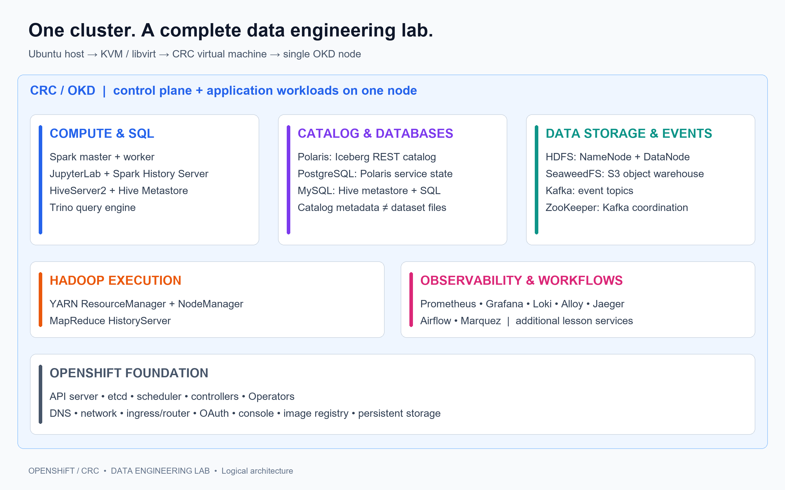
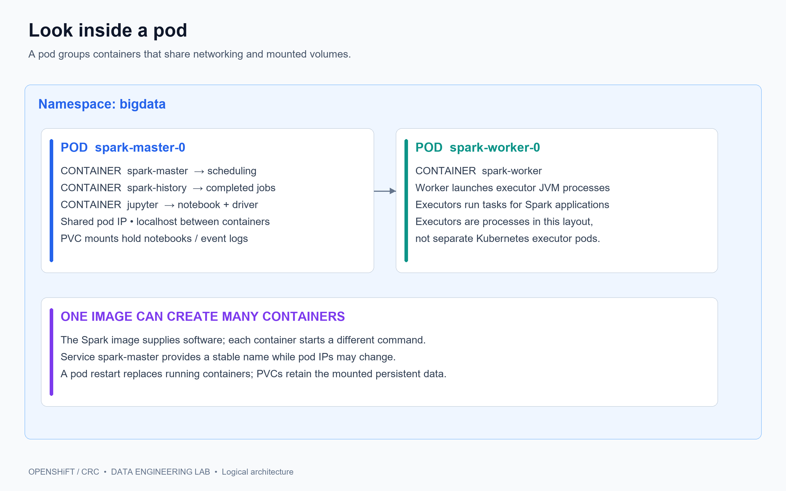
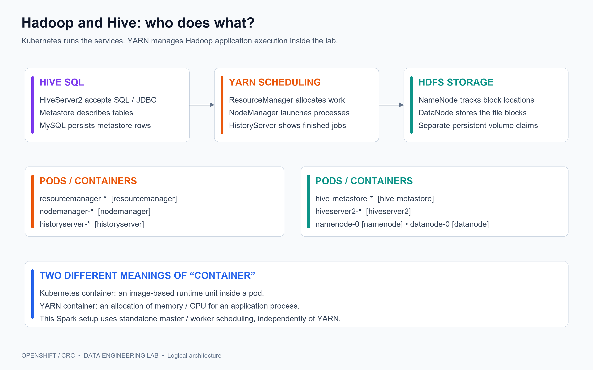
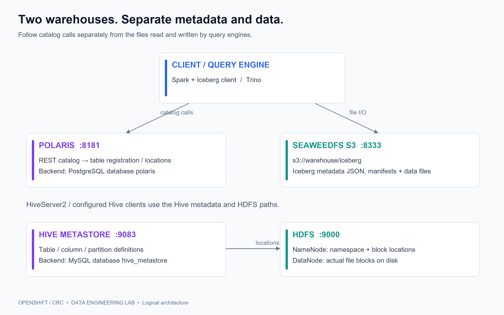
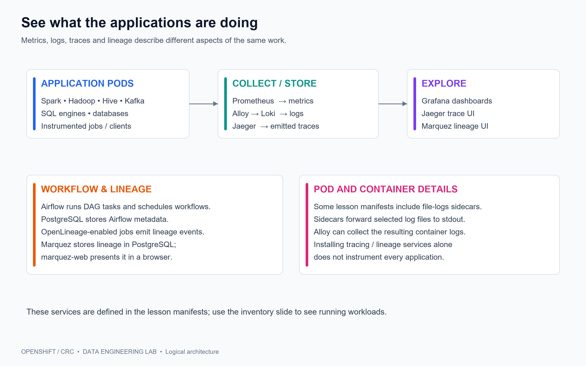
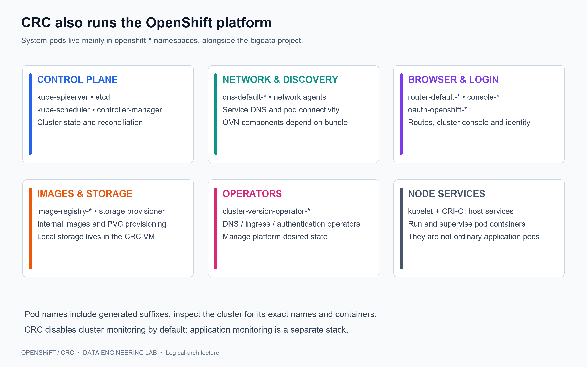

# 03 - Architecture
## Our data engineering platform on OpenShift / CRC

**Technology stack -> pods -> containers -> data and metadata -> platform services**

A visual introduction to the architecture defined by this course's OpenShift deployment files. Exact running replicas and generated pod names can be seen on the final inventory slide.

[Installation](00-Installation.md) | [Getting-started demonstrations](../01-GetStarted/README.md)

Read this guide from top to bottom.

## 01 - The complete picture



**Read from top to bottom:** compute uses catalogs and storage; OpenShift supplies the shared foundation. These are logical service groups inside one node, not separate machines. The workflow and observability group shows the additional services supplied with the lessons.

## 02 - Where the stack runs

| Layer | Our lab | Responsibility |
|---|---|---|
| Linux host | Ubuntu, course checkout, browser, `crc`, `oc` | Manage and access the environment |
| Virtualization | KVM / libvirt | Run the CRC virtual machine |
| Cluster | OKD preset in CRC; one node | Control plane and applications share the node |
| Node runtime | kubelet + CRI-O | Start and supervise containers |
| Application project | `bigdata` | Pods, Services, Routes, configuration and PVCs |
| Platform projects | Mostly `openshift-*` | Cluster APIs, DNS, ingress, identity, registry and Operators |

The installation guide configures **4 vCPUs, 16 GiB memory and a 50 GiB CRC disk**. All workloads share that capacity. Local persistent storage remains inside the CRC VM.

A namespace is a resource grouping and access boundary; it is not another virtual machine.

## 03 - Pod, container, process



**This course's Spark layout:** the master pod contains three containers. A notebook can run the Spark driver, while the worker launches executor processes. A Spark master schedules applications; it does not execute their tasks itself.

## 04 - Technology stack -> pods -> containers

Names ending in `-0` are the first pods of StatefulSets. `*` represents generated Deployment suffixes.

| Area | Pod name / pattern | Containers inside | Main purpose |
|---|---|---|---|
| Spark + workbench | `spark-master-0` | `spark-master`, `spark-history`, `jupyter` | Scheduling, job history, notebooks / driver |
| Spark execution | `spark-worker-0` | `spark-worker` | Launch executor processes and run tasks |
| HDFS metadata | `namenode-0` | `namenode` | File namespace and block locations |
| HDFS blocks | `datanode-0` | `datanode` | Store file blocks |
| Hive catalog | `hive-metastore-*` | `hive-metastore` | Hive table and partition metadata API |
| Hive SQL | `hiveserver2-*` | `hiveserver2` | JDBC / SQL entry point |
| Iceberg catalog | `polaris-*` | `polaris`; init: `wait-for-postgres` | REST catalog backed by PostgreSQL |
| Object warehouse | `seaweedfs-0` | `seaweedfs` | S3-compatible file storage |
| Relational state | `postgres-0` | `postgres` | Polaris database and relational exercises |
| Relational state | `mysql-0` | `mysql` | Hive metastore database and SQL exercises |
| Federated SQL | `trino-0` | `trino` | Query configured connectors |
| Event streaming | `kafka-0` | `kafka`; init: `wait-for-zookeeper` | Broker and topic records |
| Kafka coordination | `zookeeper-0` | `zookeeper` | Coordination for this ZooKeeper-backed Kafka setup |

An **init container** completes before the main containers start. Multiple processes inside a container do not automatically become extra pods.

Source: `spark-image/openshift.yaml`, `hadoop-hive.yaml`, `trino-image/openshift.yaml`, `manifests-compact/` and `manifests/kafka/`.

## 05 - Hadoop, YARN and Hive



HiveServer2 provides SQL access, the metastore describes tables, and HDFS holds warehouse files. YARN provides Hadoop execution resources; it is a different scheduler from Spark standalone.

YARN pod patterns are `resourcemanager-*`, `nodemanager-*` and `historyserver-*`, each with its same-named container, as defined in `yarn.yaml`.

## 06 - The two metadata paths



**Iceberg:** the client uses Polaris for catalog operations and accesses SeaweedFS for table files. PostgreSQL stores Polaris service state; Iceberg metadata files also live in object storage.

**Hive:** the metastore stores schema and location information in MySQL. HDFS stores dataset files. The NameNode tracks where blocks are; the DataNode serves the block bytes.

## 07 - SeaweedFS: S3 inside one container

| Inside `seaweedfs-0` | Responsibility | Service port |
|---|---|---|
| S3 gateway | S3-compatible bucket and object API | `8333` |
| Master | Volume topology and placement coordination | `9333` |
| Volume server | Store object bytes in volumes | `9340` |
| Filer | File / directory metadata and namespace | `8888` |
| Admin interface | Administrative view | `23646` |

The manifest starts **`weed mini`**, combining these roles in the single **`seaweedfs` container**. They are not five separate pods in this lab.

The PVC **`seaweedfs-data`** is mounted at `/data`. The configured warehouse is **`s3://warehouse/iceberg`**. The lab does not deploy a separate relational database for SeaweedFS; its local state uses its mounted storage.

Spark and Trino use `http://seaweedfs:8333` as the internal S3 endpoint. This is S3-compatible storage hosted in the lab, rather than an AWS-hosted bucket.

## 08 - Databases and persistent state

| Service | Associated database / storage | What belongs there |
|---|---|---|
| Polaris | PostgreSQL database `polaris` | Catalog service state, entities and access configuration |
| Hive Metastore | MySQL database `hive_metastore` | Table definitions, columns, partitions and locations |
| PostgreSQL exercises | `training_person` created by deployment script | Relational exercise data |
| Airflow lesson | PostgreSQL metadata database | DAG runs, task state and scheduling metadata |
| Marquez lesson | PostgreSQL lineage database | Collected OpenLineage entities and events |
| SeaweedFS | `seaweedfs-data` PVC | Objects and local storage state |
| HDFS | Separate NameNode / DataNode PVCs | Filesystem metadata / file blocks |
| Kafka / ZooKeeper | Their declared persistent claims | Topic logs / coordination state |
| Jupyter / Spark history | Declared Spark PVC mounts | Notebooks and Spark event logs |

**Image = software. Container = running instance. PVC = persistent storage request.**

A container filesystem is not a substitute for a persistent volume. Retaining a PVC across a pod restart does not provide a backup or multi-node redundancy.

## 09 - Spark and Trino: processing the data

| Component | Entry point | What happens next |
|---|---|---|
| JupyterLab | Spark master service, port `8888` | Python / PySpark notebook starts a driver |
| Spark standalone | `spark://spark-master:7077` | Master allocates worker resources; worker starts executors |
| Spark History Server | Port `18080` | Reads event logs to display completed application history |
| Trino | `trino:8080` | A single query-engine pod queries configured catalogs |
| HiveServer2 | Port `10000` | JDBC client submits Hive SQL |

**Typical Iceberg flow:** notebook -> Spark driver / executors -> Polaris for catalog operations + SeaweedFS for files.

**Typical relational query:** Trino -> PostgreSQL or MySQL connector -> database rows.

Endpoint configuration matters: the Spark manifest includes `HDFS_URI=file:///` and an external HDFS setting; Trino's Hive endpoint references `host.crc.internal`. These are configuration choices, so the presence of an in-cluster HDFS or metastore pod does not automatically redirect every client to it. The exercises select the intended connection.

## 10 - Kafka: streaming data

**Producer -> Kafka topic partitions -> consumer / Spark streaming application**

| Pod | Container | Responsibility |
|---|---|---|
| `zookeeper-0` | `zookeeper` | Coordination for the broker in this repository |
| `kafka-0` | `kafka` | Store and serve ordered records within topic partitions |
| Kafka init container | `wait-for-zookeeper` | Wait for the coordination service before starting the broker |

Kafka is the event transport and durable topic log. Spark streaming is a consumer / processing application; its tasks execute on Spark resources.

This course's manifest uses **ZooKeeper-backed Kafka**. The picture therefore includes ZooKeeper as part of the stack.

## 11 - Observability, workflows and lineage



| Lesson pod / pattern | Main container(s) |
|---|---|
| `prometheus-0`, `grafana-0`, `loki-0`, `alloy-0`, `jaeger-0` | Same-named service container |
| `kafka-exporter-*` | `kafka-exporter` |
| `airflow-0` | `airflow`, `file-logs`; init: `prepare-auth` |
| `marquez-*`, `marquez-web-*` | `marquez`, `marquez-web` respectively |

These names come from `manifests/monitoring`, `manifests/airflow` and `manifests/lineage`. The general lesson manifests also contain log sidecars for selected compute pods; the dedicated OpenShift Spark/Hadoop manifests use the container layouts shown earlier.

## 12 - The pods supplied by OpenShift / CRC



The application project runs on top of these system services. The following slide maps representative pod families to their namespaces and responsibilities.

## 13 - CRC system pod map

Pod families below are representative: exact suffixes, container sets and enabled components vary with the CRC / OKD bundle.

| Area | Namespace | Representative pod family | Main role / containers to recognize |
|---|---|---|---|
| Kubernetes API | `openshift-kube-apiserver` | `kube-apiserver-*` | API server with supporting containers |
| Cluster state | `openshift-etcd` | `etcd-*` | `etcd`, metrics and supporting containers |
| Scheduling | `openshift-kube-scheduler` | `openshift-kube-scheduler-*` | Scheduler and supporting containers |
| Controllers | `openshift-kube-controller-manager` | `kube-controller-manager-*` | Reconcile Kubernetes resources |
| OpenShift APIs | `openshift-apiserver`, `openshift-oauth-apiserver` | `apiserver-*` | OpenShift / OAuth API services |
| DNS | `openshift-dns` | `dns-default-*`, `node-resolver-*` | DNS service; commonly `dns` and `kube-rbac-proxy` |
| Pod network | `openshift-ovn-kubernetes` on OVN bundles | `ovnkube-node-*`, control-plane pods | OVN networking containers; bundle dependent |
| Ingress | `openshift-ingress` | `router-default-*` | `router` serves application Routes |
| Login | `openshift-authentication` | `oauth-openshift-*` | OAuth identity and authentication |
| Web console | `openshift-console` | `console-*`, `downloads-*` | Browser console and client downloads |
| Image registry | `openshift-image-registry` | `image-registry-*`, `node-ca-*` | Image storage / delivery and registry trust |
| Storage | Bundle-dependent storage namespace | Host-path / CSI provisioner pods | Provision storage for PVCs |
| Platform Operators | `openshift-*-operator`, `openshift-cluster-version` | Operator and `cluster-version-operator-*` pods | Reconcile platform services and versions |
| Node configuration | `openshift-machine-config-operator` | `machine-config-*` | Node operating-system configuration |

**kubelet and CRI-O run as node services.** They should not be counted as ordinary application pods. **etcd is the Kubernetes state database**, separate from PostgreSQL and MySQL application databases.

CRC disables cluster monitoring by default to reduce resource use. Do not assume OpenShift monitoring pods are running just because the application lesson includes Prometheus and Grafana.

References: [CRC administration](https://crc.dev/docs/administrative-tasks/) | [OpenShift control-plane architecture](https://docs.redhat.com/en/documentation/openshift_container_platform/4.6/html/architecture/control-plane).

## 14 - How requests and storage reach a pod

**Browser -> OpenShift Route -> Service -> pod -> container port**

For the workbench, the `spark-jupyter` Route targets Service `spark-master`, which forwards to the Jupyter container's port `8888`. A Service selects pods; the destination port determines the application reached inside the pod.

**In-cluster client -> Service DNS name -> selected pod**

Examples: `postgres:5432`, `mysql:3306`, `polaris:8181`, `seaweedfs:8333`. A full service name looks like `seaweedfs.bigdata.svc.cluster.local`.

**Container mount -> PVC -> PV -> storage inside the CRC VM**

Pods can be recreated while retained claims keep application data. This single-node lab has no cross-node failover. Routes are intended for suitable HTTP services; database and other protocol access uses the appropriate Service or port-forward.

See the [getting-started demonstrations](../01-GetStarted/README.md) for application access instructions.

## 15 - Match the picture to the running cluster

Run these **read-only Bash commands in the Linux VM terminal** after loading the environment from the installation guide.

```bash
okd-env
oc get nodes -o wide
oc get clusteroperators
oc -n bigdata get deployments,statefulsets,pods
oc -n bigdata get services,routes,pvc
```

**List every application pod and the containers actually inside it:**

```bash
oc -n bigdata get pods -o custom-columns='POD:.metadata.name,INIT:.spec.initContainers[*].name,CONTAINERS:.spec.containers[*].name,PHASE:.status.phase'
```

**Include all OpenShift / CRC system pods:**

```bash
oc get pods -A -o custom-columns='NAMESPACE:.metadata.namespace,POD:.metadata.name,CONTAINERS:.spec.containers[*].name,PHASE:.status.phase'
oc get storageclass
oc get pvc -A
```

Choose a real name from the output to inspect its images and process logs:

```bash
oc -n bigdata get pod spark-master-0 -o custom-columns='POD:.metadata.name,CONTAINERS:.spec.containers[*].name,IMAGES:.spec.containers[*].image'
oc -n bigdata logs spark-master-0 -c jupyter --tail=30
```

The diagrams explain the repository architecture; these commands supply the live inventory.

## 16 - Walk through one application

1. Open **JupyterLab**, a container inside `spark-master-0`.
2. Start a **Spark driver** and connect it to the standalone Spark master.
3. The **Spark worker** launches executors to process tasks.
4. An Iceberg client uses **Polaris** for catalog operations; Polaris persists its service state in **PostgreSQL**.
5. The client reads and writes table files through **SeaweedFS S3**.
6. For a Hive dataset, use **Hive Metastore -> MySQL** for definitions and **HDFS** for files.
7. **OpenShift** supplies the pod runtime, Service networking, ingress, identity and persistent volume integration.

**Remember the ownership:** Spark processes; catalogs describe; databases persist service state; HDFS / S3 hold files; OpenShift runs the platform.
