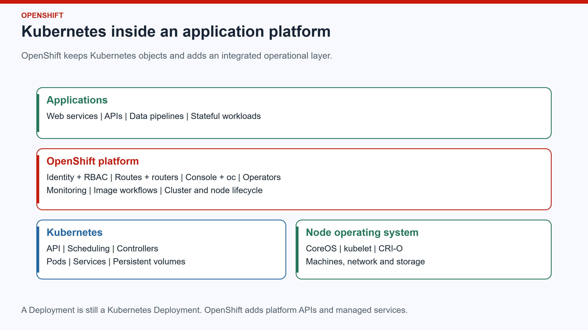
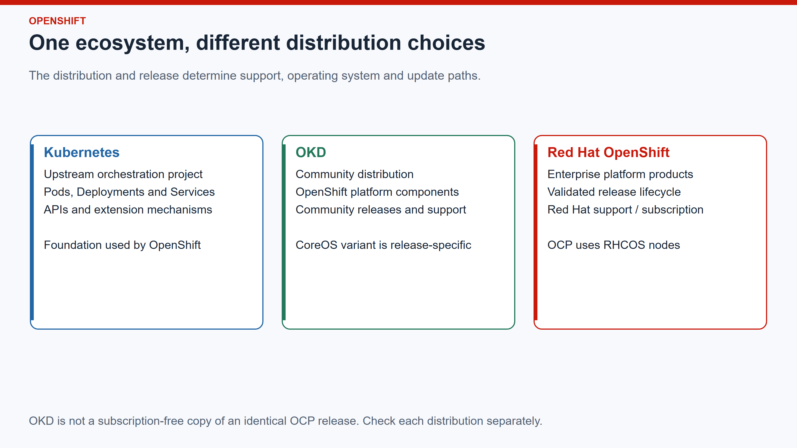
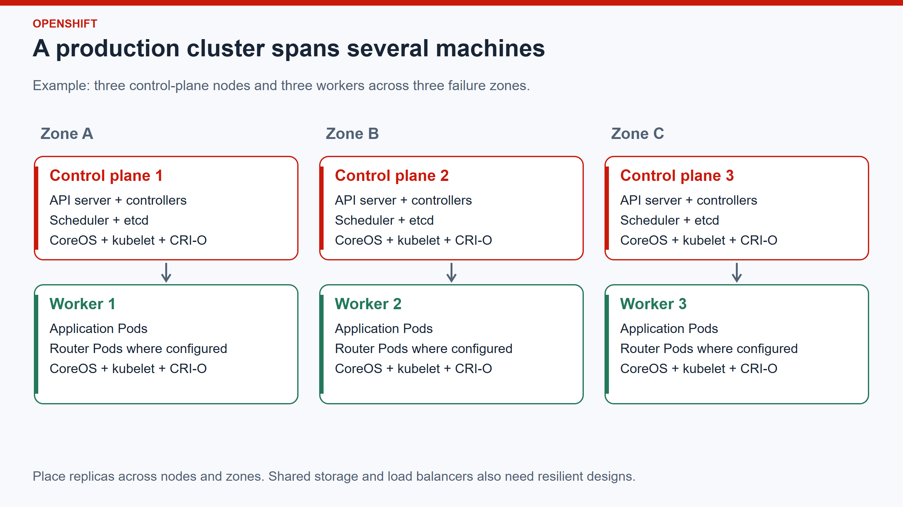
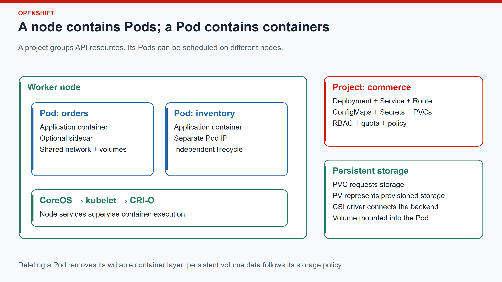
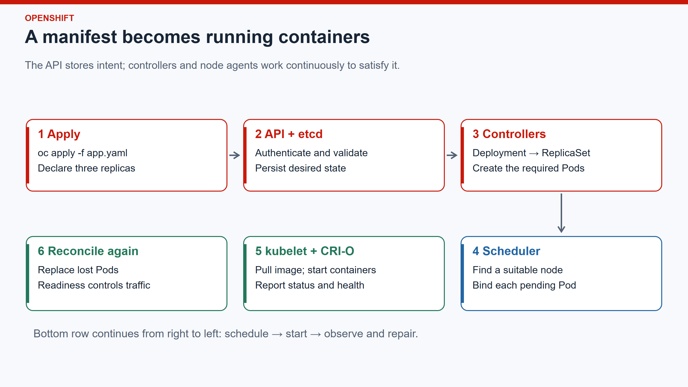
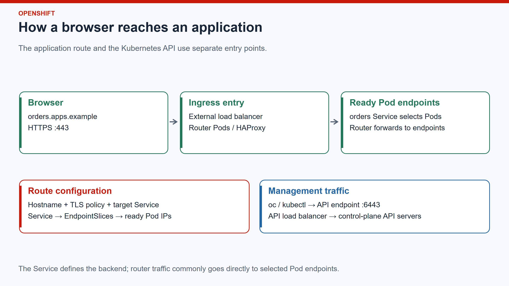
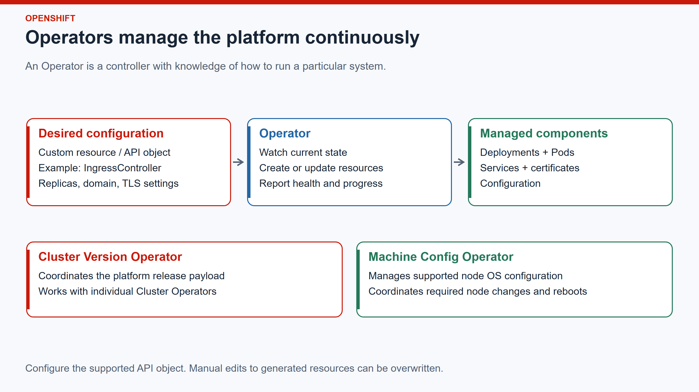
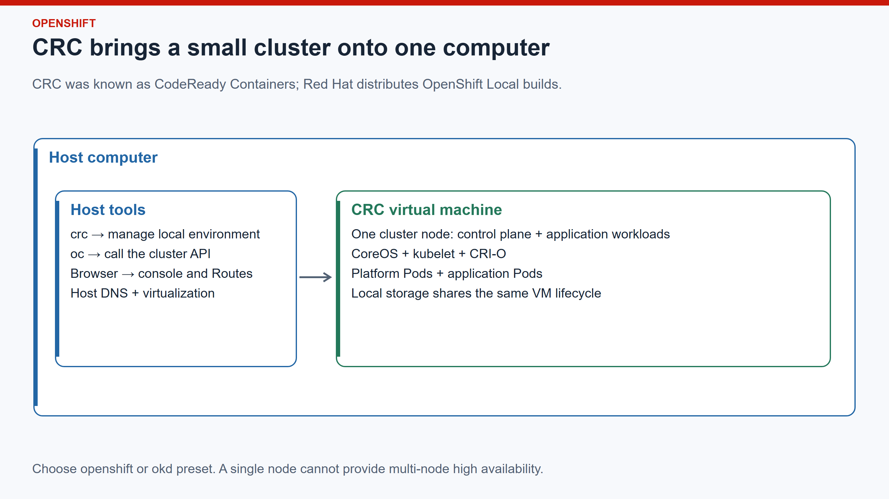

# OpenShift Introduction

**Red Hat · Kubernetes · CoreOS · Production clusters · OKD · CRC**

---

## 01 · What is OpenShift?

OpenShift is an application platform built on Kubernetes. It runs containerized applications and supplies integrated tools for access, networking, deployment, monitoring and platform maintenance.



A container image packages an application. Kubernetes manages its running copies. OpenShift adds the surrounding platform that developers and operators use to deliver and maintain it.

---

## 02 · Where Red Hat fits

**Red Hat** is the enterprise open source software company behind Red Hat Enterprise Linux and Red Hat OpenShift.

| Name | Meaning |
|---|---|
| Red Hat | Company that develops, integrates and supports enterprise software |
| RHEL | Red Hat Enterprise Linux, a general-purpose enterprise Linux distribution |
| Red Hat OpenShift | Family of Kubernetes application platform offerings |
| OpenShift Container Platform, or OCP | Red Hat's self-managed OpenShift platform |
| RHCOS | Red Hat Enterprise Linux CoreOS, the container-focused node operating system |
| OKD | Community distribution built from OpenShift components |
| CRC | Tool for running a small local container environment, including OpenShift or OKD |

Red Hat subscriptions provide a supported product lifecycle and access to services and content. Open source code and enterprise support are different parts of the offering.

---

## 03 · Kubernetes, OKD and Red Hat OpenShift



Kubernetes supplies the orchestration foundation. OKD brings OpenShift components together as a community distribution. Red Hat OpenShift supplies enterprise products with tested releases and a supported lifecycle.

Do not assume that an OKD build has the same components, node OS, installation options or upgrade path as a similarly numbered OCP release.

Reference: [Red Hat OpenShift and Kubernetes](https://www.redhat.com/en/technologies/cloud-computing/openshift/red-hat-openshift-kubernetes), [OKD project](https://okd.io/).

---

## 04 · How OpenShift uses Kubernetes

OpenShift includes Kubernetes. Kubernetes APIs remain central to application deployment.

| Kubernetes responsibility | Objects or components |
|---|---|
| Accept desired state | API server and declarative manifests |
| Choose where Pods run | Scheduler |
| Maintain replica counts | Deployments, ReplicaSets and controllers |
| Connect applications | Services, EndpointSlices and cluster DNS |
| Request durable storage | PersistentVolumeClaims and PersistentVolumes |
| Apply access controls | ServiceAccounts, Roles and RoleBindings |

OpenShift adds APIs such as `Route`, `Project` and `SecurityContextConstraints`, plus integrated platform services. Standard Kubernetes tools can manage standard Kubernetes objects on OpenShift.

---

## 05 · Kubernetes compared with OpenShift

| Area | Upstream Kubernetes | OpenShift Container Platform |
|---|---|---|
| Orchestration | Core project and APIs | Integrated Kubernetes distribution |
| Installation | Distribution or installer choice | Supported platform installation workflows |
| Node OS | Depends on distribution | RHCOS is central; supported alternatives depend on release |
| Application entry | Ingress API; controller installed separately | Managed ingress controllers and Route API |
| Identity | Authentication integration must be configured | Integrated OAuth service with configurable identity providers |
| Permissions | Kubernetes RBAC | Kubernetes RBAC plus OpenShift-specific policies and APIs |
| Container admission | Pod security mechanisms and admission extensions | Security Context Constraints and platform security defaults |
| Console | Depends on installed tools | Integrated web console |
| Operations | Assemble and maintain the chosen components | Platform Operators and coordinated updates |
| Support | Community or chosen vendor | Red Hat product support under subscription |

Other Kubernetes distributions can provide similar integrations. The distinction is the assembled and supported platform, rather than a different way of defining a Pod.

---

## 06 · What is CoreOS?

CoreOS describes a family of container-focused Linux operating systems designed for automated provisioning and managed updates.

The node OS runs the kernel, networking, storage integration, kubelet and container runtime. Applications normally run in containers above that OS.

| Operating system | Where it fits |
|---|---|
| RHCOS | Red Hat Enterprise Linux CoreOS; used by OCP |
| FCOS | Fedora CoreOS; used by historical OKD builds and other container environments |
| SCOS | CentOS Stream CoreOS; used by OKD SCOS builds |

The CoreOS name is not a container runtime. An RHCOS node can run images built from other Linux user spaces, provided the image and application meet architecture and security requirements.

Use the release documentation to identify the required node OS. OCP worker OS support and OKD's CoreOS base have changed between releases.

Reference: [RHCOS architecture](https://docs.redhat.com/en/documentation/openshift_container_platform/4.20/html/architecture/architecture-rhcos), [OKD transition to SCOS](https://okd.io/docs/project/upgrade-notes/from-4-15/fcos-to-scos-migration/).

---

## 07 · Node provisioning and operating system management

**Ignition** applies initial machine configuration during first boot: files, system services, storage and other machine settings.

The **Machine Config Operator**, or MCO, manages supported node OS configuration through machine configuration pools. A pool groups nodes that should receive the same configuration.

1. Declare configuration through the supported platform APIs.
2. The MCO renders the required configuration for the pool.
3. Nodes apply changes through a controlled rollout; some changes require draining and rebooting.
4. The platform reports progress and configuration drift.

Avoid treating cluster nodes as independently maintained Linux servers. Unmanaged changes can conflict with the desired machine configuration.

---

## 08 · Production cluster architecture



A conventional highly available cluster separates the control plane from application workers. Three control-plane nodes provide an etcd majority that can tolerate one member being unavailable.

Spread nodes and application replicas across independent failure zones where the infrastructure supports it. The load balancers, DNS and storage backends must also be designed for availability.

This diagram shows one common topology. Compact clusters, single-node deployments and hosted control planes use different layouts.

Reference: [Control-plane architecture](https://docs.redhat.com/en/documentation/openshift_container_platform/4.20/html/architecture/control-plane).

---

## 09 · Control-plane components

| Component | Responsibility |
|---|---|
| Kubernetes API server | Accepts API requests; authenticates, authorizes and validates operations |
| etcd | Stores cluster API state through a distributed key-value database |
| Scheduler | Selects a suitable node for an unscheduled Pod |
| Controller managers | Reconcile resources toward their declared state |
| OpenShift API services | Serve additional OpenShift APIs |
| OAuth service | Integrates user login with configured identity providers |

The control plane decides and records what should run. Node agents carry out the work.

etcd contains cluster configuration and resource state. It is not the database for application business data.

---

## 10 · Workers, infrastructure nodes and machines

**Worker nodes** provide CPU, memory and device capacity for application Pods. Every node runs a kubelet and a container runtime.

**Infrastructure nodes** are nodes assigned to selected platform workloads, such as routers, monitoring or the image registry. Labels, taints, tolerations and placement configuration establish this separation; a label alone does not move workloads.

**Machine** resources describe infrastructure instances where the installation supports the Machine API. A Machine and a Kubernetes Node are related objects with different responsibilities.

| Object | Represents |
|---|---|
| Machine | Provisioned infrastructure instance |
| Node | Registered Kubernetes execution host |
| Pod | Scheduled application execution unit |

---

## 11 · Pods, containers and projects



A **Pod** contains one or more containers that share a network namespace and can share volumes. Containers in the same Pod communicate through `localhost`.

A **project** is OpenShift's user-facing grouping built around a Kubernetes namespace, with associated access and administrative behavior. It groups resources; it is not a machine.

A project can contain Pods on several workers. One worker can run Pods from several projects.

---

## 12 · From manifest to running application



For a Deployment with three replicas:

1. Submit the manifest to the API server.
2. Controllers create a ReplicaSet and the required Pod objects.
3. The scheduler assigns Pods to suitable nodes.
4. The kubelet asks CRI-O to pull images and start containers.
5. Readiness determines whether a Pod can receive Service traffic.
6. Controllers replace missing Pods while the desired replica count remains three.

A replacement Pod has its own identity and may run on a different node. Applications must tolerate that movement.

---

## 13 · Container images and CRI-O

**An image** is a packaged filesystem and execution configuration. **A container** is a running instance created from that image.

OpenShift nodes use **CRI-O**, a container runtime that implements Kubernetes' Container Runtime Interface. The kubelet talks to CRI-O; CRI-O uses lower-level runtime components to start containers.

Images built with Docker, Podman or Buildah can run on OpenShift when they meet compatible image, CPU architecture and application requirements. Docker Engine is not required on the cluster nodes.

Prefer immutable image digests for reproducible deployments. Provide private registry credentials through appropriate image pull secrets.

---

## 14 · Deployments, StatefulSets, Jobs and DaemonSets

| Workload | Use it for | Example |
|---|---|---|
| Deployment | Replaceable replicas and rolling updates | REST API |
| StatefulSet | Stable Pod identity and per-replica storage claims | Stateful service requiring ordered identity |
| Job | Work that runs to completion | One-time data import |
| CronJob | Jobs started on a schedule | Periodic maintenance task |
| DaemonSet | A Pod on every eligible node | Node log collector |

A StatefulSet provides Kubernetes identity and lifecycle behavior. Database replication, backups and recovery still depend on the database and its operating procedures.

Use Deployments for new stateless applications. Older OpenShift material may use `DeploymentConfig`, a legacy OpenShift-specific workload API.

---

## 15 · Cluster networking and Services

Each Pod has an IP address. The cluster network connects Pods across nodes; OVN-Kubernetes is a common OpenShift network implementation.

A **Service** gives a changing set of Pods a stable network identity. Its selector identifies matching Pods; EndpointSlices describe backend endpoints and their readiness.

| Service type | Typical purpose |
|---|---|
| ClusterIP | Internal application access |
| NodePort | Expose a port on node addresses |
| LoadBalancer | Request an external load balancer through supported infrastructure integration |
| Headless Service | DNS discovery of individual endpoints without a virtual Service IP |

Use Service DNS names for internal dependencies. Pod IPs change when Pods are replaced.

---

## 16 · Routes, routers and external traffic



A **Route** declares an application hostname, target Service and optional TLS settings. A **router** implements that entry point. The Ingress Operator manages HAProxy-based ingress controller deployments.

DNS directs the application hostname to the ingress entry. The router matches the request and forwards it to ready backend endpoints selected through the Service.

The Kubernetes API uses its own API endpoint, commonly on port `6443`. Application HTTP and HTTPS traffic normally enters on ports `80` and `443`.

Routes handle HTTP, HTTPS and supported TLS routing. Exposing another TCP protocol requires an appropriate Service or other networking design.

Reference: [Ingress Operator](https://docs.redhat.com/en/documentation/openshift_container_platform/4.20/observability/networking_operators/configuring-ingress).

---

## 17 · TLS at the application boundary

| Route termination | Where client TLS ends | Router-to-application connection |
|---|---|---|
| Edge | Router | HTTP |
| Re-encrypt | Router | A new TLS connection to the backend |
| Passthrough | Application | Router forwards the encrypted connection; hostname selection uses SNI |

Choose the mode from the application's security and certificate requirements. An edge Route secures the client connection, but does not encrypt the router-to-backend connection.

Router replica placement and an external load balancer affect ingress availability. Creating a Route alone does not make an application highly available.

---

## 18 · Persistent storage

**Container writable layers are temporary.** Keep durable application data on deliberately managed storage.

| Resource | Responsibility |
|---|---|
| StorageClass | Describes a storage provisioner and provisioning policy |
| PersistentVolumeClaim, PVC | Application request for storage |
| PersistentVolume, PV | Cluster resource representing provisioned storage |
| CSI driver | Connects Kubernetes storage operations to the backend |

Select access modes, capacity and performance for the workload. `ReadWriteOnce` means read-write mounting by a single node; it does not necessarily restrict access to one Pod.

Pod deletion does not automatically mean volume deletion. PVC deletion, PV reclaim policy and storage backend behavior determine what happens to the data. Replication and snapshots must be complemented by a tested recovery process.

---

## 19 · Identity, permissions and workload security

Three questions govern access:

| Question | Mechanism |
|---|---|
| Who is making the request? | Authentication; identity providers, tokens and ServiceAccounts |
| What can that identity do? | RBAC Roles, ClusterRoles and bindings |
| Under which security settings can the Pod run? | Security Context Constraints and admission policy |

OpenShift commonly runs application containers with an assigned non-root user ID. Build images that tolerate an arbitrary UID and provide writable directories through suitable permissions or mounted volumes.

Apply least privilege. Avoid granting privileged SCC access to solve an image permission problem. Use NetworkPolicies to define permitted traffic and configure them explicitly; a project boundary alone does not guarantee network isolation.

Reference: [OpenShift authentication and authorization](https://docs.redhat.com/en/documentation/openshift_container_platform/4.20/html/authentication_and_authorization/index).

---

## 20 · Configuration, Secrets and resource limits

| Resource or setting | Purpose |
|---|---|
| ConfigMap | Non-sensitive application settings |
| Secret | Credentials or sensitive configuration represented as API objects |
| CPU and memory requests | Scheduling and resource allocation inputs |
| CPU and memory limits | Runtime resource boundaries |
| ResourceQuota | Aggregate resource allowance within a namespace |
| LimitRange | Defaults and constraints for individual resource requests |

Secret values encoded as base64 are not encrypted by that encoding. Restrict API access and use the platform's configured protection and secret-management integrations.

Set requests from measured demand. A Pod can remain `Pending` when no node can satisfy its requests; a container can be killed for exceeding its memory limit.

---

## 21 · Operators and platform lifecycle



An **Operator** combines a controller with operational knowledge. It watches configuration and manages the resources required to run a system.

**Cluster Operators** maintain platform capabilities. The Cluster Version Operator coordinates the platform release payload. The Machine Config Operator handles supported machine configuration and OS changes.

**Application Operators** can manage databases, messaging systems and other services. Their installation, upgrade policy and support depend on the individual Operator; installing one does not transfer all application responsibilities to the platform.

Inspect Operator health before a platform update. Plan capacity and disruption budgets so workloads can tolerate node maintenance.

---

## 22 · Images, builds and delivery

An application delivery path commonly looks like this:

**Source → build and test → image registry → deployment manifest → rollout → health checks**

OpenShift can work with externally built images or integrated build workflows. ImageStreams track image references; BuildConfigs and source-to-image workflows are available where the relevant capabilities are enabled.

OpenShift Pipelines and OpenShift GitOps add CI/CD and declarative delivery capabilities through separately installed Operators. They are not prerequisites for running a Deployment.

Keep secrets outside source control, scan images, and promote the same verified image between environments.

---

## 23 · Health, scaling and availability

| Mechanism | What it changes |
|---|---|
| Startup probe | Allows an application time to initialize before other probes take effect |
| Readiness probe | Controls eligibility for Service traffic |
| Liveness probe | Restarts a container that fails its health check |
| Horizontal Pod Autoscaler | Adjusts replica count from configured metrics |
| Cluster autoscaling | Adjusts infrastructure capacity where supported and configured |
| PodDisruptionBudget | Limits allowed voluntary disruptions for selected Pods |
| Topology spread / anti-affinity | Influences replica placement across nodes or zones |

Three replicas on one node still share one node failure domain. A disruption budget does not prevent involuntary node failures or repair an application that cannot tolerate losing a replica.

---

## 24 · Operating OpenShift in production

Production operation includes both platform and application responsibilities.

| Area | Required decisions |
|---|---|
| Availability | Node and zone placement, load balancers, application redundancy |
| Capacity | Requests, limits, quotas, growth and spare capacity during maintenance |
| Observability | Platform metrics, application metrics, logs, alerts and ownership |
| Recovery | etcd backups, application backups, storage recovery and restore exercises |
| Security | Identity, RBAC, SCCs, network policy, certificates and image provenance |
| Maintenance | Supported update paths, Operator compatibility and workload disruption |

Platform monitoring covers cluster health. User workload monitoring and centralized logging require the appropriate configuration or additional components.

An etcd backup restores cluster state; it does not replace application data backups.

---

## 25 · Deployment choices

| Environment | Operational model |
|---|---|
| Self-managed OCP | Organization operates the platform on supported infrastructure |
| Managed OpenShift service | Provider and organization divide responsibilities under the service agreement |
| Multi-node OKD | Community distribution operated by the organization |
| Single-node OpenShift | Supported deployment topology for suitable use cases; no multi-node redundancy |
| CRC with OpenShift or OKD | Local development and evaluation environment |

Bare metal, virtual machines and public cloud infrastructure can host OpenShift under their supported installation models. Managed services change the operational responsibility split; application design, permissions and data protection still need owners.

Reference: [Red Hat OpenShift Container Platform](https://www.redhat.com/en/technologies/cloud-computing/openshift/container-platform).

---

## 26 · What is OKD?

OKD is the community distribution of Kubernetes built from OpenShift components. It exposes familiar OpenShift concepts such as projects, Routes, the web console and Operators.

Use OKD to work with the OpenShift platform through community releases. Operate it with the release-specific installation and upgrade documentation; Red Hat OCP product support does not automatically apply to an OKD cluster.

OKD has shipped builds using Fedora CoreOS and CentOS Stream CoreOS. Inspect the actual release and node OS rather than inferring the OS from the word OKD.

```bash
# Cluster release and node operating system information
oc get clusterversion
oc get nodes -o wide
oc get nodes -o custom-columns=NAME:.metadata.name,OS:.status.nodeInfo.osImage
```

Reference: [OKD SCOS release guidance](https://okd.io/docs/project/scos-migration-faq/).

---

## 27 · What is CRC?

CRC runs a small local container environment. Its name comes from **CodeReady Containers**; Red Hat distributes builds as **Red Hat OpenShift Local**.



With the `openshift` or `okd` preset, CRC creates a minimal single-node cluster using a prepared bundle. Host-side tooling sets up the local environment, while `oc` communicates with the cluster API.

The host OS and the VM's node OS are separate. Running CRC on Ubuntu does not make the cluster node an Ubuntu node.

Reference: [CRC overview](https://crc.dev/), [CRC usage](https://crc.dev/docs/using/).

---

## 28 · CRC presets and lifecycle

| Item | Meaning |
|---|---|
| `openshift` preset | Local OpenShift Container Platform environment |
| `okd` preset | Local OKD environment |
| Bundle | Prepared cluster image and related content for the selected environment |
| `crc` command | Manages setup, configuration and the local instance |
| `oc` command | Manages cluster resources through the API |

For a new OKD instance, after installing a compatible CRC build and meeting its virtualization requirements:

```bash
crc config set preset okd
crc setup
crc start
crc status

# Print the shell command that adds CRC's oc binary to PATH
crc oc-env

# Print login instructions for the running instance
crc console --credentials
```

Follow the command printed by `crc oc-env` for the current shell. The OpenShift preset requires the relevant Red Hat access and pull secret. Available presets and bundles depend on the installed CRC build.

`crc stop` stops the instance. **`crc delete` removes it**, including local cluster state and storage associated with that instance. Export manifests and protect data before recreating it.

Reference: [CRC configuration](https://crc.dev/docs/configuring/), [CRC getting started](https://crc.dev/docs/getting-started/).

---

## 29 · What CRC represents—and its limits

| Concept | Local CRC cluster | Typical highly available production cluster |
|---|---|---|
| Control plane and workloads | Share one node | Commonly separated across multiple nodes |
| Failure domains | One host and one cluster VM | Multiple nodes, often multiple zones |
| Capacity | Fixed local CPU, memory and disk budget | Planned capacity with expansion options |
| Storage | Often tied to local instance lifecycle | Deliberate storage service and recovery design |
| Availability | Host or VM failure affects everything | Designed to tolerate specified failures |
| Operations | Simplified local environment | Monitoring, backups, identity and update procedures |

The APIs and core objects are real. The topology does not demonstrate multi-node resilience, production throughput or disaster recovery.

---

## 30 · Read the cluster from the command line

```bash
oc whoami                       # Current authenticated identity
oc project                      # Current project
oc get nodes -o wide             # Nodes and node details
oc get clusteroperators          # Platform Operator health
oc get clusterversion            # Cluster release and update status

oc get deployments,statefulsets  # Long-running application controllers
oc get pods -o wide              # Pod state, IP and assigned node
oc get services,routes           # Internal and external application entry
oc get pvc                       # Storage claims
oc get events --sort-by=.metadata.creationTimestamp
```

Commands without a namespace flag generally use the current project. Cluster-wide visibility depends on permissions; use `-n <project>` to select a namespace explicitly.

The web console presents the same API-backed resources through a graphical interface.

---

## 31 · Diagnose an application by following its dependencies

| Symptom | Inspect first |
|---|---|
| Pod remains `Pending` | Events, resource requests, node placement and PVC binding |
| `ImagePullBackOff` | Image reference, registry reachability and pull credentials |
| `CrashLoopBackOff` | Container logs, previous container logs, command and configuration |
| `OOMKilled` | Memory demand and limits; inspect container termination details |
| Service has no ready endpoints | Selectors, Pod labels and readiness probes |
| Route returns an error | DNS, Route admission, router health, endpoints and target port |
| Pod cannot write to a directory | Assigned UID, filesystem permissions and mounted volumes |

```bash
oc describe pod <pod>
oc logs <pod> -c <container>
oc logs <pod> -c <container> --previous
oc get endpointslices -l kubernetes.io/service-name=<service>
oc describe route <route>
```

Start with the failing resource and its events. Follow the path from Route to Service to endpoint to container before changing cluster-wide settings.

---

## 32 · Recognize the boundaries

| Term | Remember |
|---|---|
| OpenShift | Kubernetes plus an integrated application and operations platform |
| Red Hat | Enterprise vendor behind OCP and RHCOS |
| CoreOS | Node operating system family |
| CRI-O | Container runtime used by the node |
| Node | Execution host registered with Kubernetes |
| Pod | Scheduled group of containers |
| Project | Namespace-based grouping and access context |
| Service | Stable discovery and backend selection |
| Route | Application hostname and ingress configuration |
| Router | Running component that handles ingress traffic |
| Operator | Controller that manages a system through reconciliation |
| OKD | Community OpenShift distribution |
| CRC | Local environment manager, including single-node OpenShift and OKD presets |

---

## Diagram sources

Editable SVG diagrams and their PNG exports are in [assets](assets/).
