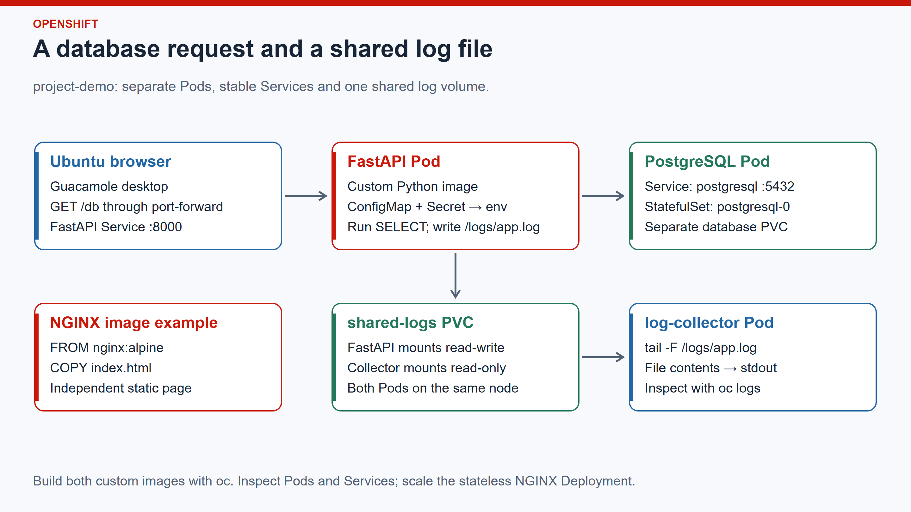

# OpenShift hands-on with oc

**Projects · Pods · Services · Images · Configuration · Shared volumes · Logs**

Build a minimal end-to-end Kubernetes deployment on OpenShift using the `oc` client. Create a project, build container images, deploy Pods and Services, connect FastAPI to PostgreSQL, and read application logs through a shared volume.

Create all application files under `~/oc-demo`, select `context-demo` and work in `project-demo`.



| Example | What it demonstrates |
|---|---|
| FastAPI → PostgreSQL | Build a Python image, inject configuration and credentials, run one SELECT |
| FastAPI → shared volume → log-collector | Separate Pods writing and reading the same log file |
| NGINX static page | Build from `nginx:alpine`, copy `index.html`, deploy and scale |

Use the numbered steps in order. Paste each heredoc block in full, including its closing marker. `>` creates or replaces a file; `>>` appends. Quoted heredoc markers preserve variables for the generated file.

The default storage class and integrated image registry must be available. Image builds need outbound access to registries and the Python package index. Application credentials below are disposable examples.

The steps can reuse the matching demo namespace. They should not be pointed at an unrelated project. Existing `bigdata` workloads are separate.

---

## 01 · Create the working directory

Create `oc-demo` in your home directory and enter it. Keep the YAML manifests, NGINX files and FastAPI source in separate subdirectories.

```bash
mkdir -p "$HOME/oc-demo"/{manifests,nginx,fastapi}
cd "$HOME/oc-demo"
umask 077
cat > .gitignore <<'TEXT'
kubeconfig
manifests/01-config.yaml
TEXT
```

---

## 02 · Understand contexts and projects

### What is a context?

A **context** is a named kubeconfig entry that selects a cluster, an identity and a default namespace.

| Setting | Purpose |
|---|---|
| Cluster | API server address and certificate trust settings |
| User | Identity and credentials for accessing the cluster |
| Namespace | Default destination for namespaced commands without `-n` |

Creating a context does not create a cluster, user or namespace. `context-demo` reuses the existing cluster and identity while selecting `project-demo`.

### List contexts and get the current context

```bash
oc config get-contexts
oc config current-context
oc config view --minify
```

`get-contexts` lists the available contexts; `*` marks the current selection. `current-context` prints its name. `view --minify` shows its configuration with sensitive values normally redacted. Do not add `--raw` when displaying credentials.

### Use a separate configuration for this terminal

Copy the active configuration into a protected demo file, preserving the original:

```bash
if [ "${KUBECONFIG:-$HOME/.kube/config}" != "$HOME/oc-demo/kubeconfig" ]; then
  oc config view --flatten --raw > "$HOME/oc-demo/kubeconfig"
fi
chmod 600 "$HOME/oc-demo/kubeconfig"
export KUBECONFIG="$HOME/oc-demo/kubeconfig"
```

Here `--raw` writes credentials to the protected file, not to the screen. Keep that file private.

The export selects this file for the current shell and its child processes. Other existing terminals keep their own environment. Context selection is stored in the file, so terminals explicitly using this same demo kubeconfig share its current-context setting. Do not add this export to `.bashrc`.

### Create context-demo

Read the existing cluster and identity names, then create the context:

```bash
DEMO_CLUSTER=$(oc config view --minify -o jsonpath='{.contexts[0].context.cluster}')
DEMO_USER=$(oc config view --minify -o jsonpath='{.contexts[0].context.user}')
oc config set-context context-demo --cluster="$DEMO_CLUSTER" \
  --user="$DEMO_USER" --namespace=project-demo
oc config get-contexts context-demo
```

`set-context` creates or updates an entry; it does not select it. Naming `project-demo` here does not create the project.

### Select the default context for this terminal

```bash
oc config use-context context-demo
oc config current-context
oc config get-contexts context-demo
```

Expect `context-demo` as the current name. Commands now use this context in the demo kubeconfig. Create its project next.

### What are namespaces and projects?

A Kubernetes **namespace** groups resources such as Pods, Services, ConfigMaps, Secrets and PVCs. The same resource name can exist in different namespaces.

An OpenShift **project** is the user-facing representation of a namespace with OpenShift access and management features. `project-demo` appears in both listings. Nodes and PersistentVolumes are cluster-scoped; they are not contained in a namespace.

```bash
oc get projects
oc get namespaces
```

### Create and select project-demo

```bash
if ! oc get project project-demo >/dev/null 2>&1; then
  oc new-project project-demo
fi
# new-project can select a generated context; return to our named context.
oc config use-context context-demo
oc project project-demo
oc project
oc get namespace project-demo
oc -n project-demo get pods
```

A new project reports no Pods. An existing demo project lists its workloads. `oc project project-demo` sets the default namespace in the selected context. Subsequent commands also use explicit `-n project-demo` flags to make their destination visible.

### Effect on bigdata

These steps preserve the original kubeconfig and do not modify or delete `bigdata` workloads. The demo shares the same cluster, so its builds, Pods and storage consume shared capacity and can affect other workloads if the node runs short of resources.

The existing administrator identity is reused. A context selects a destination; it does not restrict permissions. An explicit `-n bigdata` command would still target `bigdata`. Keep the commands here scoped to `project-demo` and avoid cluster-wide changes.

---

## 03 · Create a ConfigMap and a Secret

ConfigMaps store ordinary settings. Secrets supply credentials. These disposable database credentials are unrelated to the Ubuntu login. envFrom will load these keys into the FastAPI container environment.

```bash
cat > manifests/01-config.yaml <<'YAML'
apiVersion: v1
kind: ServiceAccount
metadata: {name: demo-app}
---
apiVersion: v1
kind: ConfigMap
metadata: {name: demo-config}
data:
  APP_NAME: FastAPI PostgreSQL demo
  DB_HOST: postgresql
  DB_PORT: "5432"
  DB_NAME: demodb
  LOG_FILE: /logs/app.log
---
apiVersion: v1
kind: Secret
metadata: {name: demo-secret}
type: Opaque
stringData:
  DB_USER: demouser
  DB_PASSWORD: DemoDbPass42
YAML
oc -n project-demo apply -f manifests/01-config.yaml
oc -n project-demo get configmap/demo-config secret/demo-secret
```

---

## 04 · Start PostgreSQL with a Service and a PVC

The Service supplies the database name postgresql. A StatefulSet owns postgresql-0 and its persistent data claim. The default StorageClass allocates the volume. The image supports OpenShift-assigned non-root IDs.

### PV, PVC and StorageClass

| Term | Meaning | Example in this deployment |
|---|---|---|
| **PV — PersistentVolume** | A cluster-level object representing allocated storage and how to access it. The actual bytes live on the storage backend. | A dynamically provisioned volume bound to the database claim |
| **PVC — PersistentVolumeClaim** | A namespaced request for storage capacity and access mode | `data-postgresql-0` requests at least `1Gi` with `ReadWriteOnce` |
| **StorageClass** | A provisioning policy identifying the driver and storage settings to use | The default `crc-csi-hostpath-provisioner` class provisions local storage inside CRC |

Think of the PVC as **the request**, the StorageClass as **the provisioning policy**, and the PV as **the allocated storage resource**.

```text
Pod → PVC → bound PV → storage backend
       │
       └─ StorageClass → provisioner creates a suitable PV
```

In dynamic provisioning, create a PVC and let its StorageClass provision the PV. A Pod references the **PVC name**, rather than a disk path or PV name.

### Read a storage request

The database's `volumeClaimTemplates` below contains this request:

```yaml
accessModes: [ReadWriteOnce]
resources:
  requests:
    storage: 1Gi
```

This means “provide at least one gibibyte of storage, mountable read-write by one node.” `ReadWriteOnce` can allow multiple Pods on that same node; it does not mean only one Pod. `Gi` is a binary unit and differs from decimal GB.

The YAML omits `storageClassName`, so the cluster uses its default StorageClass. An explicit selection would be `storageClassName: crc-csi-hostpath-provisioner`. No new StorageClass is needed for this demo.

The default CRC class uses `WaitForFirstConsumer`: a new PVC can remain `Pending` until a consuming Pod is scheduled. A successful allocation becomes `Bound`. The allocated capacity can exceed the request; this environment provisioned 49 GiB volumes for the 1 GiB requests.

### The two storage claims used here

| Claim | Created by | Mounted in | Purpose |
|---|---|---|---|
| `data-postgresql-0` | StatefulSet's `volumeClaimTemplates` | PostgreSQL at `/var/lib/pgsql/data` | Database files |
| `shared-logs` | Explicit PVC manifest in step 07 | FastAPI and log-collector at `/logs` | Shared application log file |

`data-postgresql-0` follows the pattern **template name + StatefulSet name + ordinal**: `data` + `postgresql` + `0`.

Inspect the provisioning policy now:

```bash
oc get storageclass
oc describe storageclass crc-csi-hostpath-provisioner
```

The creation block below ends with commands to inspect the database claim and print its bound PV name.

`oc get pv` lists cluster-wide storage, including other projects. Inspection is read-only; cleanup must target only PVs belonging to `project-demo`.

### What happens when a Pod or claim is deleted?

| Action or policy | Result |
|---|---|
| Replace a Pod | Its existing PVC and stored files remain; the replacement can mount them |
| Delete a PVC with PV policy `Retain` | The claim disappears, but the PV and backend data remain for administrative handling |
| Delete a PVC with PV policy `Delete` | The provisioner removes the PV and backing storage when no Pod is using the claim |

The final cleanup changes only the demo PVs to `Delete`, stops their consumers, deletes the claims, and waits for the PVs to disappear. It removes both database data and shared logs. The shared StorageClass is kept because other projects use it.

Reference: [Kubernetes persistent storage](https://kubernetes.io/docs/concepts/storage/persistent-volumes/).

### Create the database resources

```bash
cat > manifests/02-postgresql.yaml <<'YAML'
apiVersion: v1
kind: Service
metadata: {name: postgresql-headless}
spec:
  clusterIP: None
  selector: {app: postgresql}
  ports:
    - {name: postgres, port: 5432, targetPort: postgres}
---
apiVersion: v1
kind: Service
metadata: {name: postgresql}
spec:
  selector: {app: postgresql}
  ports:
    - {name: postgres, port: 5432, targetPort: postgres}
---
apiVersion: apps/v1
kind: StatefulSet
metadata: {name: postgresql}
spec:
  serviceName: postgresql-headless
  replicas: 1
  selector:
    matchLabels: {app: postgresql}
  template:
    metadata:
      labels: {app: postgresql}
    spec:
      serviceAccountName: demo-app
      automountServiceAccountToken: false
      containers:
        - name: postgresql
          image: quay.io/sclorg/postgresql-16-c9s:latest
          ports:
            - {name: postgres, containerPort: 5432}
          env:
            - name: POSTGRESQL_USER
              valueFrom:
                secretKeyRef: {name: demo-secret, key: DB_USER}
            - name: POSTGRESQL_PASSWORD
              valueFrom:
                secretKeyRef: {name: demo-secret, key: DB_PASSWORD}
            - name: POSTGRESQL_DATABASE
              valueFrom:
                configMapKeyRef: {name: demo-config, key: DB_NAME}
          resources:
            requests: {cpu: 100m, memory: 256Mi}
            limits: {cpu: "1", memory: 512Mi}
          securityContext:
            allowPrivilegeEscalation: false
            capabilities: {drop: [ALL]}
          readinessProbe:
            exec:
              command: [/bin/sh, -c, 'pg_isready -h 127.0.0.1 -p 5432']
            initialDelaySeconds: 5
          volumeMounts:
            - {name: data, mountPath: /var/lib/pgsql/data}
  volumeClaimTemplates:
    - metadata: {name: data}
      spec:
        accessModes: [ReadWriteOnce]
        resources:
          requests: {storage: 1Gi}
YAML
oc -n project-demo apply -f manifests/02-postgresql.yaml
oc -n project-demo rollout status statefulset/postgresql --timeout=300s
oc -n project-demo get pods,svc,pvc
oc -n project-demo describe pvc data-postgresql-0
oc get pv
oc -n project-demo get pvc data-postgresql-0 \
  -o jsonpath='{.spec.volumeName}{"\n"}'
```

---

## 05 · Write the FastAPI application and Dockerfile

GET /db runs one SELECT and returns JSON. It logs the result to stdout and /logs/app.log. No table creation, writes or web forms are needed. GET /health checks the API process.

```bash
cat > fastapi/main.py <<'PY'
import logging
import os

import psycopg
from fastapi import FastAPI, HTTPException

log = logging.getLogger("demo")
log.setLevel(logging.INFO)
for handler in (logging.StreamHandler(), logging.FileHandler(os.environ["LOG_FILE"])):
    handler.setFormatter(logging.Formatter("%(levelname)s %(message)s"))
    log.addHandler(handler)

app = FastAPI(title="PostgreSQL SELECT demo")

@app.get("/health")
def health():
    return {"status": "ok"}

@app.get("/db")
def database():
    try:
        with psycopg.connect(
            host=os.environ["DB_HOST"], port=os.environ["DB_PORT"],
            dbname=os.environ["DB_NAME"], user=os.environ["DB_USER"],
            password=os.environ["DB_PASSWORD"], connect_timeout=5,
        ) as conn:
            row = conn.execute("SELECT 1 AS result, current_database() AS database").fetchone()
        log.info("SELECT completed: result=%s database=%s", row[0], row[1])
        return {"app": os.environ["APP_NAME"], "result": row[0], "database": row[1]}
    except psycopg.Error:
        log.error("SELECT failed: database unavailable")
        raise HTTPException(status_code=503, detail="Database unavailable")
PY
cat > fastapi/requirements.txt <<'TEXT'
fastapi==0.115.12
uvicorn==0.34.2
psycopg[binary]==3.2.6
TEXT
cat > fastapi/Dockerfile <<'DOCKER'
FROM docker.io/library/python:3.12-slim
WORKDIR /app
COPY requirements.txt .
RUN pip install --no-cache-dir -r requirements.txt
COPY main.py .
RUN chmod 0644 /app/main.py /app/requirements.txt
ENV PYTHONDONTWRITEBYTECODE=1 PYTHONUNBUFFERED=1
USER 1001
EXPOSE 8000
CMD ["uvicorn", "main:app", "--host", "0.0.0.0", "--port", "8000"]
DOCKER
```

---

## 06 · Build the FastAPI image

A binary BuildConfig uploads the chosen directory, builds its Dockerfile inside the cluster and pushes the image to the integrated registry. Save the generated build objects as YAML. Docker Engine is not needed on the Ubuntu host.

```bash
oc -n project-demo new-build --name=fastapi-demo --binary --strategy=docker \
  --to=fastapi-demo:v1 --dry-run -o yaml > manifests/03-fastapi-build.yaml
oc -n project-demo apply -f manifests/03-fastapi-build.yaml
oc -n project-demo start-build fastapi-demo --from-dir=fastapi --follow --wait
API_IMAGE=$(oc -n project-demo get istag fastapi-demo:v1 \
  -o jsonpath='{.image.dockerImageReference}')
test -n "$API_IMAGE"
```

---

## 07 · Create the shared log PVC and FastAPI Deployment

envFrom injects the ConfigMap and Secret. The PVC mounts at /logs. A Service gives FastAPI a stable internal address. Recreate avoids overlapping file writers during Pod updates in this one-replica demonstration.

```bash
cat > manifests/04-fastapi.yaml <<'YAML'
apiVersion: v1
kind: PersistentVolumeClaim
metadata: {name: shared-logs}
spec:
  accessModes: [ReadWriteOnce]
  resources:
    requests: {storage: 1Gi}
---
apiVersion: apps/v1
kind: Deployment
metadata: {name: fastapi}
spec:
  replicas: 1
  strategy: {type: Recreate}
  selector:
    matchLabels: {app: fastapi}
  template:
    metadata:
      labels: {app: fastapi}
    spec:
      serviceAccountName: demo-app
      automountServiceAccountToken: false
      containers:
        - name: fastapi
          image: fastapi-demo:placeholder
          ports:
            - {name: http, containerPort: 8000}
          envFrom:
            - configMapRef: {name: demo-config}
            - secretRef: {name: demo-secret}
          resources:
            requests: {cpu: 50m, memory: 64Mi}
            limits: {cpu: 500m, memory: 192Mi}
          securityContext:
            allowPrivilegeEscalation: false
            capabilities: {drop: [ALL]}
          readinessProbe:
            httpGet: {path: /health, port: http}
            initialDelaySeconds: 3
          livenessProbe:
            httpGet: {path: /health, port: http}
            initialDelaySeconds: 15
          volumeMounts:
            - {name: logs, mountPath: /logs}
      volumes:
        - name: logs
          persistentVolumeClaim: {claimName: shared-logs}
---
apiVersion: v1
kind: Service
metadata: {name: fastapi}
spec:
  selector: {app: fastapi}
  ports:
    - {name: http, port: 8000, targetPort: http}
YAML
sed "s|fastapi-demo:placeholder|$API_IMAGE|" \
  manifests/04-fastapi.yaml > manifests/04-fastapi-resolved.yaml
oc -n project-demo apply -f manifests/04-fastapi-resolved.yaml
oc -n project-demo rollout status deployment/fastapi --timeout=300s
```

---

## 08 · Start a separate log-collector Pod

Mount the same PVC read-only and tail the log file to the collector's stdout. No Service is needed: this background worker has no listening port. Pod affinity keeps it on the FastAPI node, as required for shared ReadWriteOnce storage.

```bash
cat > manifests/05-log-collector.yaml <<'YAML'
apiVersion: apps/v1
kind: Deployment
metadata: {name: log-collector}
spec:
  replicas: 1
  selector:
    matchLabels: {app: log-collector}
  template:
    metadata:
      labels: {app: log-collector}
    spec:
      serviceAccountName: demo-app
      automountServiceAccountToken: false
      affinity:
        podAffinity:
          requiredDuringSchedulingIgnoredDuringExecution:
            - labelSelector:
                matchLabels: {app: fastapi}
              topologyKey: kubernetes.io/hostname
      containers:
        - name: log-collector
          image: docker.io/library/busybox:1.37
          command: [/bin/sh, -c]
          args: ['exec tail -n +1 -F /logs/app.log']
          resources:
            requests: {cpu: 10m, memory: 16Mi}
            limits: {cpu: 100m, memory: 64Mi}
          securityContext:
            allowPrivilegeEscalation: false
            capabilities: {drop: [ALL]}
          volumeMounts:
            - {name: logs, mountPath: /logs, readOnly: true}
      volumes:
        - name: logs
          persistentVolumeClaim: {claimName: shared-logs}
YAML
oc -n project-demo apply -f manifests/05-log-collector.yaml
oc -n project-demo rollout status deployment/log-collector --timeout=300s
```

---

## 09 · Run SELECT and inspect the shared file

The request reaches FastAPI through its Service. FastAPI queries PostgreSQL through its Service and writes a log record. Both Pods below read the same underlying file, while oc logs reads each container's stdout and stderr.

```bash
oc -n project-demo exec deployment/fastapi -- python -c \
  'import urllib.request; print(urllib.request.urlopen("http://fastapi:8000/db").read().decode())'
oc -n project-demo exec deployment/fastapi -- cat /logs/app.log
oc -n project-demo exec deployment/log-collector -- cat /logs/app.log
oc -n project-demo logs deployment/fastapi --tail=10
oc -n project-demo logs deployment/log-collector --tail=10
```

---

## 10 · Build a static page from nginx:alpine

This independent example demonstrates image creation only. echo writes index.html; COPY includes it in the image. Port 8080 and /tmp paths let the official nginx:alpine image run with an OpenShift-assigned non-root UID.

```bash
echo '<!doctype html><html><head><title>NGINX demo</title></head><body><h1>Hello World from nginx:alpine</h1></body></html>' > nginx/index.html
cat > nginx/nginx.conf <<'NGINX'
worker_processes 1;
pid /tmp/nginx.pid;
error_log /dev/stderr warn;
events { worker_connections 128; }
http {
  include /etc/nginx/mime.types;
  access_log /dev/stdout;
  client_body_temp_path /tmp/client_temp;
  proxy_temp_path /tmp/proxy_temp;
  fastcgi_temp_path /tmp/fastcgi_temp;
  uwsgi_temp_path /tmp/uwsgi_temp;
  scgi_temp_path /tmp/scgi_temp;
  server {
    listen 8080;
    root /usr/share/nginx/html;
    location / { try_files $uri $uri/ =404; }
  }
}
NGINX
cat > nginx/Dockerfile <<'DOCKER'
FROM nginx:alpine
COPY index.html /usr/share/nginx/html/index.html
COPY nginx.conf /etc/nginx/nginx.conf
RUN chmod 0644 /usr/share/nginx/html/index.html /etc/nginx/nginx.conf
EXPOSE 8080
ENTRYPOINT ["nginx"]
CMD ["-g", "daemon off;"]
DOCKER
oc -n project-demo new-build --name=nginx-demo --binary --strategy=docker \
  --to=nginx-demo:v1 --dry-run -o yaml > manifests/06-nginx-build.yaml
oc -n project-demo apply -f manifests/06-nginx-build.yaml
oc -n project-demo start-build nginx-demo --from-dir=nginx --follow --wait
NGINX_IMAGE=$(oc -n project-demo get istag nginx-demo:v1 \
  -o jsonpath='{.image.dockerImageReference}')
test -n "$NGINX_IMAGE"
```

---

## 11 · Launch the custom NGINX image with oc

new-app generates a Deployment and Service from the built image. Save the generated YAML, then apply it. NGINX has no database connection or API proxy.

```bash
oc -n project-demo new-app --docker-image="$NGINX_IMAGE" --name=nginx-demo \
  --dry-run -o yaml > manifests/07-nginx-app.yaml
oc -n project-demo apply -f manifests/07-nginx-app.yaml
oc -n project-demo rollout status deployment/nginx-demo --timeout=300s
oc -n project-demo exec deployment/nginx-demo -- wget -qO- http://nginx-demo:8080/
oc -n project-demo get pods,services,pvc
oc -n project-demo get builds,imagestreams
```

---

## 12 · Resume the demo in another Ubuntu terminal

```bash
okd-env
export KUBECONFIG="$HOME/oc-demo/kubeconfig"
oc config use-context context-demo
cd "$HOME/oc-demo"
```

`okd-env` selects the original configuration and `bigdata`. Select the demo kubeconfig afterward. A context selects an identity; RBAC on the server determines its permissions.

---

## 13 · Inspect Pods, Services and volumes

```bash
oc -n project-demo get deployment,statefulset,pods
oc -n project-demo get pods -o wide --show-labels
oc -n project-demo get services
oc -n project-demo get pvc
oc -n project-demo describe deployment fastapi
oc -n project-demo describe service fastapi
oc -n project-demo get endpointslices -l kubernetes.io/service-name=fastapi
oc -n project-demo get events --sort-by=.metadata.creationTimestamp
```

| Object | What it does here |
|---|---|
| Project / namespace | Groups application resources inside `project-demo` |
| Context | Selects cluster, identity and namespace in local client configuration |
| Deployment | Maintains the desired number of FastAPI, collector or NGINX Pods |
| ReplicaSet | Created by a Deployment to maintain its Pods |
| StatefulSet | Maintains PostgreSQL's stable Pod and volume identity |
| Pod | Runs a container on a node |
| Service | Selects ready Pods and supplies a stable internal address |
| ConfigMap | Supplies ordinary configuration |
| Secret | Supplies credentials |
| PVC / PV | Requests and represents allocated storage |
| BuildConfig / Build | Describes image creation and one execution of it |
| ImageStreamTag | Records a built or imported image reference |

`log-collector` appears as a Deployment and Pod. It has no Kubernetes Service because it does not accept network connections.

---

## 14 · Open FastAPI and NGINX in the Ubuntu browser

In Ubuntu terminal A, initialized with section 12:

```bash
oc -n project-demo port-forward --address=127.0.0.1 service/fastapi 18090:8000
```

In Ubuntu terminal B, also initialized:

```bash
oc -n project-demo port-forward --address=127.0.0.1 service/nginx-demo 18091:8080
```

Keep both terminals running. Open **Firefox or another browser inside the same Ubuntu desktop**:

| URL | Expected result |
|---|---|
| `http://127.0.0.1:18090/health` | `{"status":"ok"}` |
| `http://127.0.0.1:18090/db` | JSON containing `result: 1` and `database: demodb` |
| `http://127.0.0.1:18090/docs` | FastAPI's generated API documentation |
| `http://127.0.0.1:18091` | Hello World from the custom NGINX image |

Every `/db` request runs the SELECT and adds a log entry. NGINX serves only its static page. Press `Ctrl+C` to stop a forward; the application remains running.

---

## 15 · Follow logs through the shared volume

Make another database request and read the file from both Pods:

```bash
oc -n project-demo exec deployment/fastapi -- python -c \
  'import urllib.request; print(urllib.request.urlopen("http://fastapi:8000/db").read().decode())'
oc -n project-demo exec deployment/fastapi -- cat /logs/app.log
oc -n project-demo exec deployment/log-collector -- cat /logs/app.log
oc -n project-demo logs deployment/log-collector --tail=20
```

To follow new lines continuously:

```bash
oc -n project-demo logs -f deployment/log-collector
```

Refresh `/db` in the Ubuntu browser. A new SELECT line appears in the collector output. Press `Ctrl+C` when finished.

```text
FastAPI Pod                shared-logs PVC              Collector Pod
FileHandler ────────────► /logs/app.log ──────────────► tail -F
                                                          │
                                                          ▼
                                                  collector stdout
                                                          │
                                                          ▼
                                             oc logs log-collector
```

The database and log PVCs are separate. The collector mounts the log volume read-only. `oc logs` reads container stdout and stderr; it does not directly retrieve arbitrary files. The collector bridges that distinction by printing file contents.

---

## 16 · Inspect shared-volume placement and persistence

```bash
oc -n project-demo get pods -l 'app in (fastapi,log-collector)' -o wide
oc -n project-demo describe pvc shared-logs
oc -n project-demo exec deployment/fastapi -- id
oc -n project-demo exec deployment/log-collector -- id
oc -n project-demo exec deployment/log-collector -- ls -l /logs
```

`ReadWriteOnce` allows multiple Pods on the **same node** to mount the volume. The collector's Pod affinity chooses the FastAPI node. This is different from `ReadWriteOncePod`, which permits only one Pod. Keep FastAPI at one replica in this demonstration.

OpenShift supplies permitted non-root IDs and a volume group through its security policy. The storage driver must support those permissions. The image and volume setup do not require an `anyuid` grant.

Replace the FastAPI Pod and read the log again:

```bash
oc -n project-demo rollout restart deployment/fastapi
oc -n project-demo rollout status deployment/fastapi --timeout=180s
oc -n project-demo exec deployment/fastapi -- cat /logs/app.log
```

The old lines remain because the replacement mounts the same PVC. This demonstration does not add log rotation or indexing. A multi-node logging platform needs a different collection or storage design.

Reference: [Persistent volume access modes](https://kubernetes.io/docs/concepts/storage/persistent-volumes/).

---

## 17 · Inspect and change environment configuration

Print ordinary settings without printing passwords:

```bash
oc -n project-demo exec deployment/fastapi -- python -c \
  'import os; print({k:os.environ[k] for k in ("APP_NAME","DB_HOST","DB_PORT","DB_NAME","LOG_FILE")})'
oc -n project-demo get secret demo-secret
```

Change the application label and replace the API Pod:

```bash
oc -n project-demo patch configmap demo-config --type=merge \
  -p '{"data":{"APP_NAME":"FastAPI configuration updated"}}'
oc -n project-demo rollout restart deployment/fastapi
oc -n project-demo rollout status deployment/fastapi --timeout=180s
oc -n project-demo exec deployment/fastapi -- python -c \
  'import urllib.request; print(urllib.request.urlopen("http://fastapi:8000/db").read().decode())'
```

Environment variables are loaded at container start. Editing the ConfigMap alone does not change the running process. The source YAML still contains the original label; update it too if maintaining the change.

Secret base64 encoding is not encryption. Protect the credential manifest and kubeconfig. Updating a Secret alone is not a coordinated PostgreSQL password rotation.

---

## 18 · Scale the stateless NGINX example

```bash
oc -n project-demo scale deployment/nginx-demo --replicas=2
oc -n project-demo rollout status deployment/nginx-demo --timeout=180s
oc -n project-demo get pods -l app=nginx-demo -o wide
oc -n project-demo get endpointslices -l kubernetes.io/service-name=nginx-demo
oc -n project-demo scale deployment/nginx-demo --replicas=0
oc -n project-demo get deployment/nginx-demo
oc -n project-demo scale deployment/nginx-demo --replicas=1
oc -n project-demo rollout status deployment/nginx-demo --timeout=180s
```

Controllers reconcile the replica count asynchronously. The Service remains while backend Pods change. Multiple replicas on one CRC node share its failure domain.

Keep PostgreSQL, FastAPI and log-collector at one replica here. Scaling PostgreSQL does not automatically create database replication; scaling file writers would complicate this logging example.

---

## 19 · Inspect build output and diagnose problems

```bash
oc -n project-demo get builds,imagestreams
oc -n project-demo get deployment fastapi -o yaml
oc -n project-demo logs deployment/fastapi --tail=20
oc -n project-demo logs deployment/log-collector --tail=20
oc -n project-demo logs deployment/nginx-demo --tail=20
oc -n project-demo get events --sort-by=.metadata.creationTimestamp
```

| Symptom | Check |
|---|---|
| Build cannot download an image or dependency | Build logs and outbound connectivity |
| Pod stays `Pending` | Scheduling events, PVC binding and capacity |
| FastAPI does not start | Volume permissions, environment and container logs |
| `/db` returns `503` | PostgreSQL readiness, Service and credentials |
| Collector initially reports no file | FastAPI must create the file; `tail -F` retries |
| Collector repeats old lines after restart | It intentionally reads the file from the beginning |
| NGINX reports permission denied | Supplied port 8080 and `/tmp` configuration |

FastAPI readiness uses `/health`, which checks the process. `/db` separately demonstrates whether PostgreSQL is reachable.

---

## 20 - Clean up the complete demo

This section permanently removes the demo applications, database data, log files, build resources, image streams, project and local context. Stop the port-forward and log-follow commands with `Ctrl+C` in their terminals first.

### Select and inspect the demo

```bash
export KUBECONFIG="$HOME/oc-demo/kubeconfig"
oc config use-context context-demo
oc project
oc -n project-demo get deployments,statefulsets,pods,services,pvc,buildconfigs,imagestreams
```

Continue only with `project-demo` as the target. The commands below do not delete `bigdata` resources or stop CRC.

### Capture the demo volumes and remove retained storage

The default CRC StorageClass uses `Retain`. Deleting a PVC alone can therefore leave its PV and data behind. Record the demo's bound volumes and change **only those volumes** to `Delete` before deleting the claims:

```bash
DEMO_PVS=$(oc -n project-demo get pvc \
  -o jsonpath='{range .items[*]}{.spec.volumeName}{"\n"}{end}')
for DEMO_PV in $DEMO_PVS; do
  CLAIM_NAMESPACE=$(oc get pv "$DEMO_PV" -o jsonpath='{.spec.claimRef.namespace}')
  if [ "$CLAIM_NAMESPACE" != project-demo ]; then
    echo "Unexpected owner for $DEMO_PV; stopping cleanup." >&2
    exit 1
  fi
  oc patch pv "$DEMO_PV" --type=merge \
    -p '{"spec":{"persistentVolumeReclaimPolicy":"Delete"}}'
done
```

This requires administrator permission. The provisioner deletes the storage when the claims are removed; the cluster's default StorageClass policy is unchanged. See [PV reclaim policies](https://kubernetes.io/docs/tasks/administer-cluster/change-pv-reclaim-policy/).

### Remove workloads, containers and demo image references

Delete the controllers first so they cannot recreate Pods. Deleting the Pods terminates their containers:

```bash
oc -n project-demo delete deployments,statefulsets --all --wait=true
oc -n project-demo delete jobs,cronjobs --all --ignore-not-found
oc -n project-demo delete buildconfigs --all --ignore-not-found
oc -n project-demo delete builds --all --ignore-not-found
oc -n project-demo delete pods --all --wait=true --timeout=180s
oc -n project-demo delete imagestreams --all --ignore-not-found
oc -n project-demo delete pvc --all --wait=true --timeout=180s
for DEMO_PV in $DEMO_PVS; do
  oc wait --for=delete "pv/$DEMO_PV" --timeout=180s
done
```

Confirm that no demo claims remain:

```bash
oc -n project-demo get pvc
```

Expect `No resources found`. The completed PV deletion waits above confirm that the associated volumes were removed too. Do not proceed past a failed deletion wait: inspect the affected PV and its provisioner events instead. Deleting only the PV object manually can leave backend data behind.

ImageStreams and build output references belong to the demo project. Registry layers and node image caches have a separate lifecycle: the platform's image pruner and container-runtime garbage collector reclaim unreferenced content. Shared base images can remain cached for other workloads. Do not run a cluster-wide image prune or runtime reset for this demo. There are no Docker containers or locally built Docker images to remove on the Ubuntu host; these builds and containers run inside OpenShift.

Reference: [OpenShift image pruning and registry storage](https://docs.okd.io/latest/applications/pruning-objects.html).

### Delete the project and confirm its removal

The project deletion removes remaining namespaced objects, including Services, ConfigMaps, Secrets and ServiceAccounts:

```bash
oc delete project project-demo --wait=true --timeout=180s
oc wait --for=delete namespace/project-demo --timeout=180s
if oc get namespace project-demo >/dev/null 2>&1; then
  echo 'project-demo still exists; inspect its deletion status.' >&2
  exit 1
else
  echo 'project-demo has been removed.'
fi
```

### Remove the context and local files

Delete `context-demo` from the separate demo kubeconfig, then return to the original configuration:

```bash
oc config unset current-context
oc config delete-context context-demo
oc config get-contexts
okd-env
oc project
```

`okd-env` restores the original administrator configuration and selects `bigdata`. The original cluster and identity entries are shared configuration and must not be deleted from that original file.

Remove the local source, YAML, logs and copied credentials only after confirming the exact directory:

```bash
DEMO_DIRECTORY=$(realpath -e "$HOME/oc-demo")
EXPECTED_DIRECTORY="$(realpath -e "$HOME")/oc-demo"
if [ "$DEMO_DIRECTORY" != "$EXPECTED_DIRECTORY" ]; then
  echo 'Unexpected demo directory; stopping cleanup.' >&2
  exit 1
fi
cd "$HOME"
rm -rf -- "$DEMO_DIRECTORY"
test ! -e "$HOME/oc-demo"
oc -n bigdata get pods
```

This removes the entire `oc-demo` directory, including its kubeconfig and any saved files. Close or reset other terminals still pointing to that deleted kubeconfig.

## Verified behavior

The commands were tested on the configured OKD environment: image builds, the FastAPI SELECT, shared-file logging, browser port-forwards, configuration updates, Pod replacement and NGINX scaling all passed. Cleanup removed the demo workloads, image streams, both PVCs and their PVs, the project, context and local directory. The identities and desired replica counts of the existing `bigdata` workloads were unchanged. Shared registry layers and runtime caches remain managed by the platform.

## References

- [FastAPI containers](https://fastapi.tiangolo.com/deployment/docker/)
- [Official NGINX image](https://hub.docker.com/_/nginx)
- [OpenShift binary builds](https://docs.redhat.com/en/documentation/openshift_container_platform/4.20/html/builds_using_buildconfig/basic-build-operations)
- [PostgreSQL container image](https://github.com/sclorg/postgresql-container)
- [OpenShift concepts](040-OpenShift-Introduction.md)
- [Client access and kubeconfig](041-KubeCtl.md)

All required files are created under `~/oc-demo` by the commands in this guide.
