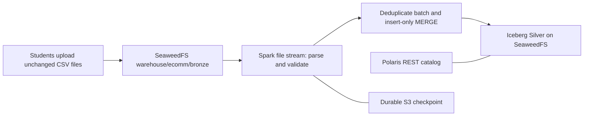

# Ecommerce: SeaweedFS CSV to Iceberg Silver

Run in the existing OpenShift Jupyter Python/PySpark kernel. Use a fresh kernel for each notebook. Polaris is the Iceberg REST catalog; SeaweedFS stores CSVs, Iceberg files and checkpoints. The image already supplies Spark/Iceberg/S3 libraries and credential environment variables.



Start with an empty Bronze prefix and an empty Silver table for a new class. Upload extracted CSV files from the supplied ZIP one at a time using unique object names. Do not upload the ZIP itself. No input files are rewritten or generated by this notebook.

```python
# Change these constants before running the notebook.
INPUT_PATH = "s3a://warehouse/ecomm/bronze"
OUTPUT_TABLE = "polaris.ecomm.silver"
OUTPUT_PATH = "s3://warehouse/iceberg/ecomm/silver"
CHECKPOINT_PATH = "s3a://warehouse/ecomm/checkpoints/bronze_to_silver"
APP_NAME = "ecomm-bronze-to-silver"
```

## Connect to the existing services
Credentials come from the Jupyter environment. Never paste them into a notebook.

```python
import os, socket
from pyspark.sql import SparkSession, functions as F

builder = (SparkSession.builder.appName(APP_NAME)
    .master("spark://spark-master:7077")
    .config("spark.driver.host", os.environ.get("POD_IP") or socket.gethostbyname(socket.gethostname()))
    .config("spark.driver.bindAddress", "0.0.0.0")
    .config("spark.cores.max", "1")
    .config("spark.executor.cores", "1")
    .config("spark.executor.memory", "512m")
    .config("spark.sql.shuffle.partitions", "2")
    .config("spark.sql.session.timeZone", "UTC")
    .config("spark.sql.extensions", "org.apache.iceberg.spark.extensions.IcebergSparkSessionExtensions")
    .config("spark.hadoop.fs.s3a.endpoint", "http://seaweedfs:8333")
    .config("spark.hadoop.fs.s3a.path.style.access", "true")
    .config("spark.hadoop.fs.s3a.connection.ssl.enabled", "false")
    .config("spark.hadoop.fs.s3a.aws.credentials.provider", "org.apache.hadoop.fs.s3a.SimpleAWSCredentialsProvider")
    .config("spark.hadoop.fs.s3a.access.key", os.environ["AWS_ACCESS_KEY_ID"])
    .config("spark.hadoop.fs.s3a.secret.key", os.environ["AWS_SECRET_ACCESS_KEY"])
    .config("spark.sql.catalog.polaris", "org.apache.iceberg.spark.SparkCatalog")
    .config("spark.sql.catalog.polaris.type", "rest")
    .config("spark.sql.catalog.polaris.rest.auth.type", "oauth2")
    .config("spark.sql.catalog.polaris.rest-metrics-reporting-enabled", "false")
    .config("spark.sql.catalog.polaris.uri", "http://polaris:8181/api/catalog")
    .config("spark.sql.catalog.polaris.oauth2-server-uri", "http://polaris:8181/api/catalog/v1/oauth/tokens")
    .config("spark.sql.catalog.polaris.header.Polaris-Realm", "POLARIS")
    .config("spark.sql.catalog.polaris.warehouse", "training")
    .config("spark.sql.catalog.polaris.scope", "PRINCIPAL_ROLE:ALL")
    .config("spark.sql.catalog.polaris.credential", os.environ["POLARIS_CLIENT_ID"] + ":" + os.environ["POLARIS_CLIENT_SECRET"])
    .config("spark.sql.catalog.polaris.io-impl", "org.apache.iceberg.aws.s3.S3FileIO")
    .config("spark.sql.catalog.polaris.s3.endpoint", "http://seaweedfs:8333")
    .config("spark.sql.catalog.polaris.s3.path-style-access", "true")
    .config("spark.sql.catalog.polaris.s3.access-key-id", os.environ["AWS_ACCESS_KEY_ID"])
    .config("spark.sql.catalog.polaris.s3.secret-access-key", os.environ["AWS_SECRET_ACCESS_KEY"])
    .config("spark.sql.catalog.polaris.client.region", "us-east-1")
    .config("spark.redaction.regex", "(?i)secret|password|token|access.?key|credential"))
spark = builder.getOrCreate()
spark.sparkContext.setLogLevel("WARN")
print(spark.version, spark.sparkContext.applicationId)
```

## Create Silver once
The table identifier is registered in Polaris. Its physical files live at OUTPUT_PATH. `IF NOT EXISTS` preserves an existing table: changing OUTPUT_PATH does not relocate it. Change constants together for a separate exercise.

```python
spark.sql(f"CREATE NAMESPACE IF NOT EXISTS {OUTPUT_TABLE.rsplit('.', 1)[0]}")
spark.sql(f"""CREATE TABLE IF NOT EXISTS {OUTPUT_TABLE} (
    LineID STRING, InvoiceNo STRING, StockCode STRING, Description STRING,
    Quantity INT, InvoiceDate TIMESTAMP, UnitPrice DECIMAL(18,2),
    CustomerID STRING, Country STRING, Amount DECIMAL(28,2)
) USING iceberg LOCATION '{OUTPUT_PATH}'
TBLPROPERTIES ('format-version'='2')""")
```

## Read and clean incoming files

CSV headers must match the supplied eight-column dataset. Timestamp format is `yyyy-MM-dd HH:mm:ss`, interpreted as UTC. Retain positive quantities and nonnegative prices; exclude cancellations (invoice prefix C) and missing invoice/product/customer/country/time. Description is optional. Invalid typed fields are filtered; malformed CSV fails visibly. Amount uses decimal arithmetic. These are sales excluding returns, not net revenue.

LineID represents an **exact cleaned row**, including description, quantity and price. Identical lines within or across files count once. Two legitimate identical lines cannot be distinguished without an upstream line identifier. A changed value produces a different LineID and is a new sale, not a correction. No watermark is required: the Silver table remembers keys across batches.

```python
raw = (spark.readStream.format("csv")
    .schema("InvoiceNo STRING, StockCode STRING, Description STRING, Quantity STRING, InvoiceDate STRING, UnitPrice STRING, CustomerID STRING, Country STRING")
    .option("header", "true").option("mode", "FAILFAST")
    .option("pathGlobFilter", "*.csv").option("maxFilesPerTrigger", 1)
    .load(INPUT_PATH))

sales = (raw.select([F.trim(F.col(c)).alias(c) for c in raw.columns])
    .withColumn("Quantity", F.expr("try_cast(Quantity AS INT)"))
    .withColumn("UnitPrice", F.expr("try_cast(UnitPrice AS DECIMAL(18,2))"))
    .withColumn("InvoiceDate", F.try_to_timestamp("InvoiceDate", F.lit("yyyy-MM-dd HH:mm:ss")))
    .filter("InvoiceNo <> '' AND StockCode <> '' AND CustomerID <> '' AND Country <> ''")
    .filter("InvoiceDate IS NOT NULL AND Quantity > 0 AND UnitPrice >= 0")
    .filter(~F.upper(F.col("InvoiceNo")).startswith("C")))

# No line number exists in the source. Hash the entire cleaned source row.
sales = (sales.withColumn("LineID", F.sha2(F.to_json(F.struct(*sales.columns)), 256))
    .withColumn("Amount", (F.col("Quantity") * F.col("UnitPrice")).cast("decimal(28,2)")))
sales.printSchema()
```

## Merge each micro-batch

`dropDuplicates` prevents repeated keys inside one batch. Insert-only MERGE ignores keys already in Silver, including a re-upload under a new filename and a retried batch after a crash. Use one Silver writer. There is deliberately no matched UPDATE or DELETE: the downstream stream requires append snapshots. Do not change that contract without redesigning the reader.

```python
def merge_silver(batch, batch_id):
    batch.dropDuplicates(["LineID"]).createOrReplaceTempView("incoming_sales")
    batch.sparkSession.sql(f"""MERGE INTO {OUTPUT_TABLE} t
        USING incoming_sales s ON t.LineID = s.LineID
        WHEN NOT MATCHED THEN INSERT *""")

writer = (sales.writeStream.foreachBatch(merge_silver)
    .outputMode("append").option("checkpointLocation", CHECKPOINT_PATH))
```

## Choose one trigger cell

**One-time processing:** `trigger(once=True)` runs one micro-batch and terminates. Its query supports `processAllAvailable()`, but does not need it: `awaitTermination()` waits for completion. Spark has no `processOnce()` method. In Spark 3.5, Once can ignore `maxFilesPerTrigger` and consume all currently available files; upload one file first to demonstrate one-file arrival.

**Recurring processing:** run the next cell only after the one-time query terminates. It checks for work every 15 seconds; `maxFilesPerTrigger=1` limits the recurring file source to one file per micro-batch. To drain all files currently visible while that query stays active, run `query.processAllAvailable()` in a separate cell. It can wait indefinitely if uploads keep arriving. Stop the query before changing modes. Both modes reuse the same durable checkpoint.

### A. Process once and wait

```python
query = writer.trigger(once=True).start()
query.awaitTermination()
```

### B. Run every 15 seconds (alternative to A)

```python
query = writer.trigger(processingTime="15 seconds").start()
# This cell returns while the query keeps polling. Upload the next CSV now.
```

### Drain currently visible input (recurring query only)

```python
query.processAllAvailable()
```

### Stop the recurring query

```python
query.stop()  # Stop before switching trigger mode or closing the kernel.
```

## Inspect Silver and commit types
Run after the one-time query, or after draining the recurring query. Snapshots must be append for notebook 02.

```python
spark.table(OUTPUT_TABLE).orderBy("InvoiceDate", "InvoiceNo").show(20, truncate=False)
spark.sql(f"SELECT operation, snapshot_id, summary FROM {OUTPUT_TABLE}.snapshots").show(truncate=False)
spark.sql(f"SELECT LineID, count(*) n FROM {OUTPUT_TABLE} GROUP BY LineID HAVING count(*) > 1").show()
```

## Finish
After stopping the query and inspecting results, release the Spark executor. Restart the kernel to run setup again.

```python
spark.stop()
```
