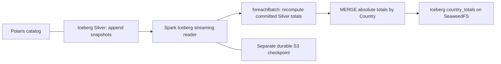

# Ecommerce: Iceberg Silver stream to country totals

Run notebook 01 through at least one successful commit first. Use a fresh kernel. Run the two notebooks in separate kernels for a live demonstration.



This teaching design uses the stream as the change notification and a batch aggregation of current Silver for exact lifetime totals. It avoids unbounded streaming state and supports exact distinct invoice counts. Each micro-batch scans Silver; this is appropriate for the small classroom dataset, not a large low-latency production workload.

```python
# Silver must match notebook 01. Use a separate checkpoint for this query.
INPUT_TABLE = "polaris.ecomm.silver"
INPUT_PATH = "s3://warehouse/iceberg/ecomm/silver"  # Documentation; reads resolve through Polaris.
OUTPUT_TABLE = "polaris.ecomm.country_totals"
OUTPUT_PATH = "s3://warehouse/iceberg/ecomm/country_totals"
CHECKPOINT_PATH = "s3a://warehouse/ecomm/checkpoints/silver_to_country"
APP_NAME = "ecomm-silver-to-country"
```

## Connect

```python
import os, socket
from pyspark.sql import SparkSession, functions as F

builder = (SparkSession.builder.appName(APP_NAME)
    .master("spark://spark-master:7077")
    .config("spark.driver.host", os.environ.get("POD_IP") or socket.gethostbyname(socket.gethostname()))
    .config("spark.driver.bindAddress", "0.0.0.0")
    .config("spark.cores.max", "1")
    .config("spark.executor.cores", "1")
    .config("spark.executor.memory", "512m")
    .config("spark.sql.shuffle.partitions", "2")
    .config("spark.sql.session.timeZone", "UTC")
    .config("spark.sql.extensions", "org.apache.iceberg.spark.extensions.IcebergSparkSessionExtensions")
    .config("spark.hadoop.fs.s3a.endpoint", "http://seaweedfs:8333")
    .config("spark.hadoop.fs.s3a.path.style.access", "true")
    .config("spark.hadoop.fs.s3a.connection.ssl.enabled", "false")
    .config("spark.hadoop.fs.s3a.aws.credentials.provider", "org.apache.hadoop.fs.s3a.SimpleAWSCredentialsProvider")
    .config("spark.hadoop.fs.s3a.access.key", os.environ["AWS_ACCESS_KEY_ID"])
    .config("spark.hadoop.fs.s3a.secret.key", os.environ["AWS_SECRET_ACCESS_KEY"])
    .config("spark.sql.catalog.polaris", "org.apache.iceberg.spark.SparkCatalog")
    .config("spark.sql.catalog.polaris.type", "rest")
    .config("spark.sql.catalog.polaris.rest.auth.type", "oauth2")
    .config("spark.sql.catalog.polaris.rest-metrics-reporting-enabled", "false")
    .config("spark.sql.catalog.polaris.uri", "http://polaris:8181/api/catalog")
    .config("spark.sql.catalog.polaris.oauth2-server-uri", "http://polaris:8181/api/catalog/v1/oauth/tokens")
    .config("spark.sql.catalog.polaris.header.Polaris-Realm", "POLARIS")
    .config("spark.sql.catalog.polaris.warehouse", "training")
    .config("spark.sql.catalog.polaris.scope", "PRINCIPAL_ROLE:ALL")
    .config("spark.sql.catalog.polaris.credential", os.environ["POLARIS_CLIENT_ID"] + ":" + os.environ["POLARIS_CLIENT_SECRET"])
    .config("spark.sql.catalog.polaris.io-impl", "org.apache.iceberg.aws.s3.S3FileIO")
    .config("spark.sql.catalog.polaris.s3.endpoint", "http://seaweedfs:8333")
    .config("spark.sql.catalog.polaris.s3.path-style-access", "true")
    .config("spark.sql.catalog.polaris.s3.access-key-id", os.environ["AWS_ACCESS_KEY_ID"])
    .config("spark.sql.catalog.polaris.s3.secret-access-key", os.environ["AWS_SECRET_ACCESS_KEY"])
    .config("spark.sql.catalog.polaris.client.region", "us-east-1")
    .config("spark.redaction.regex", "(?i)secret|password|token|access.?key|credential"))
spark = builder.getOrCreate()
spark.sparkContext.setLogLevel("WARN")
print(spark.version, spark.sparkContext.applicationId)
```

## Create the Gold table

```python
spark.sql(f"CREATE NAMESPACE IF NOT EXISTS {OUTPUT_TABLE.rsplit('.', 1)[0]}")
spark.sql(f"""CREATE TABLE IF NOT EXISTS {OUTPUT_TABLE} (
    Country STRING, TotalOrders BIGINT, TotalAmount DECIMAL(38,2)
) USING iceberg LOCATION '{OUTPUT_PATH}'
TBLPROPERTIES ('format-version'='2')""")
```

## Read Silver and compute lifetime totals

TotalOrders is the number of distinct InvoiceNo values **per country**, not invoice lines or units. An invoice split over files still counts once. TotalAmount sums accepted, deduplicated line amounts. Both cover all history in Silver.

The streaming DataFrame identifies new snapshots; the callback reads the latest committed Silver state and replaces each country's totals with absolute values. It may include a newer upstream commit than the triggering micro-batch; the result represents the current committed Silver view, not an event-time cutoff. Replaying a batch cannot double-add revenue. No watermark or hourly window is used.

Keep Silver append-only. The reader deliberately fails on unsupported overwrite/delete snapshots instead of skipping sales silently. Do not run Silver updates, deletes, or snapshot expiration during the exercise. Gold MERGE updates are safe because Gold is queried with batch reads, not streamed here.

```python
silver = spark.readStream.format("iceberg").load(INPUT_TABLE)

def merge_country_totals(batch, batch_id):
    # Recompute lifetime totals from committed Silver, not just this micro-batch.
    # Absolute totals make a retry safe; do not add the batch amount to the target.
    totals = (spark.table(INPUT_TABLE).groupBy("Country")
        .agg(F.countDistinct("InvoiceNo").alias("TotalOrders"),
             F.sum("Amount").alias("TotalAmount")))
    totals.createOrReplaceTempView("current_country_totals")
    spark.sql(f"""MERGE INTO {OUTPUT_TABLE} t
        USING current_country_totals s ON t.Country = s.Country
        WHEN MATCHED THEN UPDATE SET *
        WHEN NOT MATCHED THEN INSERT *""")

writer = (silver.writeStream.foreachBatch(merge_country_totals)
    .outputMode("append").option("checkpointLocation", CHECKPOINT_PATH))
```

## Choose one trigger cell

**One-time processing:** `trigger(once=True)` runs one micro-batch and terminates. Its query supports `processAllAvailable()`, but does not need it: `awaitTermination()` waits for completion. Spark has no `processOnce()` method. In Spark 3.5, Once can ignore `maxFilesPerTrigger` and consume all currently available files; upload one file first to demonstrate one-file arrival.

**Recurring processing:** run the next cell only after the one-time query terminates. It checks for work every 15 seconds; `maxFilesPerTrigger=1` limits the recurring file source to one file per micro-batch. To drain all files currently visible while that query stays active, run `query.processAllAvailable()` in a separate cell. It can wait indefinitely if uploads keep arriving. Stop the query before changing modes. Both modes reuse the same durable checkpoint.

### A. Process once and wait

```python
query = writer.trigger(once=True).start()
query.awaitTermination()
```

### B. Run every 15 seconds (alternative to A)

```python
query = writer.trigger(processingTime="15 seconds").start()
# This cell returns while the query keeps polling. Upload the next CSV now.
```

### Drain visible Silver commits (recurring query only)

```python
query.processAllAvailable()
```

### Stop the recurring query

```python
query.stop()  # Stop before switching trigger mode or closing the kernel.
```

## Inspect the country totals

```python
spark.table(OUTPUT_TABLE).orderBy(F.desc("TotalAmount")).show(50, truncate=False)
```

## Finish
After stopping the query and inspecting results, release the Spark executor. Restart the kernel to run setup again.

```python
spark.stop()
```
