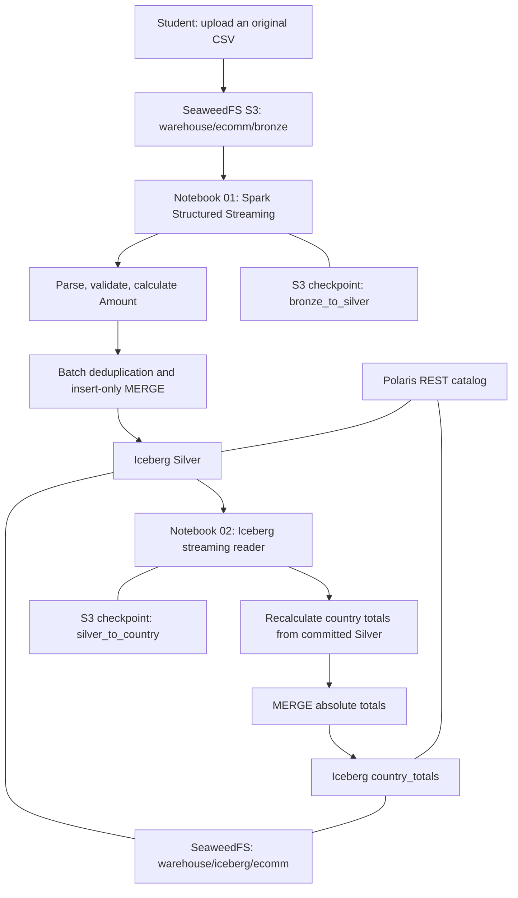
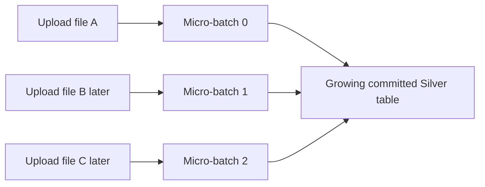
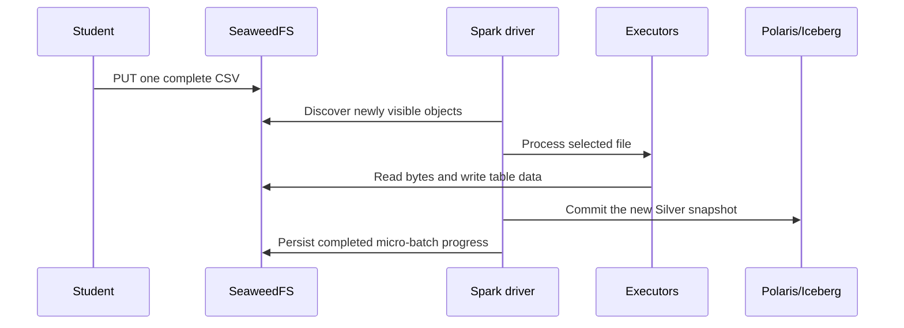
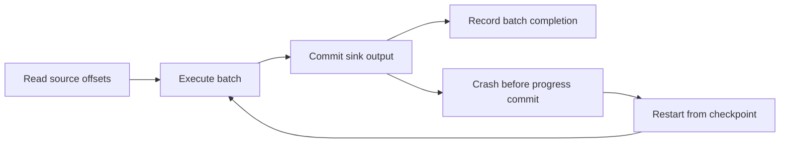

# Spark Structured Streaming: a classroom data lake

Presentation and speaker notes for the OpenShift ecommerce exercise. Read alongside `01-bronze-to-silver.ipynb` and `02-silver-to-country-totals.ipynb`. The examples use the existing Spark 3.5 cluster, Polaris REST catalog, Iceberg tables and SeaweedFS S3 service. No new container image is needed.

---

## 1. The business question

Sales CSV files arrive throughout the day. Students upload each file to object storage. The business wants trustworthy sales records and a continuously refreshed answer to two questions:

- How many distinct orders have we received from each country?
- What is their total accepted sales amount?

An invoice can have many product lines. Counting rows would overstate orders. A delivery can be uploaded twice. Summing raw files would overstate sales. The pipeline must address both problems.

Speaker notes: Ask students whether ten rows necessarily mean ten orders. Then show two lines with the same InvoiceNo. Next ask what happens if yesterday's file is uploaded under another name. The streaming source and business deduplication solve different problems.

---

## 2. End-to-end architecture



There are two independent streaming queries. Notebook 01 owns Silver. Notebook 02 owns country_totals. Run them in separate kernels for a live demonstration. Each has its own checkpoint and one writer.

The VM worker must advertise at least two Spark cores so that both one-core notebook applications can run. Validation enables its second core within the existing pod CPU and memory limits. Stop both queries and their Spark sessions after the lesson to release their executors.

---

## 3. What each platform component does

| Component | Responsibility | What it stores or executes |
|---|---|---|
| SeaweedFS | S3 compatible object storage | Original CSVs, Parquet data, Iceberg metadata, checkpoints |
| Polaris | Iceberg REST catalog | Namespaces, table registration, access control and metadata pointers |
| Iceberg | Table format and commit protocol | Snapshots, manifests, schemas and references to data files |
| Spark driver | Coordinates the query | File discovery, plans, micro-batch scheduling and commits |
| Spark executors | Run distributed tasks | CSV parsing, filtering, shuffles, aggregation and writes |
| OpenShift | Runs the existing services | Pods, Services, networking, Secrets and persistent storage |
| Jupyter | Interactive student interface | Notebook code and the live Spark driver process |

Polaris is not the storage engine. SeaweedFS is not the catalog. Iceberg is not a server that replaces Spark. Spark reads and writes objects using S3 APIs while Polaris resolves table identities and coordinates table metadata commits.

---

## 4. The paths and table names

| Purpose | Default |
|---|---|
| Raw CSV landing prefix | `s3a://warehouse/ecomm/bronze` |
| Silver table identifier | `polaris.ecomm.silver` |
| Silver physical location | `s3://warehouse/iceberg/ecomm/silver` |
| Country totals identifier | `polaris.ecomm.country_totals` |
| Country totals location | `s3://warehouse/iceberg/ecomm/country_totals` |
| Notebook 01 checkpoint | `s3a://warehouse/ecomm/checkpoints/bronze_to_silver` |
| Notebook 02 checkpoint | `s3a://warehouse/ecomm/checkpoints/silver_to_country` |

The existing training catalog allows Iceberg table locations beneath `s3://warehouse/iceberg`. That is why tables use this prefix while students upload to `warehouse/ecomm/bronze`. Keeping the current catalog policy avoids an infrastructure change.

`s3a://` selects Hadoop's S3 connector for file sources and checkpoints. Iceberg's S3FileIO uses `s3://` for table storage. Both address the same SeaweedFS bucket; the schemes select different client libraries.

Change constants at the top before creating a query. The second notebook's INPUT_TABLE must match the first notebook's OUTPUT_TABLE. An existing table retains its registered location even if a notebook's OUTPUT_PATH is edited.

---

## 5. Batch processing and streaming

A batch query processes a bounded dataset and returns a result. A streaming query describes how to process a dataset that may continue growing. Structured Streaming lets us describe transformations with familiar DataFrame operations while Spark keeps discovering additional input.

The classroom data is historical, but its arrival is incremental. Event time can be in 2011 while processing happens today. A stream does not require current timestamps, Kafka, or a sensor.



Speaker notes: Streaming is a way of handling arrival over time. The arrival mechanism here is a prefix containing completed files. Students control arrival simply by uploading another CSV.

---

## 6. Micro-batches

Spark's default Structured Streaming engine groups newly available input into small batches. For each batch it determines input, executes a plan, invokes the output operation and records progress.



The 15 second trigger is a scheduling interval, not a promise that every result appears in 15 seconds. If a batch takes longer, the next batch waits. Slow processing does not cause Spark to overlap batches within the same query.

---

## 7. A query definition is lazy

`readStream` defines the source. Filtering, casting and adding columns define a plan. They do not start continuous execution. `printSchema()` can describe a streaming DataFrame without consuming files.

`writeStream` describes how output should be handled. `start()` creates the active StreamingQuery. Its Python variable is called `query` in the notebooks.

```text
readStream -> transformations -> writeStream -> trigger -> start()
                                                        |
                                                 active query
```

Do not run `.collect()` or `.show()` directly on the unbounded streaming DataFrame. Inspect the committed output table with a normal `spark.table(...)` batch query instead.

---

## 8. File arrival rules

Extract the supplied ZIP outside the Bronze prefix. Upload individual original CSVs into `warehouse/ecomm/bronze`. Preserve their bytes and give each delivery a unique object name. Upload one, drain the query, inspect the result, then upload the next.

Object-store directories are key prefixes rather than ordinary filesystem folders. The prefix must exist or contain an initial CSV before constructing the file stream. A folder marker can make an empty prefix visible. The notebook filters for `*.csv`, so the marker is not data.

Never edit an object after ingestion. Do not reuse an old filename for corrected data: Spark's file source tracks seen paths and is not a general object-change feed. Do not upload temporary partial CSVs into the watched prefix. Publish a completed object through the S3 API.

The notebook reads the supplied eight-column schema explicitly. Inferring schema independently on every arrival would make type behavior dependent on whichever small file happened to arrive first.

---

## 9. The Silver contract

The input columns are InvoiceNo, StockCode, Description, Quantity, InvoiceDate, UnitPrice, CustomerID and Country.

Notebook 01 trims fields, converts Quantity to integer, UnitPrice to decimal and InvoiceDate to timestamp. It rejects missing required business fields, invalid dates, invalid numbers, nonpositive quantities and negative prices. Invoices beginning with C are cancellations and are excluded. A zero price is allowed. Description is optional.

Amount is Quantity multiplied by UnitPrice with decimal arithmetic. Three units at 2.50 produce 7.50. Binary floating point is avoided for sales amounts. Accepted timestamps are interpreted as UTC for a consistent classroom convention; the export does not carry a timezone.

The output describes sales excluding returns. It does not describe net revenue after refunds, tax, foreign exchange or invoice corrections. Invalid semantic rows are filtered in this compact exercise. A production ingestion design should retain rejected data and rejection reasons for operational review.

---

## 10. Two levels of duplicate detection

| Situation | Mechanism | Result |
|---|---|---|
| Same source path is visible again | File-source checkpoint | Normally not read again |
| Exact duplicate lines in one admitted batch | `dropDuplicates(["LineID"])` | One merge candidate |
| Same business line appears in a later file | MERGE against committed Silver | Existing LineID is not inserted |
| File delivered again under another name | File source reads it; MERGE recognizes LineID | No duplicated sale |
| Callback completes, driver crashes before checkpoint commit | Retried MERGE matches existing keys | No duplicated sale |

The checkpoint handles source progress. The table merge handles business identity and sink retries. A checkpoint alone cannot recognize duplicate content delivered with another path.

---

## 11. What is a line identity?

The dataset has invoice numbers and product codes but no unique invoice-line identifier. InvoiceNo alone is too broad: one invoice has many lines. InvoiceNo plus StockCode can also be too broad if a product is split across legitimate lines.

The exercise creates LineID as a SHA-256 hash of the entire typed, trimmed source row. The Amount field is derived afterward. That defines an explicit policy: an exact cleaned source row represents one accepted line.

Two legitimate identical rows cannot be distinguished with this dataset. They will collapse. Changing quantity, price, date or description makes a different identity, so it becomes a new sale rather than updating the old one. A production contract should provide a stable line ID and a correction/version rule.

Speaker notes: A hash implements an identity rule; it cannot discover the right business identity for us. Ask students which upstream column would remove this ambiguity.

---

## 12. Why use foreachBatch?

`foreachBatch` supplies a bounded DataFrame and a batch ID to a Python callback for each micro-batch. Inside that callback, ordinary batch operations such as temporary SQL views and MERGE can run.

Notebook 01 has one short callback: deduplicate the current batch, expose its rows as a temporary view, then insert only keys absent from Silver.

```sql
MERGE INTO silver t
USING incoming_sales s ON t.LineID = s.LineID
WHEN NOT MATCHED THEN INSERT *
```

Matched rows are left alone. This is an insert-only merge, not a general upsert. The validation checks that this exact query produces append snapshots on the installed Iceberg version. Do not add an UPDATE clause and assume the downstream stream still has the same behavior.

---

## 13. Checkpointing and recovery

Each query stores offsets and completed batch progress at its checkpoint path. A checkpoint belongs to one logical query. Notebook 01 and notebook 02 must never share it.



A failure between sink commit and progress commit may repeat the callback. `foreachBatch` should be treated as at least once. The callbacks in these notebooks make repeated work safe: Silver inserts only missing LineIDs; Gold replaces absolute country totals.

Stopping a query does not delete its checkpoint or its tables. Restart with the same logical source, sink and checkpoint to continue. Changing a source path, table identity or query plan substantially can require a fresh checkpoint. A fresh checkpoint replays source history; deduplication remains important.

---

## 14. One-time processing

The first trigger cell starts a query with `trigger(once=True)` and waits using `awaitTermination()`. It executes one micro-batch and terminates. It is useful for a classroom cycle: upload, process once, inspect.

```python
query = writer.trigger(once=True).start()
query.awaitTermination()
```

Spark has no `processOnce()` method. `processAllAvailable()` is a method on an already running StreamingQuery. It is not a trigger name.

Spark 3.5 can ignore `maxFilesPerTrigger` for Once and process the currently available backlog in one batch. Upload only one file before the first run if the demonstration must show a single arrival. Once is deprecated in favor of AvailableNow in newer Spark guidance, but is retained here to make the requested one-batch mode explicit. AvailableNow can drain admitted input in multiple batches and then stop; it is mentioned for context rather than added as another student solution.

---

## 15. Recurring processing

The alternative trigger cell schedules work every 15 seconds:

```python
query = writer.trigger(processingTime="15 seconds").start()
```

The cell returns while the query remains active. Upload the next CSV through the S3 API. With the recurring file source, `maxFilesPerTrigger=1` admits at most one new file per micro-batch. It controls file admission, not the number of rows or total processing time.

Use a separate cell to drain input currently visible:

```python
query.processAllAvailable()
```

This waits for current backlog and does not stop the query. It can wait for a long time if uploads continue. It is especially useful for a deterministic demonstration: upload, drain Bronze-to-Silver, then drain Silver-to-country.

Stop explicitly with `query.stop()`. Do not start Once and ProcessingTime queries concurrently against the same checkpoint. The cells are alternatives; do not run the entire notebook blindly with Run All.

---

## 16. What Iceberg streaming reads

Notebook 02 resolves the Silver table through Polaris and reads Iceberg snapshots. A new stream begins with existing table data and then follows new append snapshots. Its checkpoint remembers progress across runs.

Iceberg's Spark streaming source supports append snapshots. Overwrite and delete snapshots are different: they can replace or remove rows already delivered. Ignoring them can silently produce wrong results. These notebooks deliberately do not enable skip-overwrite or skip-delete options.

Silver is therefore append-only after deduplication. No matched update or delete is permitted during the exercise. Gold can use matched updates because Gold is not a streaming source in this pipeline.

Do not run destructive maintenance or expire snapshots needed by a reader during a class. Compaction and snapshot retention need coordination in a production deployment.

---

## 17. Country totals and exact order counts

TotalOrders is `countDistinct(InvoiceNo)` within each Country. TotalAmount is the sum of accepted deduplicated Amount values.

Suppose invoice 100 has two UK lines worth 10.00 and 15.00. The UK result is one order and 25.00, not two orders. If another file later supplies a third line on that invoice worth 5.00, the result becomes one order and 30.00. If the original file is replayed, it stays one order and 30.00.

Country is part of the grouping. If the source inconsistently assigns the same invoice to two countries, each country's distinct count includes it. The exercise does not invent a master invoice-country correction rule.

---

## 18. Stream notification, batch calculation

The Silver stream invokes a callback when new rows arrive. Inside that callback, the notebook reads the full latest committed Silver table and recalculates country totals with ordinary batch aggregation.

This avoids unsupported exact distinct operations in a simple streaming aggregate and avoids keeping all historical invoice IDs in an ever-growing streaming state store. It also makes retry behavior easy to inspect.

The cost is a full Silver scan for every triggered micro-batch. This is intentional for a small teaching dataset. It is not a high-volume incremental aggregation design.

The callback may observe a newer Silver commit than the particular streaming batch that invoked it. Gold represents the committed Silver view used by the callback, not an event-time cutoff or an isolated per-batch snapshot. Stop uploads or drain both streams before comparing final totals.

---

## 19. Why Gold uses absolute values

The Gold callback merges one row per country. Matched countries receive the newly calculated absolute TotalOrders and TotalAmount. New countries are inserted.

If the callback is retried, the same absolute value replaces the previous value. It does not add revenue again. An expression such as `target.TotalAmount + source.BatchAmount` would require additional transactional batch tracking to avoid duplicate additions.

There is no delete clause because Silver never removes accepted lines in this exercise. If Silver becomes mutable, disappearing countries and corrected values require a different source and reconciliation contract.

---

## 20. Event time, processing time and watermarks

Event time is the InvoiceDate recorded in the file. Processing time is when Spark handles the file. Arrival time is when the object becomes visible in SeaweedFS. They can be very different.

The country totals cover all accepted history. They have no event-time window and no watermark. An old invoice arriving today can still contribute to lifetime totals.

A watermark is useful when a stateful event-time operation needs a rule for how long to wait for late data and how long to retain state. It is not a generic duplicate-removal switch. A bounded watermark would deliberately stop remembering old keys; Silver's persistent key matching has a different purpose.

Speaker notes: Ask whether a 2011 file uploaded now would be dropped by these notebooks. The answer is no, if its rows satisfy the acceptance rules.

---

## 21. Demonstration sequence

1. Open both notebooks in separate fresh kernels; inspect the top constants.
2. Ensure the Bronze prefix is visible, then upload the first original CSV.
3. Run notebook 01 setup, table creation, transformations and writer definition.
4. Run its Once cell, then inspect Silver and snapshot operations.
5. Run notebook 02 definitions and Once cell; inspect country totals.
6. Upload the second CSV. Rerun Once in notebook 01, then notebook 02.
7. Upload the first CSV under a fresh filename. Process both again. Totals should not increase because of the replay.
8. Start the recurring cells in both notebooks. Upload another original CSV.
9. Drain notebook 01, then notebook 02. Inspect the new output.
10. Stop both queries before shutting down their kernels.

This sequence needs no input conversion, no Kafka and no new image. Test artifacts use separate paths and table names so they do not pre-load the classroom tables.

---

## 22. Observe the query

`query.isActive` tells you whether a query is still running. `query.status` reports what it is doing. `query.lastProgress` includes the most recent batch statistics when a batch has completed. `query.exception()` exposes a query failure.

Use the existing Spark UI to inspect jobs, stages, executors and SQL plans. A long batch can reflect a CSV read, a deduplication shuffle, a table scan or a commit. Empty input is a normal idle condition.

Use batch queries against Silver and Gold to verify business output. Use Silver's `.snapshots` metadata table to verify append operations. A running query alone is not evidence that amounts or duplicate handling are correct.

---

## 23. Common classroom failures

| Symptom | Likely cause | Action |
|---|---|---|
| File source path missing | Empty Bronze prefix has no marker or CSV | Create the prefix or upload the first original CSV before defining the source |
| Polaris rejects table location | Path outside training catalog's allowed prefix | Use the supplied `warehouse/iceberg/ecomm` table locations |
| CSV is not discovered | Wrong prefix, non-CSV suffix, or already seen path | Inspect INPUT_PATH and use a unique delivery filename |
| No new Silver rows | File contains only duplicates or rejected sales | Inspect source fields and the deduplication contract |
| Gold appears behind Silver | Downstream trigger has not processed the commit | Drain upstream first, then downstream |
| Streaming reader rejects a snapshot | Silver was updated, overwritten or deleted | Restore an append-only teaching flow; do not silently skip changes |
| New kernel uses old Spark settings | Existing SparkContext was reused | Restart that notebook's kernel before setup |
| Checkpoint errors | Two queries share it or its source/plan changed | Stop conflicting query and restore matching configuration |

---

## 24. What the validation proves

The validation executes the actual notebook definition cells on the VM's distributed Spark runtime. It uploads original ZIP members unchanged, tests separated arrivals, re-delivery with a different filename, checkpoint reuse, replay through a fresh upstream checkpoint, and recurring triggers.

An independent Python CSV and Decimal calculation checks accepted exact-line identities, distinct invoices by country and sales amounts. The complete archive is compared with the resulting tables. Silver snapshot operations and physical SeaweedFS locations are checked.

See `VALIDATION.md` and `verification-results.json` for the actual run and counts. This checks classroom behavior on the installed versions; it does not claim exhaustive production fault-injection or throughput testing.

---

## 25. Discussion prompts

- Why is a file checkpoint insufficient when a delivery gets a new name?
- Why is InvoiceNo not a unique invoice-line key?
- What extra source field would allow correction handling without ambiguity?
- Why does Gold replace absolute totals instead of incrementing them?
- Why would skipping overwrite snapshots be dangerous for a general Silver upsert?
- Where would you record rejected rows in a production design?
- What part of this teaching architecture becomes expensive as Silver grows?

The answers connect arrival tracking, business identity, retry semantics and table change semantics. These are separate decisions even when a small notebook expresses them in a few lines.

---

## References for the presenter

- [Apache Spark 3.5.9 Structured Streaming guide](https://spark.apache.org/docs/3.5.9/structured-streaming-programming-guide.html): micro-batches, triggers, checkpointing and foreachBatch semantics.
- [Apache Iceberg Structured Streaming](https://iceberg.apache.org/docs/latest/spark-structured-streaming/): append-snapshot reader contract and operational considerations.
- [Apache Iceberg Spark writes](https://iceberg.apache.org/docs/latest/spark-writes/): MERGE and table writes.

The checked-in validation identifies the actual installed Spark and Iceberg behavior used for this lesson. Newer documentation may describe additional capabilities; do not assume they exist in an older runtime.
