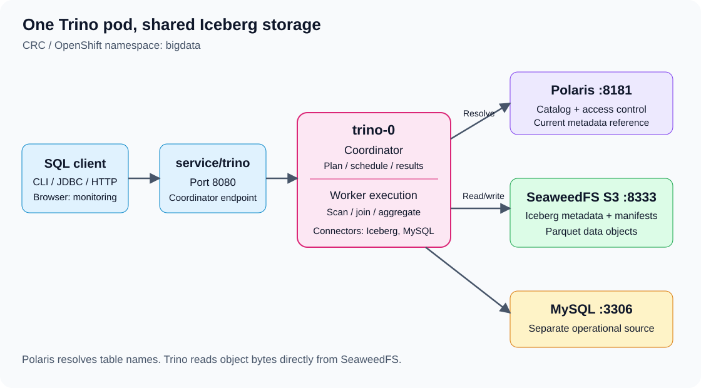
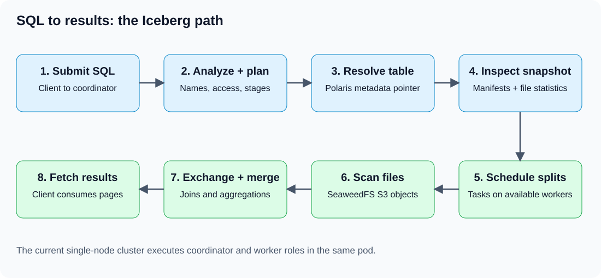
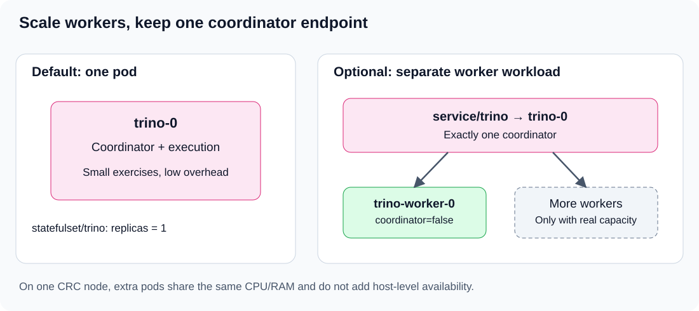

# 00 — Trino introduction

Open the Linux desktop through Guacamole. CRC, OpenShift, Trino, Polaris and SeaweedFS are already deployed. Use a terminal on the host for `oc` commands and the browser on the same desktop for the web UI.

## 1. What is Trino?

Trino is a distributed SQL query engine. It accepts SQL, plans the work and executes it across available processing nodes. Connectors let it read and write supported external systems. Trino itself does not replace the databases or object store holding the business data.

For example, one query can combine Iceberg sales in object storage with customer records in MySQL:

```sql
SELECT c.customer_name, sum(s.line_amount) AS revenue
FROM iceberg_polaris.trino_ecomm_s01.silver_order_lines s
JOIN mysql.trino_ecomm.trino_s01_customers c
  ON s.customer_id = c.customer_id
GROUP BY c.customer_name;
```

This example becomes runnable after exercises 01 and 02. It illustrates federation: one SQL statement spans different storage systems. It does not imply an atomic transaction across those systems.

## 2. Why use it?

| Need | Trino's role |
|---|---|
| Query Iceberg with SQL | Read table metadata through a catalog and scan selected files |
| Combine database and lake data | Join supported sources through connectors |
| Interactive analytics | Execute joins, filters, aggregates and window functions |
| Separate storage from compute | Retain tables in the lake while query processes stop or scale |
| Share tables with Spark | Use compatible Iceberg tables registered in the same Polaris catalog |

Use Trino for analytical SQL. Keep transaction processing in the operational database. Use Spark where the exercise needs a Spark batch/streaming application. Use Airflow to coordinate tasks and dependencies. Trino is not a streaming ingestion service, and its monitoring UI is not a general SQL editor.

## 3. Architecture on the current CRC host



The existing `trino-0` pod performs two roles:

- **Coordinator:** receives SQL, analyzes it, creates the execution plan, schedules tasks and gathers results.
- **Worker:** executes scheduled tasks, reads source data, exchanges intermediate results and produces partial output.

The current configuration has `coordinator=true` and `node-scheduler.include-coordinator=true`. This is a compact single-node Trino cluster suited to the small exercises. It does not have a separate worker StatefulSet by default.

| Component | Purpose |
|---|---|
| Client: CLI, JDBC or HTTP | Submit SQL and fetch results |
| `service/trino:8080` | Stable internal coordinator endpoint |
| `statefulset/trino`, pod `trino-0` | Current coordinator plus query execution |
| Connector | Translate supported operations to a particular source |
| Polaris | Resolve Iceberg names and current metadata references; enforce catalog permissions |
| SeaweedFS S3 | Store Iceberg metadata, manifests and Parquet objects |
| MySQL | Store operational tables; introduced after the Iceberg exercise |

## 4. How one Iceberg query works



For `SELECT country, sum(line_amount) ... GROUP BY country`:

1. The client sends SQL to the coordinator.
2. Trino parses the SQL, resolves names and checks access.
3. The Iceberg connector asks Polaris for the table's current metadata location.
4. Trino reads Iceberg metadata and manifests from SeaweedFS. The snapshot identifies the valid files; partition and file statistics can eliminate unnecessary reads.
5. The coordinator creates stages and schedules tasks. A split describes a portion of source work; a task processes work for a stage. Parallel execution uses multiple splits/tasks where useful.
6. Workers read selected files through SeaweedFS's S3 API. They filter, join or aggregate as the plan requires. Exchanges move intermediate data between stages when needed.
7. Partial results are combined and returned through the coordinator. The client continues fetching result pages until the query finishes.

An Iceberg write creates data/metadata objects and commits the new table metadata through the catalog. A successful object upload alone is not a committed table update. Do not manually remove files belonging to an Iceberg table.

## 5. Polaris, Iceberg, Parquet and SeaweedFS

| Name | What it describes |
|---|---|
| `iceberg_polaris` | Trino's configured catalog alias |
| `training` in the Polaris connector | Existing Polaris catalog/warehouse setting; unrelated to a MySQL database name |
| `trino_ecomm_s01` | Iceberg namespace used by the exercises |
| `silver_order_lines` | Iceberg table name |
| `s3://warehouse/iceberg/...` | Bucket and object location |
| `http://seaweedfs:8333` | S3-compatible service endpoint inside OpenShift |

Polaris holds catalog references and authorization state. Iceberg's metadata files describe table schema, snapshots and files. SeaweedFS stores those metadata files and the Parquet data. Trino needs both catalog access and storage access. A successful namespace listing does not prove that a data-file read will succeed.

## 6. Connect to the existing Trino service

In the host terminal:

```bash
cd ~/openshift/08-OpenShift-Trino-Iceberg-Ecommerce
export PATH="$HOME/.crc/bin/oc:$PATH"
oc get pod -n bigdata trino-0 seaweedfs-0
oc get pods -n bigdata -l app=polaris
oc get svc -n bigdata trino polaris seaweedfs
oc exec -it -n bigdata trino-0 -- trino --server http://localhost:8080 --user team
```

At the Trino prompt:

```sql
SET SESSION task_concurrency = 1;
SET SESSION query_max_run_time = '2m';
SET SESSION query_max_memory = '128MB';
SELECT version();
SHOW CATALOGS;
SHOW SCHEMAS FROM iceberg_polaris;
SELECT count(*) AS nations FROM tpch.tiny.nation;
SELECT node_id, coordinator, state FROM system.runtime.nodes;
```

Expected: Trino 476, 25 nations and one active coordinator node in the default layout. Use `quit` to leave the CLI. Session settings must be repeated in a new session. They do not change server configuration.

The default exercise profile accepts the query identity `team` without a password. For immediate browser monitoring, use a host-loopback port-forward. Optional password authentication and the prepared HTTPS Route are explained separately in [web UI and access](05-trino-web-ui-and-access.md).

## 7. Scaling: what changes and what does not



**Do not scale `statefulset/trino` above one replica.** Every replica would use coordinator configuration, and the existing Service could send clients to different coordinators. That is not worker scale-out or coordinator high availability.

To add processing capacity, provision a separate workload configured with `coordinator=false`. All workers must discover the same coordinator, use the same Trino release and environment, and have matching connector configuration plus access to the required data systems. Their node IDs must be unique. Route client requests to the coordinator only.

The optional [worker manifest](trino-workers.yaml) starts at **zero replicas**. [Operations](04-trino-operations.md) explains review, one-worker startup, verification and scale-down. The coordinator can keep executing tasks in this small demonstration; a larger deployment commonly dedicates it to coordination after separate worker capacity exists.

CRC has one OpenShift node on the same constrained host. More pods do not create more physical CPU or RAM, and they do not add node-level fault tolerance. Start at most one optional worker for the demonstration. Query memory, coordinator planning, source database load, network exchanges and storage throughput can all limit performance; more workers are not a universal speed-up.

## 8. Start, stop and web access

Keep the existing services running during the data exercises. Start/stop commands are lifecycle operations, not prerequisites to repeat on every page. Use [operations](04-trino-operations.md) when intentionally changing the running state; it includes direct `oc scale` commands and preserves the existing PVC.

Use [web UI and access](05-trino-web-ui-and-access.md) for query monitoring, the optional Route and username/password configuration. A Route exposes an endpoint; it does not create Trino users or passwords.

Next: [Trino with Iceberg, Polaris and SeaweedFS](01-iceberg-polaris-seaweedfs.md).

## References

[Trino 476 deployment and node roles](https://github.com/trinodb/trino/blob/476/docs/src/main/sphinx/installation/deployment.md), [Iceberg connector](https://github.com/trinodb/trino/blob/476/docs/src/main/sphinx/connector/iceberg.md), and [client protocol](https://trino.io/docs/current/develop/client-protocol.html). The diagrams describe this exercise's architecture; they are not live cluster screenshots.
