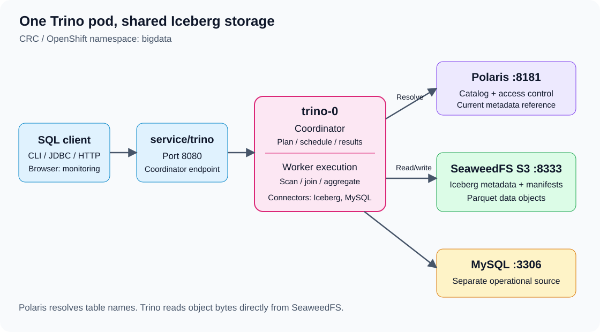
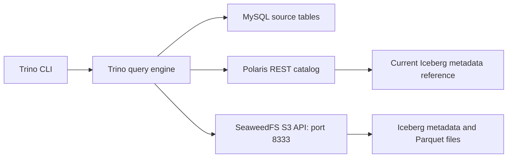

# Trino ecommerce: MySQL, Iceberg, Polaris and SeaweedFS

Open the Linux desktop through Guacamole. CRC, OpenShift and the required services are already deployed. Open a terminal on the Linux host and run the exercises from `~/openshift`. Use the browser on the same desktop for service UIs.

| Lesson | Exercise | Result |
|---|---|---|
| [00: Trino introduction](00-trino-introduction.md) | Purpose, architecture, execution, storage and scaling | Illustrated foundation and connection steps |
| [01: Iceberg, Polaris and SeaweedFS](01-iceberg-polaris-seaweedfs.md) | Seed Iceberg directly; build Bronze, Silver and Gold | Lakehouse tables without a MySQL prerequisite |
| [02: MySQL and federation](02-trino-mysql-ecommerce.md) | Create a dedicated MySQL database and matching source data | Source analytics and comparison with Iceberg |
| [03: Incremental processing](03-incremental-federation.md) | Add an order; MERGE, replay, federate and reconcile | Correct incremental totals and time travel |
| [04: Operations](04-trino-operations.md) | Start/stop, optional separate workers, diagnostics and cleanup | Lifecycle commands kept apart from data exercises |
| [05: Web UI and access](05-trino-web-ui-and-access.md) | Loopback UI, optional HTTPS Route and password profile | Explicit access and authentication configuration |

Read 00, then run 01, 02 and 03 in order. Use 04 and 05 only for the particular operation needed; their configuration changes are optional. Use one SQL session and one writer at a time. The Iceberg seed has six orders and nine lines. Exercise 02 creates four customers, three products and the matching source orders in MySQL. Exercise 03 adds one order and one line. Amounts use one reporting currency, CU. Revenue excludes tax, shipping, refunds, pending orders and cancelled orders.

## Architecture

Trino executes SQL. Polaris resolves Iceberg table names and authorizes catalog operations. SeaweedFS stores Iceberg objects. Table bytes do not pass through Polaris. Iceberg is a table format, Parquet is a file format, and S3 is an object access protocol.

## Environment

| Item | Value |
|---|---|
| Course directory on the host | `~/openshift/08-OpenShift-Trino-Iceberg-Ecommerce` |
| OpenShift namespace | `bigdata` |
| Trino pod / internal service | `trino-0` / `http://trino:8080` |
| Trino release | 476 |
| Trino query identity | `team` |
| MySQL service / exercise database | `mysql:3306` / `trino_ecomm`, created in exercise 02 |
| MySQL application account | `team`, password `team1234` |
| MySQL administrator account | `root`, password `team1234` |
| Trino catalogs | `mysql`, `iceberg_polaris` |
| Polaris REST endpoint / catalog | `http://polaris:8181/api/catalog` / `training` |
| SeaweedFS S3 endpoint / bucket | `http://seaweedfs:8333` / `warehouse` |

The host terminal can use `oc` to execute commands inside pods. Service names such as `mysql` and `trino` resolve inside the cluster; they are not automatically host browser addresses. Use the loopback port-forward commands in [web UI and access](05-trino-web-ui-and-access.md) for immediate browser monitoring. The Polaris catalog named `training` is unrelated to a MySQL database name.

Use existing Trino catalog credentials. Enter MySQL passwords at the `-p` prompt; do not put passwords in shell command arguments or query logs. Do not print Kubernetes Secrets, access tokens, pod environments or Spark configuration.

## Exercise names and reruns

Use the example suffix `s01` throughout:

| Object | Name |
|---|---|
| MySQL table prefix | `mysql.trino_ecomm.trino_s01_` |
| Iceberg namespace | `iceberg_polaris.trino_ecomm_s01` |
| Storage root | `s3://warehouse/iceberg/trino_ecomm_s01` |

For a separate run on the same cluster, replace every `s01` in all three lessons with a fresh suffix, including storage paths. Do not reuse the streaming exercise's existing `ecomm` namespace. The CREATE statements deliberately fail if an object already exists. If interrupted, inspect counts and resume the incomplete step. Repeating the initial INSERT block duplicates rows because the example source tables have no enforced keys.

## Resource limits

Run queries serially. Keep other Spark drivers and streaming queries stopped when they are not required. The SQL session uses task concurrency one, a two-minute query timeout and a 128 MB query memory ceiling. Reapply session settings after reconnecting. These do not change Trino server configuration. A LIMIT alone does not guarantee a cheap scan; keep the inputs small.

Do not reapply deployment manifests, restart services or change limits to begin the data exercises. If a required pod is unavailable, inspect its status and resolve the prerequisite separately. Hive and HDFS are not required. The optional worker manifest has zero replicas. The optional password profile changes configuration and restarts Trino; it also requires migrating existing unauthenticated clients.

## Optional deployment files

| File | Purpose |
|---|---|
| [trino-workers.yaml](trino-workers.yaml) | Separate worker workload, initially scaled to zero |
| [trino-routes.yaml](trino-routes.yaml) | HTTPS edge Route to the existing coordinator Service |
| [trino-auth-config.yaml](trino-auth-config.yaml) | Password-file and shared-secret properties |
| [trino-ui-auth-patch.yaml](trino-ui-auth-patch.yaml) | Optional coordinator authentication patch |
| [trino-worker-auth-patch.yaml](trino-worker-auth-patch.yaml) | Matching optional worker internal authentication |

Read the corresponding operations/access section before applying any file. No plaintext password or shared-secret value is stored in these manifests. The Route alone does not enable login security.

## Checkpoints

| Stage | Expected result |
|---|---|
| Initial source | 4 customers, 3 products, 6 orders, 9 lines |
| Initial Bronze | 9 lines / 220.00 across all statuses |
| Initial Silver | 7 lines / 4 completed orders / 175.00 |
| Initial Gold | 3 groups / 175.00 |
| Incremental Silver | 8 lines / 5 completed orders / 225.00 |
| Refreshed Gold | 4 groups / 225.00 |

Use [verification](VALIDATION.md) to check the exercises. Continue with [Airflow orchestration](../09-OpenShift-Airflow-Trino-Spark-Ecommerce/README.md) after lesson 03.

## References

[Trino 476 Iceberg connector](https://github.com/trinodb/trino/blob/476/docs/src/main/sphinx/connector/iceberg.md), [Trino 476 MERGE](https://github.com/trinodb/trino/blob/476/docs/src/main/sphinx/sql/merge.md), and [MySQL connector](https://trino.io/docs/current/connector/mysql.html). Current documentation may describe features beyond the installed release.
