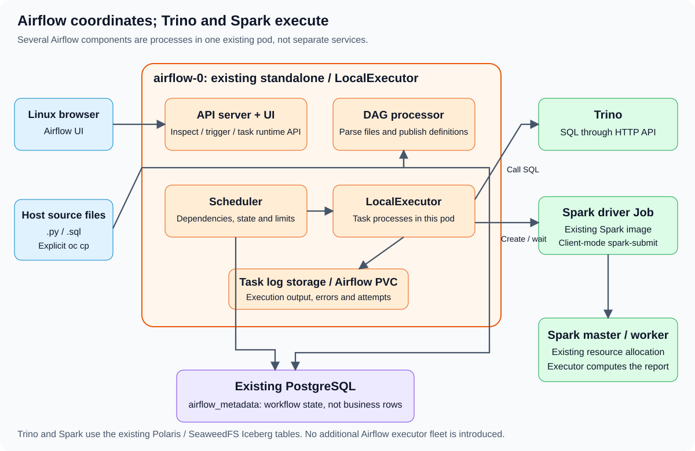
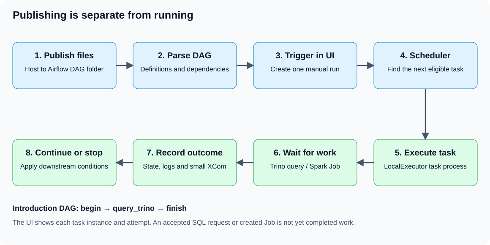

# 00 — Airflow introduction: DAGs, architecture, Trino and Spark

Use a terminal and browser with access to the existing OpenShift services. Open the extracted exercise directory and set `export EXERCISE_DIR="$(pwd)"` before following the commands. No package installation, new Airflow service or restart is required for these examples.

## 1. What Airflow does

Airflow coordinates finite workflows. A workflow can check source data, execute Trino SQL, submit a Spark application, wait for it and verify the output. Airflow records what ran, in which order, and whether each step succeeded.

The data engines still do the computation. Trino executes SQL against its connectors. Spark runs the PySpark application. MySQL and SeaweedFS retain the business data. Airflow stores orchestration state and logs, not the whole ecommerce dataset.

Use Airflow when the order, run history and failure boundaries matter. It does not turn a group of independent database writes into one transaction. It is not a replacement for a continuously running Spark streaming engine.

## 2. Open the Airflow UI first

In the terminal:

```bash
cd "$EXERCISE_DIR"
export PATH="$HOME/.crc/bin/oc:$PATH"
oc get pod -n bigdata airflow-0
oc get svc -n bigdata airflow
oc port-forward -n bigdata svc/airflow 28080:8080 --address=127.0.0.1
```

Keep the forward open. Browse to **http://127.0.0.1:28080** in the browser and sign in with the existing Airflow account. If an existing forwarder already serves that port, use it instead of creating a conflicting one. Do not read or publish authentication files to obtain a password.

The UI is the main place to inspect DAGs, trigger runs, follow dependencies and open task logs. It is not the source-code editor. Use a second terminal for the remaining commands.

## 3. Architecture on the current stack



The prepared deployment runs `airflow standalone` in the existing `airflow-0` pod. Several logical Airflow components run as processes in that pod; each box in the diagram does not imply a separate pod.

| Component | Responsibility here |
|---|---|
| DAG files | Python source in `/opt/airflow/dags`; defines tasks and dependencies |
| DAG processor | Imports/parses source, detects definition errors and publishes serialized DAG information |
| Scheduler | Determines which task instances are eligible, considering dependencies, run state, schedules and limits |
| LocalExecutor | Executes eligible Python tasks in processes on the Airflow pod; it is the scheduler's execution mechanism |
| API server and web UI | Serves browser/API requests to inspect, trigger and manage workflows |
| Airflow 3 Execution API / Task SDK | Runtime interface through which task processes interact with Airflow; task code should not access the metadata database directly |
| PostgreSQL metadata database | Stores DAG/run/task state and orchestration metadata; the prepared database is `airflow_metadata` |
| Task log storage | Captures task output and errors; the prepared Airflow home/log storage is on its PVC |
| Triggerer, when used | Runs asynchronous triggers for deferred tasks; these examples use ordinary polling, not deferrable operators |

The current LocalExecutor does not create a Kubernetes pod for every Airflow task. The Spark driver Job is created explicitly by one task through the Kubernetes API. No Celery broker, Celery worker fleet or KubernetesExecutor is introduced.

Check the current runtime without changing it:

```bash
oc exec -n bigdata airflow-0 -- airflow version
oc exec -n bigdata airflow-0 -- airflow config get-value core executor
oc exec -n bigdata airflow-0 -- airflow config get-value core parallelism
oc exec -n bigdata airflow-0 -- airflow config get-value core dags_folder
oc exec -n bigdata airflow-0 -- airflow config get-value logging base_log_folder
```

Expected: Airflow 3, LocalExecutor, parallelism one and `/opt/airflow/dags`. Inspect differing prerequisites separately; do not change executor or parallelism to run the examples.

## 4. DAG, task, run and task instance

| Term | Example |
|---|---|
| DAG definition | Python code describing `begin -> query_trino -> finish` |
| Task definition | The `query_trino` function wrapped with `@task` |
| DAG run | One trigger of that DAG; another trigger creates another run |
| Task instance | A particular task within a particular DAG run |
| Task attempt | One attempt to execute that task instance; retries can add attempts |
| Upstream / downstream | `begin` is upstream of `query_trino`; `finish` is downstream |
| XCom | A small value passed between tasks, such as `{"nations": 25}` |

Directed means dependencies have a direction. Acyclic means they cannot loop back into a cycle. Do not model repeated workflow runs as a dependency cycle; use separate DAG runs.

## 5. What happens after Trigger DAG?



1. The DAG processor has already parsed the `.py` file and made its definition available.
2. Trigger DAG requests a new run. The browser does not execute the Python function itself.
3. The scheduler examines that run and finds tasks whose dependencies and limits allow execution.
4. LocalExecutor starts the eligible task work in the Airflow pod.
5. The task calls Trino or submits/waits for Spark if that is its purpose. Output is captured in the task log.
6. Success or failure updates the task-instance state. Downstream eligibility is reconsidered.
7. The UI displays the run history, task states and logs. Later triggers produce separate runs over whatever input/contract the code defines.

Parsing is not task execution. Keep network calls, file reads that can fail, SQL execution and Spark submission inside task functions. A file may be parsed many times; calling a database while constructing the DAG would repeat work unexpectedly.

## 6. Dependencies: order is explicit

```python
first = validate_source()
second = load_iceberg()
third = verify_output()
first >> second >> third
```

This creates `validate_source -> load_iceberg -> verify_output`. Python line order alone does not establish Airflow dependencies. With the default `all_success` trigger rule, a downstream task runs only after all its upstream tasks succeed.

Passing a task result to another decorated task also creates a dependency:

```python
result = query_trino()
finish(result)
```

`result` is a task-output reference during DAG construction, not the actual query rows. At execution, Airflow resolves the small returned value through XCom. Keep large datasets in their data store and pass table names, paths or summaries instead.

Tasks on different branches may be eligible together, but concurrency settings can still serialize them. This course uses one active task and one active run per DAG, plus the existing single global task slot. Run only one course DAG at a time.

## 7. Use the premade files

The files are already provided:

| File | Purpose |
|---|---|
| [dags/airflow_hello_trino.py](dags/airflow_hello_trino.py) | A three-task introduction DAG |
| [dags/sql/hello_trino.sql](dags/sql/hello_trino.sql) | One read-only query against the existing TPCH tiny catalog |
| [publish-course.sh](publish-course.sh) | Copies the helper code, SQL, DAGs and Spark script into existing pods |

You can open `.py` and `.sql` files in the text editor. Jupyter is optional. Its `/workspace` and Airflow's `/opt/airflow/dags` are different PVC-backed locations; saving in Jupyter does not publish a DAG.

## 8. Create a SQL file using cat

To recreate the provided file from the terminal, run the following block. It overwrites this one source file, so keep its DAG idle:

```bash
cd "$EXERCISE_DIR"
mkdir -p dags/sql
cat > dags/sql/hello_trino.sql <<'SQL'
SELECT count(*) AS nations FROM tpch.tiny.nation;
SQL
```

`cat` with a quoted heredoc is suitable for multiline `.py` and `.sql` files. The quoted delimiter keeps shell variables, backticks and dollar signs literal. `echo` can create a short line, but is harder to maintain for multiline Python and SQL. Use `>` to replace a file; do not append with `>>` unless appending is intentional.

## 9. Create the matching Python DAG

This recreates the same premade DAG file. It imports only definitions during parsing; the SQL read and HTTP call happen inside the task:

```bash
cat > dags/airflow_hello_trino.py <<'PY'
"""Small first DAG: read one SQL file, call Trino and check the result."""
from datetime import timedelta
from pathlib import Path
from airflow.sdk import dag, task


@dag(
    dag_id="course_00_hello_trino",
    schedule=None,
    catchup=False,
    is_paused_upon_creation=True,
    max_active_runs=1,
    max_active_tasks=1,
    default_args={"retries": 0, "execution_timeout": timedelta(minutes=4)},
    tags=["course", "introduction"],
)
def hello_trino():
    @task(do_xcom_push=False)
    def begin():
        print("HELLO_BEGIN: starting the Trino check")

    @task
    def query_trino():
        from course_airflow_ecomm.trino_http import query
        statement = (Path(__file__).resolve().parent / "sql" / "hello_trino.sql").read_text().strip().removesuffix(";")
        rows = query(statement)
        if rows != [[25]]:
            raise ValueError("Expected 25 nations from the existing TPCH tiny catalog")
        print("HELLO_TRINO_QUERY_PASS: nations=25")
        return {"nations": 25}

    @task(do_xcom_push=False)
    def finish(result):
        if result["nations"] != 25:
            raise ValueError("Unexpected Trino summary")
        print("HELLO_FINISH: all checks passed")

    result = query_trino()
    begin() >> result
    finish(result)


hello_trino_dag = hello_trino()
PY
```

The final function call constructs the DAG; it does not run its tasks. The `@task` wrappers describe tasks. The `>>` and output reference describe their dependencies.

## 10. Copy the code into Airflow

From the host course directory, with the course DAGs/Jobs idle:

```bash
bash publish-course.sh
```

This publishes source files only. It does not unpause or trigger a DAG, submit Spark, change service configuration or restart Airflow. Helper files and SQL are copied before DAG entrypoints so imports can resolve. Individual file copies avoid nested package directories on repeated publication.

To see the essential commands for just the introduction:

```bash
oc exec -n bigdata airflow-0 -- mkdir -p /opt/airflow/dags/course_airflow_ecomm /opt/airflow/dags/sql
for file in ./dags/course_airflow_ecomm/*.py; do
    oc cp "$file" "bigdata/airflow-0:/opt/airflow/dags/course_airflow_ecomm/$(basename "$file")"
done
oc cp ./dags/sql/hello_trino.sql bigdata/airflow-0:/opt/airflow/dags/sql/hello_trino.sql
oc cp ./dags/airflow_hello_trino.py bigdata/airflow-0:/opt/airflow/dags/airflow_hello_trino.py
```

Use the script or the individual commands; repeating both is unnecessary. `oc cp` requires existing tar support. Do not install tools or restart services if copying fails; inspect the prerequisite.

Wait for discovery and check the real Airflow parser:

```bash
oc exec -n bigdata airflow-0 -- airflow dags list-import-errors
oc exec -n bigdata airflow-0 -- airflow dags list
```

The introduction DAG should appear paused. A paused-on-creation setting does not repause an existing DAG. `airflow dags test` executes tasks; it is not a harmless syntax check. Plain host Python also cannot execute a DAG that imports an unavailable Airflow SDK; parsing belongs to the existing Airflow environment.

## 11. Trigger the introduction and open its logs

In the UI:

1. Search for **course_00_hello_trino**.
2. Open it and inspect the Graph: `begin -> query_trino -> finish`.
3. Unpause it, then choose **Trigger DAG** once. Leave configuration empty.
4. Open that run in Grid/Graph view. Follow tasks from eligible/queued to running and success.
5. Select `begin`, choose its log view and find `HELLO_BEGIN`.
6. Open `query_trino` logs and find `HELLO_TRINO_QUERY_PASS: nations=25`.
7. Inspect its small returned XCom: `{"nations": 25}`.
8. Open `finish` logs and find `HELLO_FINISH`.
9. Pause the DAG when finished. It has no automatic schedule.

This example performs a small Trino read and starts no Spark Job. It does not require the ecommerce tables. The three following data exercises do require the completed Trino ecommerce course.

## 12. Schedules, states and retries

| Setting/state | Meaning in these examples |
|---|---|
| `schedule=None` | Manual runs; no periodic automatic trigger |
| `start_date` | Scheduling boundary, not an instruction to run immediately |
| `catchup=False` | Do not create a backlog of historical scheduled intervals |
| `scheduled` / `queued` | Eligible or submitted for execution; not yet the same as running |
| `running` | The task is executing |
| `success` | The task completed without a reported failure |
| `failed` | The task raised an error, timed out or otherwise failed |
| `upstream_failed` | Default dependency conditions cannot be met after upstream failure |
| `skipped` | The task was intentionally skipped by workflow logic/conditions |
| `up_for_retry` | A retry is waiting; these DAGs set retries to zero |

Airflow task retries, Kubernetes Job retries and rerunning a DAG are different mechanisms. A task can fail after an external write committed. Therefore replays still need stable keys and idempotent write logic. Do not mark a failed task successful just to make the graph green.

## 13. How Airflow uses Trino

The introduction reads a `.sql` file, removes its final CLI-style semicolon and passes one statement to the existing bounded HTTP helper. Keep one statement in this file; it is not a multi-statement SQL script runner. The task waits for every result page, detects SQL errors even after HTTP 200 and checks the result. The result is not trusted merely because the request was accepted.

The ecommerce DAG in exercise 01 uses the same helper to validate source keys and compare aggregates. Exercise 03 uses it for MySQL-to-Iceberg ingestion. Those SQL statements are premade in `course_airflow_ecomm/sql.py`; extracting larger queries into separate `.sql` files is also valid when their deployed paths and parameters are explicit.

These examples use the base Trino username-only HTTP profile. Do not enable the optional Trino password profile without also migrating these callers to authenticated HTTPS and trusted certificates.

## 14. How Airflow uses Spark and spark-submit

`spark-submit` launches a Spark application; it is not an Airflow scheduler. A driver creates the SparkSession, plans Spark work and coordinates executors. Here the existing standalone master allocates available worker resources for the application.

The premade [Spark script](spark/spark_ecomm.py) groups Iceberg sales and MERGEs daily totals. In exercises 02/03 the Airflow task creates one short Kubernetes Job using the existing Spark image. That image's `submit` entrypoint invokes spark-submit. The driver runs in the Job pod in client mode; the executor runs on the existing Spark worker. The waiter checks the Job until completion, then a Trino task independently verifies the report.

The submission has this shape; it is an **illustration**, not a host command to run in addition to the DAG:

```text
spark-submit --master spark://spark-master:7077 --deploy-mode client
  --driver-memory 512m --conf spark.cores.max=1
  --conf spark.executor.cores=1 --conf spark.executor.memory=512m
  --conf spark.sql.shuffle.partitions=2
  /workspace/user_notebooks/09-airflow-ecommerce/spark_ecomm.py
  --schema airflow_ecomm_s01
  --input-table polaris.airflow_ecomm_s01.sales_input
  --output-table daily_sales
```

Actual arguments also set driver Pod IP/bind address so executors can reach it. Existing Job environment variables supply Polaris/S3 credentials; the command line contains none. The full settings are in `spark_job.py`. Python standalone Spark applications use client mode in this exercise. Do not run spark-submit in the Airflow container unless it has a deliberately configured Spark runtime; this deployment delegates it to the existing Spark image instead.

## 15. Keep the schedulers distinct

| Scheduler/controller | What it decides |
|---|---|
| Airflow scheduler | Which workflow task instance can run next |
| OpenShift/Kubernetes scheduler | Which node runs a pending pod, such as the Spark driver Job pod |
| Spark standalone master | Resource allocation for Spark applications on its workers |
| Spark driver scheduling | Stages/tasks within its Spark application |
| Trino coordinator scheduling | Stages/tasks for its SQL query |

The single CRC node and shared physical resources do not grow when another scheduler or pod exists. Keep the configured single Airflow task slot and one short Spark application at a time. The current polling waiter occupies its Airflow slot while Spark runs; this is an intentional simple design, not a deferrable task.

## 16. Find the right logs

| Question | Where to look |
|---|---|
| DAG not discovered or import failed | `airflow dags list-import-errors`, then DAG processor logs |
| Python task failed | That run/task/attempt's log in the Airflow UI |
| Spark driver failed | Exact Kubernetes Job/pod logs, using the Job name returned by the task |
| Spark execution stalled | Driver logs and existing Spark master/application UI |
| Trino query failed | Airflow task error plus the corresponding query in Trino UI |
| Pod cannot start | Pod events and readiness, not just the Airflow DAG graph |

Use exact Job names from the task result rather than guessing a pod name. For an existing Job, set the variable to its actual displayed name before using this command:

```bash
oc logs -n bigdata job/"${JOB_NAME:?Set JOB_NAME to the exact Spark Job name}"
```

Airflow does not automatically mirror every external Spark log line into the submitting task's log. The task waits on Job state; the Spark driver log contains `SPARK_ECOMM_PASS`. Completed Job logs can disappear after the one-hour TTL deletes the Job/pod. Record needed non-sensitive evidence before that cleanup.

Scheduler/DAG-processor logs describe orchestration health; they are not a substitute for a selected task's log. Check the configured log path and storage permissions if UI logs are unavailable. Do not print Secrets, full environments or SparkConf to diagnose a failure.

## 17. Continue with the premade pipeline

The remaining exercises keep the same pattern: premade host files, explicit publication, UI trigger, logs and verification.

1. [Trino checks](01-airflow-trino-checks.md): validate the existing ecommerce source and Gold.
2. [Spark report](02-airflow-spark-report.md): one Spark submission, wait, then Trino verification.
3. [End to end](03-end-to-end-mysql-iceberg-spark.md): MySQL -> Trino staging -> Spark report -> Trino reconciliation.

No cron schedule, extra executor, new cluster or notification service is needed. Stop only the port-forward you started with Ctrl+C when finished; leave shared services running.

## References

[Airflow 3.1.8 architecture](https://airflow.apache.org/docs/apache-airflow/3.1.8/core-concepts/overview.html), [DAGs and dependencies](https://airflow.apache.org/docs/apache-airflow/3.1.8/core-concepts/dags.html), [LocalExecutor](https://airflow.apache.org/docs/apache-airflow/3.1.8/core-concepts/executor/local.html), [Airflow Task SDK](https://airflow.apache.org/docs/task-sdk/stable/api.html), and [Spark submission](https://spark.apache.org/docs/3.5.6/submitting-applications.html). Match these concepts to the installed version reported by the runtime check.
