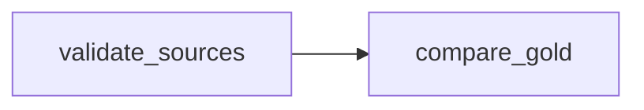

# 01 — Airflow calls Trino: ecommerce quality checks

**Outcome:** inspect the existing Airflow service, publish paused DAGs and trigger a read-only Trino validation DAG. Read the [README](README.md) and complete the preceding Trino ecommerce course first. Expected baseline: 8 completed lines, 5 orders and 225.00 CU.

If the initial Iceberg Bronze seed exists but the MySQL source or incremental refresh is missing, publish the files and run the supplied `python3 prepare-ecommerce-data.py` command before triggering this DAG. It must finish with `ECOMMERCE_DATA_READY`.

Use [the introduction](00-airflow-introduction.md) first for architecture, source creation with `cat`, the basic dependency graph and the UI/log walkthrough. The code below is premade; publishing it does not execute its tasks.

## 1. Separate orchestration from execution

Airflow stores task dependencies, run state, logs and small XCom values. It does not store the ecommerce dataset. Trino executes SQL against the configured catalogs. A task succeeds only after the Trino query finishes and its results pass the checks.



The DAG checks duplicate source keys, completed source totals, existing Silver totals and Gold group equivalence. It reads existing tables; it creates no business tables and no Spark Job.

## 2. Inspect the running services

Open a terminal in the browser:

```bash
cd "$EXERCISE_DIR"
```

```bash
export PATH="$HOME/.crc/bin/oc:$PATH"
oc get pods -n bigdata
oc get svc -n bigdata airflow trino mysql polaris seaweedfs spark-master
oc exec -n bigdata airflow-0 -- airflow version
oc exec -n bigdata airflow-0 -- airflow config get-value core executor
oc exec -n bigdata airflow-0 -- airflow config get-value core parallelism
oc exec -n bigdata airflow-0 -- airflow config get-value core dags_folder
oc exec -n bigdata airflow-0 -- python -c 'from airflow.sdk import dag, task; import requests; print("IMPORTS_OK")'
oc exec -n bigdata airflow-0 -- test -r /opt/course/job-template.json
```

Expected prerequisites: Airflow 3, LocalExecutor, parallelism 1, writable DAG folder `/opt/airflow/dags`, readable existing Job template. A successful `test` command prints nothing. If any assumption differs, stop and inspect the missing prerequisite; keep packages and service configuration unchanged.

Read-only permissions checks from the authenticated account, if it is allowed to impersonate the Airflow service account:

```bash
oc auth can-i create jobs.batch -n bigdata --as=system:serviceaccount:bigdata:airflow-runner
oc auth can-i get jobs.batch -n bigdata --as=system:serviceaccount:bigdata:airflow-runner
```

Expected: yes for lesson 02/03. If impersonation itself is forbidden, inspect the existing RoleBinding using an account permitted to read it; do not grant permissions. Lesson 01's SQL calls do not need Job permissions.

Inspect the template without printing environment values or credentials:

```bash
oc exec -n bigdata airflow-0 -- python -c 'import json; p=json.load(open("/opt/course/job-template.json"))["spec"]["template"]["spec"]; print("serviceAccount:",p.get("serviceAccountName")); print("driver containers:",len(p["containers"])); print("PVCs:",[v["persistentVolumeClaim"]["claimName"] for v in p.get("volumes",[]) if "persistentVolumeClaim" in v]); print("environment names:",[v["name"] for v in p["containers"][0].get("env",[])])'
```

For Spark lessons the template must have one container, the existing Spark-compatible image/`submit` entrypoint, a `spark-notebooks` volume mounted at `/workspace`, and the existing `POLARIS_CLIENT_ID`, `POLARIS_CLIENT_SECRET`, `AWS_ACCESS_KEY_ID` and `AWS_SECRET_ACCESS_KEY` environment wiring. Names alone do not prove valid values. Avoid raw template dumps.

## 3. Edit and publish the DAG files

Open the file manager and navigate to `$EXERCISE_DIR`. Open `dags/course_airflow_ecomm/settings.py` with the text editor. Set `RUN_SUFFIX` to match the Trino exercises. Keep the completed baseline at 8 / 5 / 225.00. Save the file.

Read `dags/airflow_ecomm_dags.py`. Functions decorated with `@task` contain runtime work; the final three function calls construct the DAG definitions. Importing the file must not execute SQL or submit a Spark Job.

Airflow reads `.py` files from its own DAG directory. Publishing the files below adds paused DAG definitions; it does not trigger a run. Keep existing runs idle while publishing. No package installation, service restart or new configuration object is required.

In the **terminal**, copy support files first and the DAG entrypoint last:

The shortest option is the premade publishing script:

```bash
cd "$EXERCISE_DIR"
bash publish-course.sh
```

Alternatively, the essential manual copies for the three ecommerce DAGs are:

```bash
cd "$EXERCISE_DIR"
oc exec -n bigdata spark-master-0 -c jupyter -- mkdir -p /workspace/user_notebooks/09-airflow-ecommerce
oc cp ./spark/spark_ecomm.py bigdata/spark-master-0:/workspace/user_notebooks/09-airflow-ecommerce/spark_ecomm.py -c jupyter
oc cp ./dags/course_airflow_ecomm bigdata/airflow-0:/opt/airflow/dags/course_airflow_ecomm
oc cp ./dags/airflow_ecomm_dags.py bigdata/airflow-0:/opt/airflow/dags/airflow_ecomm_dags.py
```

Do not overwrite the package while any of its DAGs or Jobs are active. `oc cp` requires tar in the relevant container. If it fails due to permissions or missing tools, stop; do not install tools or change ownership speculatively. Wait for the existing DAG processor to discover the files; do not restart Airflow.

```bash
oc exec -n bigdata airflow-0 -- airflow dags list-import-errors
oc exec -n bigdata airflow-0 -- airflow dags list
```

Confirm the three `course_s01_*` DAGs appear and have no import errors. The publishing script also installs `course_00_hello_trino`. These list commands do not trigger work. Do **not** run `airflow dags test`: it executes tasks and can create tables or Spark Jobs.

### Optional: edit using JupyterLab

Jupyter and Airflow run in different pods and use different directories. To edit the source in Jupyter, first copy it from the host:

```bash
oc exec -n bigdata spark-master-0 -c jupyter -- mkdir -p /workspace/user_notebooks/09-airflow-ecommerce/dags
oc cp ./dags/airflow_ecomm_dags.py bigdata/spark-master-0:/workspace/user_notebooks/09-airflow-ecommerce/dags/airflow_ecomm_dags.py -c jupyter
oc cp ./dags/course_airflow_ecomm bigdata/spark-master-0:/workspace/user_notebooks/09-airflow-ecommerce/dags/course_airflow_ecomm -c jupyter
```

Open the existing JupyterLab UI in the browser. Open `user_notebooks/09-airflow-ecommerce/dags/airflow_ecomm_dags.py` as a text file. Save edits as `.py`. Do not run it in the notebook kernel: DAG execution belongs to Airflow.

Copy an edited entrypoint back through the host, then publish it:

```bash
oc cp bigdata/spark-master-0:/workspace/user_notebooks/09-airflow-ecommerce/dags/airflow_ecomm_dags.py ./dags/airflow_ecomm_dags.py -c jupyter
oc cp ./dags/airflow_ecomm_dags.py bigdata/airflow-0:/opt/airflow/dags/airflow_ecomm_dags.py
```

For a changed helper file, perform the same two-step copy using its explicit path, such as `dags/course_airflow_ecomm/settings.py`. Publishing the entrypoint alone does not publish helper changes. Avoid concurrently editing host and Jupyter copies of the same file.

## 4. Open the existing Airflow UI

In a separate **Bash terminal**:

```bash
oc port-forward -n bigdata svc/airflow 28080:8080 --address=127.0.0.1
```

Keep this forwarding terminal open. In the browser, open `http://127.0.0.1:28080` and use the existing Airflow account. If an existing forwarder already serves the port, use it instead of starting a conflicting forwarder.

## 5. Trigger the Trino-check DAG

1. Ensure the preceding Trino course's data is present and other course DAGs are idle.
2. Open `course_s01_01_trino_checks` (or the configured run suffix).
3. Unpause that DAG and select **Trigger DAG** once, with no configuration JSON.
4. Inspect the run in Graph/Grid view. `validate_sources` runs before `compare_gold`.
5. Read task logs. Expect `PREFLIGHT_PASS` and `REPORT_PASS` with 4 groups / 225.00.
6. Inspect the small return value of `compare_gold`: `groups` and decimal revenue as a string. No dataset or password is placed in XCom.
7. Pause the DAG after the demonstration. With `schedule=None`, unpausing alone does not schedule a periodic run.

Read the code in `trino_http.py`: a statement is posted once, then every `nextUri` page is fetched until completion. HTTP 200 alone does not mean SQL succeeded; the JSON `error` field is checked. Requests have deadlines, and unfinished queries receive best-effort cancellation. The server session also limits each query to two minutes and 128 MB.

The small teaching client intentionally omits transparent POST retries and general session/transaction negotiation. It handles the standalone statements used here, not arbitrary application workloads. Generic error messages avoid copying connector details into Airflow logs; inspect the corresponding Trino query privately when diagnosis is needed.

## 6. Failure exercise without data changes

While the DAGs are idle, change `EXPECTED_REVENUE` in the host copy of `settings.py` to `"224.00"`. Publish only that helper file, wait for parsing and trigger lesson 01. `validate_sources` should fail; `compare_gold` should be upstream-failed. Restore `"225.00"`, publish the restored file and confirm the next run succeeds before continuing.

This changes the check, not the source data. Do not edit a helper while its DAG is running. Alternatively, inspect `require_totals()` without publishing a failure demonstration.

## Troubleshooting and assessment

| Symptom | Action |
|---|---|
| DAG absent | Check configured DAG path, package copy and import errors; wait for parsing |
| `airflow.sdk` missing | Installed version differs; inspect the existing runtime prerequisite |
| Baseline mismatch | Finish Trino lesson 03, inspect row counts and confirm RUN_SUFFIX |
| Gold differs | Run the preceding Trino course's explicit Gold refresh |
| Trino HTTP/SQL error | Check readiness, catalog access and query history privately |
| DAG success but no Spark Job | Correct for lesson 01: it is read-only |

Explain the difference between a DAG definition, DAG run and task instance. Which operations happen at parse time versus task execution? Why should XCom hold a tiny summary instead of rows? Continue to [lesson 02](02-airflow-spark-report.md).
