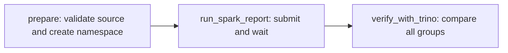

# 02 — Airflow launches one Spark report, then Trino verifies it

**Outcome:** submit a bounded Spark driver Job to the existing cluster, read a Polaris Iceberg table, publish a daily aggregate and verify it with another engine. Complete [lesson 01](01-airflow-trino-checks.md), including file publication. Source: the preceding Trino course's Silver table.

For the component roles, the meaning of spark-submit and the difference between Airflow/Spark/OpenShift schedulers, use [the introduction](00-airflow-introduction.md). The Spark script and DAG are already provided; trigger the existing definition rather than starting a second Spark submission manually.

Before triggering, the course MySQL source and Silver data must both contain eight completed lines, five orders and 225.00 revenue. If only the initial Iceberg seed has been prepared, run `python3 prepare-ecommerce-data.py` from the exercise directory after publishing. Expect `ECOMMERCE_DATA_READY`, then run lesson 01's checks. The `prepare` task validates these inputs; it does not create the missing source dataset.

## 1. Understand the task graph and process boundary



Airflow does not need Java, PySpark or spark-submit in its own image. Its Python task calls the Kubernetes API. The new short Job uses the **existing Spark-compatible image** from the mounted lab template. That image's `submit` entrypoint invokes spark-submit in client mode. The driver runs in the Job pod; one executor runs on the existing Spark worker. The Job's completion is separate from the API accepting its creation, so the Airflow task polls for success or failure.

This course does not require SparkSubmitOperator or KubernetesPodOperator packages. The implementation is intentionally visible in `spark_job.py`, following the repository's existing Airflow migration DAG pattern.

## 2. Check available capacity

Triggering this DAG starts a driver pod and consumes one existing worker core plus a 512 MiB executor. Check that a worker core and the required memory are free before triggering it. Do not run it alongside the Spark streaming notebooks or another driver on the shared machine.

Read-only **host Bash** checks:

```bash
export PATH="$HOME/.crc/bin/oc:$PATH"
oc get pods -n bigdata
oc get jobs -n bigdata -l app=airflow-ecommerce-course
oc exec -n bigdata spark-master-0 -c jupyter -- test -r /workspace/user_notebooks/09-airflow-ecommerce/spark_ecomm.py
```

Check the existing Spark master UI if available to confirm a worker core is free. Running worker pods do not prove free executor capacity. If the script is missing, return to the file publication steps; if capacity is unavailable, wait. Do not scale workers or change their memory.

## 3. Read the PySpark job before submitting

Open [spark/spark_ecomm.py](spark/spark_ecomm.py). It:

1. Validates its input/output identifiers against the exercise names.
2. Creates a SparkSession using the existing Iceberg REST catalog and S3 credentials from the Job environment.
3. Checks unique, non-null input line IDs.
4. Reads `polaris.trino_ecomm_s01.silver_order_lines`.
5. Groups by `order_date, country`, calculating distinct orders and decimal revenue.
6. MERGEs absolute totals into `polaris.airflow_ecomm_s01.spark_daily_preview`.
7. Prints only a small row-count/revenue summary and calls `spark.stop()` in finally.

Spark's `polaris` catalog alias and Trino's `iceberg_polaris` alias both resolve tables in the same existing Polaris `training` catalog. They are engine-specific aliases, not separate copies of the data. Trino can query the Spark-written table as `iceberg_polaris.airflow_ecomm_s01.spark_daily_preview`.

Spark uses the configured native S3FileIO for Iceberg. No raw S3 object listing, manual Parquet upload or S3 credential prompt is needed. Redaction is configured; avoid SparkConf/environment dumps anyway.

## 4. Trigger once and observe

Open the Airflow UI from lesson 01:

1. Ensure the lesson 01 run has finished and no other course DAG is active.
2. Unpause `course_s01_02_spark_report` and trigger once with no configuration JSON.
3. `prepare` checks baseline data and creates the exercise-specific Airflow namespace if absent.
4. `run_spark_report` creates one Job and waits. Its returned XCom contains the Job name and output table name.
5. `verify_with_trino` independently computes source groups and compares every group with Spark's output.
6. Expect all three tasks to succeed. Pause the DAG after the run.

While it runs, use a **Bash terminal**:

```bash
oc get jobs -n bigdata -l app=airflow-ecommerce-course
oc get pods -n bigdata -l app=airflow-ecommerce-course
```

Use the exact Job name shown by Airflow to inspect one run. For example, set `JOB_NAME` to that displayed name, without angle brackets:

```bash
JOB_NAME=af-ecomm-s01-replace_with_actual_suffix
oc get pods -n bigdata -l job-name="$JOB_NAME"
oc logs -n bigdata job/"$JOB_NAME"
oc get job -n bigdata "$JOB_NAME" -o jsonpath='{.status.conditions}'
```

Replace the example suffix; it is not an actual Job. Review logs privately before sharing them. The course prints `SPARK_ECOMM_PASS` with **4 groups / 225.00**; unexpected dependency errors can still contain infrastructure details. Never dump full Job manifests or environments to the report.

## 5. Query the Spark output through Trino

In a **Bash terminal**:

```bash
oc exec -it -n bigdata trino-0 -- trino --server http://localhost:8080 --user team
```

At the **Trino SQL prompt**:

```sql
SELECT * FROM iceberg_polaris.airflow_ecomm_s01.spark_daily_preview
ORDER BY order_date, country;
```

| order_date | country | completed_orders | revenue |
|---|---|---:|---:|
| source day 1 | IN | 2 | 110.00 |
| source day 2 | UK | 1 | 30.00 |
| source day 2 | US | 1 | 35.00 |
| source day 3 | UK | 1 | 50.00 |

Trino's `REPORT_PASS` should show the same 4 groups / 225.00. Its comparison uses both directions of EXCEPT plus a duplicate group-key check, rather than trusting matching totals alone.

## 6. Replays, deadlines and failure handling

After the first Job has finished, trigger one more run to check serial replay. It receives a new name but MERGEs into the same preview table, leaving logical contents unchanged. A task clear within the same DagRun derives the same Job name and reattaches to that Job while it exists. A failed Job remains failed; clearing the task is not a promise of rerunning Spark. Inspect the failure first, then use a new DagRun when ready to rerun.

Names derive from DAG ID, run ID and task ID. Kubernetes `backoffLimit=0` and Airflow retries=0 avoid automatic duplicate submissions. If the POST response is lost, a later manual clear can find the existing deterministic name. After the one-hour Job TTL removes it, the same identity can create another Job; this is bounded replay, not permanent exactly-once execution.

The Job deadline is ten minutes. Airflow waits eleven minutes inside a thirteen-minute task timeout. If an Airflow process stops, the Kubernetes deadline still bounds the driver Job. Stopping a DAG in the UI does not guarantee immediate external Job cancellation. Identify the precise Job, inspect it before cancelling it. The course does not delete arbitrary Jobs.

Gold MERGE assigns absolute values, so serial reruns over unchanged input do not add revenue. It does not remove groups that disappear from input; the pipeline is for this immutable/append-only exercise, not refunds or source deletes.

## Troubleshooting and assessment

| Symptom | Inspect |
|---|---|
| Kubernetes 403 | Existing Airflow service-account RoleBinding; no automatic grant |
| Template not readable | Existing deployment mount; do not run the old installer blindly |
| Driver Pending | Pod events, namespace quota and PVC attachment limits |
| Driver starts but no executor | Existing worker free cores/memory and driver Pod IP reachability |
| `submit` not recognized | Existing image/entrypoint differs from the repository template |
| Missing Polaris/S3 environment | Existing Secret references; never hard-code values |
| Spark succeeds but Trino verification fails | Catalog aliases, source changes, duplicate groups or stale output |

The `spark-notebooks` PVC is reused exactly as the existing template expects. If storage access modes/topology prevent a second pod mount, stop and review placement; do not change storage configuration as part of the lab.

Explain the location of the Airflow task process, Spark driver and executor. Why is successful Job creation insufficient? Why should there be one writer per target? Continue to [lesson 03](03-end-to-end-mysql-iceberg-spark.md).
