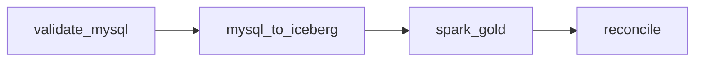

# 03 — End to end: MySQL → Trino → Iceberg → Spark → Trino

**Outcome:** orchestrate a complete ecommerce batch pipeline using one dependency chain. Complete [lesson 01](01-airflow-trino-checks.md) and [lesson 02](02-airflow-spark-report.md) first. This lab reads existing MySQL data and writes only the new Airflow course's namespace.

## 1. Follow the four tasks



| Task | Engine/action | Success criterion |
|---|---|---|
| `validate_mysql` | Trino reads MySQL source keys and totals | Unique keys; 8 completed lines / 5 orders / 225.00 |
| `mysql_to_iceberg` | Trino creates input table and insert-only MERGEs source lines | 8 staged lines / 5 orders / 225.00; no duplicate line IDs |
| `spark_gold` | One short Job reads staged Iceberg input and MERGEs daily groups | Successful Spark Job |
| `reconcile` | Trino compares Spark groups directly with a fresh MySQL aggregation | Zero missing/extra groups, no duplicate groups, total 225.00 |

Unlike lesson 02, Spark reads `airflow_ecomm_s01.sales_input`, created by this DAG directly from **MySQL through Trino**. The previous Trino course's Silver table is not the ingestion source for this DAG.

## 2. Inspect the ingestion contract

Open `dags/course_airflow_ecomm/sql.py`. The accepted source joins orders, order items and customers, retains COMPLETED orders with valid IDs/date/country/quantity/price, and calculates DECIMAL line amounts. Pending and cancelled orders stay excluded.

The staged columns are:

| Column | Meaning |
|---|---|
| `line_id` | Stable source order-line identity |
| `order_id` | Business order, potentially containing multiple lines |
| `order_date` | Day used for grouping |
| `country` | Customer country captured during ingestion |
| `line_amount` | Quantity × checkout unit price, DECIMAL(18,2) |

MERGE matches on line_id and inserts only new lines. It does not update changed existing lines or propagate deletes. The baseline check intentionally fails if the expected dataset changes unexpectedly. It also catches an interrupted or stale load when counts/totals differ, but equal totals alone cannot establish row identity. Final group reconciliation detects report differences; it is not a full source CDC audit.

The source is fixed for this exercise. Keep MySQL writers stopped during the run. Source tables are read in multiple independent statements; the DAG does not create a consistent multi-table MySQL snapshot. There is no atomic transaction across source extraction, staging, Spark Gold and verification.

## 3. Trigger the pipeline

With the source stable and capacity available:

1. Ensure all previous DAG runs and Spark applications have finished.
2. Open `course_s01_03_end_to_end` in Airflow.
3. Unpause and trigger once with no configuration JSON.
4. Follow the four tasks in Graph/Grid view.
5. Expect `PREFLIGHT_PASS`, `INPUT_MERGE_PASS`, `SPARK_ECOMM_PASS` and `REPORT_PASS` across their respective task/Job logs.
6. The final task's XCom should contain `groups: 4`, `revenue: "225.00"` and the Job name.
7. Pause the DAG when finished.

No automatic notifications, emails or messages are sent. Inspect failures in the Airflow UI and corresponding Job privately.

## 4. Inspect end-to-end results

From **host Bash**:

```bash
oc exec -it -n bigdata trino-0 -- trino --server http://localhost:8080 --user team
```

At the **Trino SQL prompt**:

```sql
SELECT count(*) AS lines, count(DISTINCT order_id) AS orders,
       CAST(sum(line_amount) AS DECIMAL(18,2)) AS revenue
FROM iceberg_polaris.airflow_ecomm_s01.sales_input;

SELECT * FROM iceberg_polaris.airflow_ecomm_s01.daily_sales
ORDER BY order_date, country;

SELECT file_path, file_format, record_count
FROM iceberg_polaris.airflow_ecomm_s01."daily_sales$files"
ORDER BY file_path;
```

Expected staged totals: **8 / 5 / 225.00**. Expected daily report:

| order_date | country | completed_orders | revenue |
|---|---|---:|---:|
| source day 1 | IN | 2 | 110.00 |
| source day 2 | UK | 1 | 30.00 |
| source day 2 | US | 1 | 35.00 |
| source day 3 | UK | 1 | 50.00 |

File names and counts vary. Paths should lie under `s3://warehouse/iceberg/airflow_ecomm_s01/daily_sales`. Polaris resolves the table; SeaweedFS stores the objects.

## 5. Prove serial replay safety

After the first Job has finished, trigger a second DagRun over unchanged source data. Compare the staged and report queries again. Expected: still 8 staged lines, 4 groups and 225.00. SQL row contents should remain equal; do not assert that snapshot counts or Job counts stay unchanged.

The ingest MERGE uses stable line IDs; the report MERGE assigns absolute totals. These two choices make the exercise replay safe for immutable source lines and append-only growth. They do not provide exactly-once external execution, source correction handling, a concurrency lock or global transactional consistency. Do not run two course DAGs simultaneously.

For an optional append exercise, define one new unique order/line and revise the expected constants before publishing the updated helper. Do not repeat the previous Trino course's seed INSERT block, which would duplicate source rows.

## 6. Recover at the right boundary

| Failed stage | What can already be committed | Recovery after review |
|---|---|---|
| `validate_mysql` | No new course output from this run | Fix the prerequisite/baseline, then trigger a new run |
| `mysql_to_iceberg` | Namespace/table and possibly input MERGE | Inspect input; a reviewed serial rerun can revisit stable keys |
| `spark_gold` | Input is committed; Spark may or may not have committed Gold | Inspect exact Job status and table contents before another submission |
| `reconcile` | Input and Gold writes may both be complete | Compare source/report differences; do not mark success without understanding them |

A clear within the same run reuses a surviving deterministic Job name. If that Job failed, clearing does not replace it. A new DagRun creates a new name. If a Job has already expired, a cleared task can create it again. Explicit timeouts and zero automatic retries bound exercise workloads but do not eliminate all ambiguous completion cases.

## 7. Cleanup — optional

First ensure no DAG run or Spark writer is active. Keep tables for assessment if needed. Stop port-forwards you started with Ctrl+C. Pause the three course DAGs in the UI; do not pause unrelated DAGs or stop shared services.

The following SQL is **destructive** and only for the assigned Airflow course namespace. Check exact names and confirm these exercise tables are no longer needed:

```sql
DROP TABLE iceberg_polaris.airflow_ecomm_s01.daily_sales;
DROP TABLE iceberg_polaris.airflow_ecomm_s01.spark_daily_preview;
DROP TABLE iceberg_polaris.airflow_ecomm_s01.sales_input;
DROP SCHEMA iceberg_polaris.airflow_ecomm_s01;
```

If a table was never created, skip its DROP after inspection. Do not add CASCADE. Iceberg table deletion can remove referenced files. Do not delete MySQL source tables, the preceding Trino course's namespace, shared buckets, Secrets, PVCs or other exercises data.

Completed driver Jobs expire after one hour through the existing Kubernetes TTL controller. Do not delete all Jobs in the namespace. For a still-running Job that needs cancellation, identify its exact name before deleting only that Job.

Removing installed DAG/Python files is optional; pause the DAGs and finish active runs first. Record the exact files copied in lesson 01, keep them for review and stop here if removal could affect another exercise. Removing a DAG file does not necessarily erase historical Airflow metadata. No service restart is needed for this course's normal end state.

## Assessment

1. Identify every independent commit boundary in the pipeline.
2. Explain why HTTP 200 or Kubernetes Job creation does not imply task success.
3. Show evidence that Trino read a Spark-written Iceberg table.
4. Explain why report verification uses live MySQL rather than only Spark's staged input.
5. Describe what happens if a customer moves country after their line was staged.
6. Design correction/refund handling with event versions, deletes and stale Gold groups.
7. Explain which limits are per DAG, which bound the driver Job, and why serial execution is still required.
