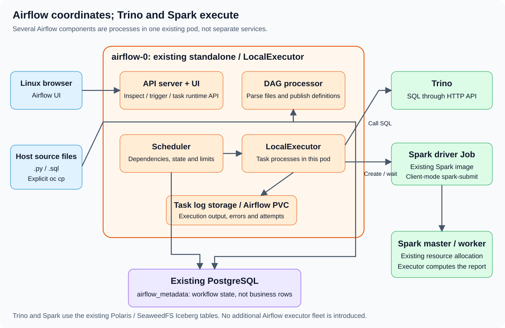
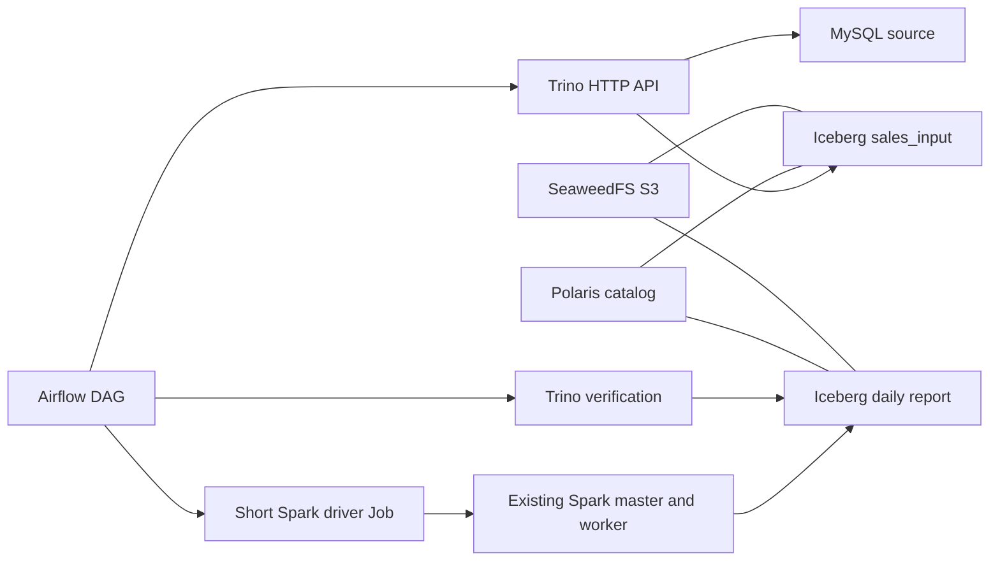

# Airflow ecommerce: orchestrate Trino and Spark

Start with the independent [Airflow getting-started exercise](../../airflow-getting-started/README.md). For these additional ecommerce lessons, open the extracted exercise directory and run `export EXERCISE_DIR="$(pwd)"`. The required services and preceding ecommerce dataset must already be available.

Start with [the Airflow introduction](00-airflow-introduction.md): it needs only the existing Airflow and Trino services, and checks 25 TPCH nations. Before data exercises 01–03, complete all three [Trino ecommerce lessons](../08-OpenShift-Trino-Iceberg-Ecommerce/README.md). Their expected input is eight completed lines, five orders and 225.00 CU.

| Lesson | DAG | Result |
|---|---|---|
| [00: Airflow introduction](00-airflow-introduction.md) | `course_00_hello_trino` | Architecture, dependencies, provided Python/SQL files, UI and task logs |
| [01: Airflow calls Trino](01-airflow-trino-checks.md) | `course_s01_01_trino_checks` | Source validation and existing Gold reconciliation |
| [02: Airflow calls Spark](02-airflow-spark-report.md) | `course_s01_02_spark_report` | One short Spark aggregation; output verified by Trino |
| [03: End-to-end pipeline](03-end-to-end-mysql-iceberg-spark.md) | `course_s01_03_end_to_end` | MySQL -> Trino -> Iceberg -> Spark -> Trino reconciliation |

## Architecture

Airflow coordinates tasks and records run state. Trino executes SQL. A short Kubernetes Job launches a Spark driver using the existing Spark image and worker. Polaris resolves Iceberg tables; SeaweedFS stores their objects.

## Where to write DAG code

Use the text editor to edit the `.py` files under `$EXERCISE_DIR/dags`. Publish them into Airflow's `/opt/airflow/dags` using the commands in lesson 01. The Airflow UI displays DAGs and logs; it is not the source editor.

The files are premade. [The introduction](00-airflow-introduction.md) also shows quoted `cat` heredocs to recreate a `.py` DAG and `.sql` query from the terminal. Run `bash publish-course.sh` while the course DAGs are idle to copy all supporting files and entrypoints. Publication does not trigger tasks or Spark Jobs.

JupyterLab can edit `.py` files too, but its `/workspace` is a separate notebook PVC. Saving a file there does not publish it to Airflow. Lesson 01 includes the explicit Jupyter-to-host-to-Airflow copy workflow. Save Python source as `.py`, not `.ipynb`.

## Files

| Path | Purpose |
|---|---|
| [dags/airflow_hello_trino.py](dags/airflow_hello_trino.py) | Three-task introduction DAG |
| [dags/sql/hello_trino.sql](dags/sql/hello_trino.sql) | Small read-only Trino query |
| [publish-course.sh](publish-course.sh) | Publish premade files from the host without triggering work |
| [dags/airflow_ecomm_dags.py](dags/airflow_ecomm_dags.py) | Three manual Airflow 3 TaskFlow DAGs |
| [dags/course_airflow_ecomm/settings.py](dags/course_airflow_ecomm/settings.py) | Run suffix and expected totals |
| `dags/course_airflow_ecomm/sql.py` | Trino SQL |
| `dags/course_airflow_ecomm/tasks.py` | Validation and ingestion task bodies |
| `dags/course_airflow_ecomm/trino_http.py` | Bounded HTTP queries and cancellation |
| `dags/course_airflow_ecomm/spark_job.py` | Build, submit and monitor the driver Job |
| [spark/spark_ecomm.py](spark/spark_ecomm.py) | One-core Spark aggregation and report MERGE |
| [VALIDATION.md](VALIDATION.md) | Logic tests and runtime verification |

## Existing runtime prerequisites

Use Airflow 3 with the existing `airflow.sdk`, `requests` package, LocalExecutor and single task slot. Reuse `/opt/course/job-template.json`, its existing Spark image, service account, Secret references and `spark-notebooks` PVC mounted at `/workspace`. Run lesson 01's read-only checks before publishing files.

These DAGs use Trino's base username-only HTTP profile. Keep the optional Trino password/HTTPS profile disabled while running them, or migrate the HTTP client to authenticated HTTPS with trusted certificates and Secret-backed credentials first. A browser login does not authenticate the DAG's HTTP requests.

If a prerequisite is missing, inspect it separately. Do not reinstall the stack, change RBAC, install providers or restart services to begin this exercise. The DAG implementation uses the existing Task SDK and HTTP/Kubernetes APIs; it does not require additional Trino, Spark or Kubernetes provider packages.

## Names and resource limits

Set `RUN_SUFFIX = "s01"` in `settings.py` to match the preceding Trino exercises. Use one suffix per installation of this package. Keep existing source tables `mysql.trino_ecomm.trino_s01_*`. New objects are confined to `iceberg_polaris.airflow_ecomm_s01`, under `s3://warehouse/iceberg/airflow_ecomm_s01`:

- `spark_daily_preview`: lesson 02 output.
- `sales_input`: lesson 03 input.
- `daily_sales`: lesson 03 report.

All four DAGs are manual, paused on first creation, have no catchup, one active run, one active task and zero automatic retries. Run only one course DAG at a time. Per-DAG limits do not prevent separate DAGs from overlapping. Keep other Spark applications stopped while running a Spark lesson.

Each Spark application uses one worker core, a 512 MiB executor, a 512 MiB driver heap and two shuffle partitions. The driver pod is limited to 1 CPU / 1536 MiB. The Job has a ten-minute deadline, zero retries and a one-hour completed-Job TTL. These are short exercise workloads, not a new Spark cluster. Do not increase service limits.

Use existing Secret-backed Spark and Trino credentials. Do not print environments, SparkConf, Kubernetes tokens or Secret contents. For native MySQL checks use `team` or `root`, password `team1234`, entered at the client password prompt.

## Checkpoints

| Exercise | Expected result |
|---|---|
| Introduction | begin -> query_trino -> finish; 25 nations, no Spark Job |
| Trino checks | PREFLIGHT_PASS and REPORT_PASS: four groups / 225.00 |
| Spark report | One successful Job; four groups / 225.00 visible through Trino |
| End-to-end | Eight staged lines; four groups / 225.00; unchanged contents after serial replay |

Publishing files installs DAG definitions. Triggering lessons 02 and 03 starts short driver Jobs and writes exercise tables. These are explicit exercise actions; no cluster configuration changes are required.

## References

[Airflow Task SDK](https://airflow.apache.org/docs/task-sdk/stable/api.html), [Trino HTTP protocol](https://trino.io/docs/current/develop/client-protocol.html), and [Spark submission](https://spark.apache.org/docs/3.5.6/submitting-applications.html). Check the installed release before using features beyond these examples.
