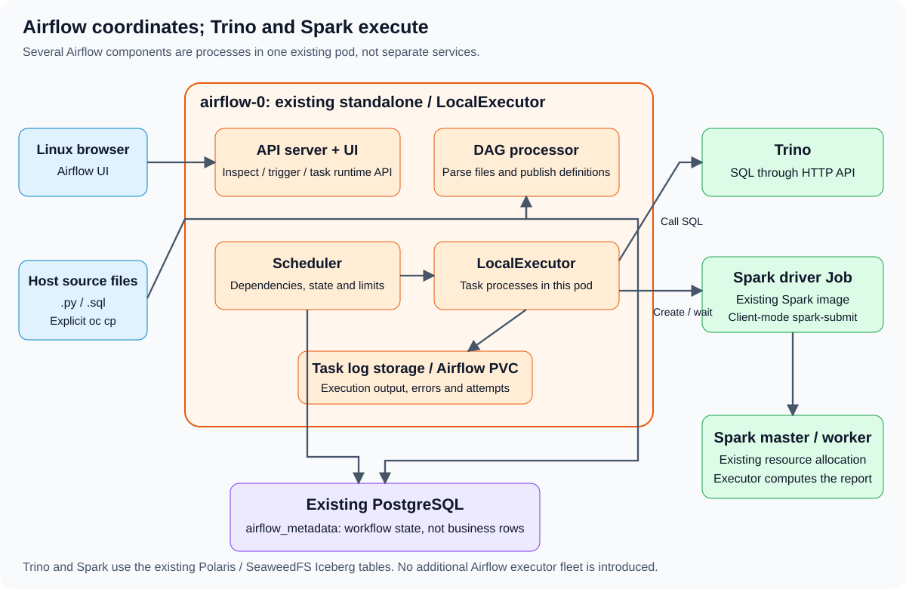
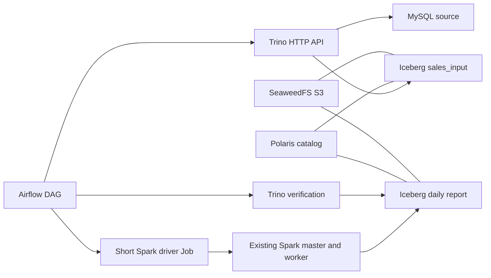

# Airflow ecommerce: orchestrate Trino and Spark

## Classroom walkthrough

After the updated ZIP is uploaded to the GitHub course folder, download and
extract it on each course VM:

```bash
cd ~/Downloads
wget -O 09-OpenShift-Airflow-Trino-Spark-Ecommerce.zip https://raw.githubusercontent.com/training-sh/tcs-iceberg-2/main/09-OpenShift-Airflow-Trino-Spark-Ecommerce/09-OpenShift-Airflow-Trino-Spark-Ecommerce.zip
unzip -o 09-OpenShift-Airflow-Trino-Spark-Ecommerce.zip
cd 09-OpenShift-Airflow-Trino-Spark-Ecommerce
```

Finish any active Airflow runs, then publish the course:

```bash
bash publish-course.sh
```

Copy the new `RUN_ID` printed by the command. To load the updated DAG
without waiting for the regular discovery cycle, restart Airflow manually
right after publishing:

```bash
export PATH="$HOME/.crc/bin/oc:$PATH"
oc rollout restart -n bigdata statefulset/airflow
oc rollout status -n bigdata statefulset/airflow --timeout=300s
```

The rollout command waits for the replacement pod to become ready. Startup
and DAG parsing can take longer than a few seconds. Open `airflow_ecommerce`
and confirm its description shows the printed `RUN_ID`, then unpause it
if needed and click **Trigger**. If you skip the restart, allow up to five
minutes for the regular discovery cycle.
The DAG creates and seeds its own data. You can use this walkthrough on a fresh
course cluster with the lab services already running.

| Airflow task | What to show students |
|---|---|
| `seed_mysql` | Creates the MySQL database and four tables, then inserts the fixed fixture. |
| `validate_mysql` | Trino joins the MySQL tables and verifies 8 completed lines, 5 orders, and 225.00 revenue. |
| `load_iceberg` | Creates the Polaris namespace through Trino and writes the completed sales into Iceberg. |
| `aggregate_with_spark` | A Spark Job groups the sales by date and country and writes `daily_sales`. |
| `validate_report` | Trino independently aggregates the MySQL rows, compares them with the Spark output, and checks all four groups. |

Replace the example ID with the one printed by your publish command and inspect the
results in Trino:

```sql
SELECT * FROM mysql.airflow_20261118_1435.orders ORDER BY order_id;
SELECT * FROM iceberg_polaris.airflow_20261118_1435.sales_input ORDER BY line_id;
SELECT * FROM iceberg_polaris.airflow_20261118_1435.daily_sales ORDER BY order_date, country;
```

SeaweedFS stores the Iceberg data under `s3://warehouse/iceberg/<RUN_ID>/`.
Trigger the same DAG again to replay the fixed fixture and report without duplicating
rows. For fresh course databases, wait for all runs to finish and publish in a
new minute. The same DAG will use the new ID for its SQL and storage locations.
Each VM prints its own ID.

Open [classroom.py](dags/course_airflow_ecomm/classroom.py) to follow the five task
bodies and [mysql_seed.sql](dags/course_airflow_ecomm/mysql_seed.sql) to read the
tables and records. The publish command reads the MySQL image and Secret reference
from the running MySQL pod. It uses the lab's existing Airflow Job permissions,
Spark Job template, and MySQL `team` account for Trino reads. Use the course
`bigdata` namespace and its existing service names. The course MySQL root
account must accept connections from the in-cluster seed Job. If a Job fails, its Airflow log
includes the Job name and the `oc logs` command to inspect it.

## Additional lessons

For these additional ecommerce lessons, open the extracted exercise directory
and run `export EXERCISE_DIR="$(pwd)"`. [The Airflow introduction](00-airflow-introduction.md)
uses the existing Airflow and Trino services and checks 25 TPCH nations. Before
exercises 01–03, prepare their shared baseline using the steps below. The
expected input is eight completed lines, five orders and 225.00 CU.

## Publish after downloading

Download or clone the complete exercise into any directory. Open a terminal in that directory and run:

```bash
export EXERCISE_DIR="$(pwd)"
bash publish-course.sh --lessons
```

The script resolves its own directory and copies the supplied files into the existing Kubernetes pods. It does not require an `~/openshift` directory or trigger any DAG runs. Keep the course DAGs idle while publishing. The prepared services and an authenticated `oc` command are required.

## Prepare the ecommerce data before lessons 01–03

The Trino introduction needs only Airflow and Trino. The advanced lessons
also need matching MySQL source tables and completed Silver/Gold data.
Run the preparation command after publishing the additional lessons:

```bash
export PATH="$HOME/.crc/bin/oc:$PATH"
python3 prepare-ecommerce-data.py
```

Expected final output:

```text
ECOMMERCE_DATA_READY: 8 lines / 5 orders / 4 groups / 225.00
```

The script uses [the supplied Bronze fixture](bronze-seed.sql) if the Bronze
table is missing. It creates the MySQL source tables, inserts the documented
incremental order, and runs the Bronze, Silver and Gold MERGEs. It checks
existing rows before reusing them. Run it while the course DAGs are idle.

| Lesson | DAG | Result |
|---|---|---|
| [00: Airflow introduction](00-airflow-introduction.md) | `course_00_hello_trino` | Architecture, dependencies, provided Python/SQL files, UI and task logs |
| [01: Airflow calls Trino](01-airflow-trino-checks.md) | `course_s01_01_trino_checks` | Source validation and existing Gold reconciliation |
| [02: Airflow calls Spark](02-airflow-spark-report.md) | `course_s01_02_spark_report` | One short Spark aggregation; output verified by Trino |
| [03: End-to-end pipeline](03-end-to-end-mysql-iceberg-spark.md) | `course_s01_03_end_to_end` | MySQL -> Trino -> Iceberg -> Spark -> Trino reconciliation |

## Architecture





Airflow coordinates tasks and records run state. Trino executes SQL. A short Kubernetes Job launches a Spark driver using the existing Spark image and worker. Polaris resolves Iceberg tables; SeaweedFS stores their objects.

## Where to write DAG code

Use the text editor to edit the `.py` files under `$EXERCISE_DIR/dags`. Publish them into Airflow's `/opt/airflow/dags` using the commands in lesson 01. The Airflow UI displays DAGs and logs; it is not the source editor.

The files are premade. [The introduction](00-airflow-introduction.md) also shows quoted `cat` heredocs to recreate a `.py` DAG and `.sql` query from the terminal. Run `bash publish-course.sh --lessons` while the course DAGs are idle to copy the additional lesson files and entrypoints. Publication does not trigger tasks or Spark Jobs.

JupyterLab can edit `.py` files too, but its `/workspace` is a separate notebook PVC. Saving a file there does not publish it to Airflow. Lesson 01 includes the explicit Jupyter-to-host-to-Airflow copy workflow. Save Python source as `.py`, not `.ipynb`.

## Files

| Path | Purpose |
|---|---|
| [dags/airflow_hello_trino.py](dags/airflow_hello_trino.py) | Three-task introduction DAG |
| [dags/sql/hello_trino.sql](dags/sql/hello_trino.sql) | Small read-only Trino query |
| [publish-course.sh](publish-course.sh) | Publish the timestamped classroom DAG or the additional lessons |
| [prepare-ecommerce-data.py](prepare-ecommerce-data.py) | Prepare and reconcile the required ecommerce dataset from the preceding Bronze seed |
| [dags/airflow_ecomm_dags.py](dags/airflow_ecomm_dags.py) | Three manual Airflow 3 TaskFlow DAGs |
| [dags/course_airflow_ecomm/settings.py](dags/course_airflow_ecomm/settings.py) | Run suffix and expected totals |
| `dags/course_airflow_ecomm/sql.py` | Trino SQL |
| `dags/course_airflow_ecomm/tasks.py` | Validation and ingestion task bodies |
| `dags/course_airflow_ecomm/trino_http.py` | Bounded HTTP queries and cancellation |
| `dags/course_airflow_ecomm/spark_job.py` | Build, submit and monitor the driver Job |
| [spark/spark_ecomm.py](spark/spark_ecomm.py) | One-core Spark aggregation and report MERGE |
| [VALIDATION.md](VALIDATION.md) | Logic tests and runtime verification |

## Existing runtime prerequisites

Use Airflow 3 with the existing `airflow.sdk`, `requests` package, LocalExecutor and single task slot. Reuse `/opt/course/job-template.json`, its existing Spark image, service account, Secret references and `spark-notebooks` PVC mounted at `/workspace`. Run lesson 01's read-only checks before publishing files.

These DAGs use Trino's base username-only HTTP profile. Keep the optional Trino password/HTTPS profile disabled while running them, or migrate the HTTP client to authenticated HTTPS with trusted certificates and Secret-backed credentials first. A browser login does not authenticate the DAG's HTTP requests.

If a prerequisite is missing, inspect it separately. Do not reinstall the stack, change RBAC, install providers or restart services to begin this exercise. The DAG implementation uses the existing Task SDK and HTTP/Kubernetes APIs; it does not require additional Trino, Spark or Kubernetes provider packages.

## Names and resource limits

Set `RUN_SUFFIX = "s01"` in `settings.py` to match the preceding Trino exercises. Use one suffix per installation of this package. Keep existing source tables `mysql.trino_ecomm.trino_s01_*`. New objects are confined to `iceberg_polaris.airflow_ecomm_s01`, under `s3://warehouse/iceberg/airflow_ecomm_s01`:

- `spark_daily_preview`: lesson 02 output.
- `sales_input`: lesson 03 input.
- `daily_sales`: lesson 03 report.

All four DAGs are manual, paused on first creation, have no catchup, one active run, one active task and zero automatic retries. Run only one course DAG at a time. Per-DAG limits do not prevent separate DAGs from overlapping. Keep other Spark applications stopped while running a Spark lesson.

Each Spark application uses one worker core, a 512 MiB executor, a 512 MiB driver heap and two shuffle partitions. The driver pod is limited to 1 CPU / 1536 MiB. The Job has a ten-minute deadline, zero retries and a one-hour completed-Job TTL. These are short exercise workloads, not a new Spark cluster. Do not increase service limits.

Use the lab's existing Secret-backed Spark and Trino credentials. For native
MySQL checks, use the credential for your lab account at the client password prompt.

## Checkpoints

| Exercise | Expected result |
|---|---|
| Introduction | begin -> query_trino -> finish; 25 nations, no Spark Job |
| Trino checks | PREFLIGHT_PASS and REPORT_PASS: four groups / 225.00 |
| Spark report | One successful Job; four groups / 225.00 visible through Trino |
| End-to-end | Eight staged lines; four groups / 225.00; unchanged contents after serial replay |

Publishing files installs DAG definitions. Triggering lessons 02 and 03 starts short driver Jobs and writes exercise tables. These are explicit exercise actions; no cluster configuration changes are required.

## References

[Airflow Task SDK](https://airflow.apache.org/docs/task-sdk/stable/api.html), [Trino HTTP protocol](https://trino.io/docs/current/develop/client-protocol.html), and [Spark submission](https://spark.apache.org/docs/3.5.6/submitting-applications.html). Check the installed release before using features beyond these examples.
