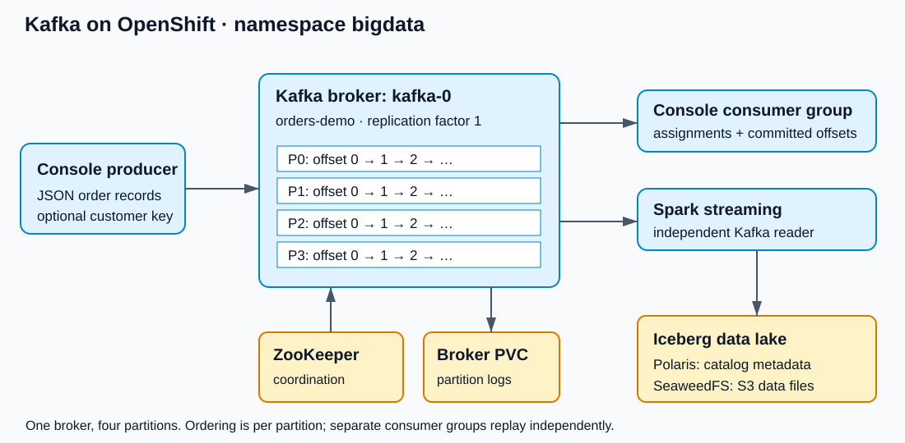

# Kafka basics on OpenShift: orders, partitions and offsets

Kafka stores events in named **topics**. Producers append records; consumers read them independently. An order event can be consumed by billing, inventory and Spark without those applications sharing a single queue position. Kafka retains records after consumption, allowing replay while the records remain available.

This exercise uses the existing `bigdata` namespace, one Kafka broker, one ZooKeeper instance and four topic partitions. Run commands in a Linux terminal on the host running CRC, with an existing authenticated `oc` session. Kafka tools run inside `kafka-0`; no local Kafka installation is required.

## Architecture



| Component | Responsibility |
|---|---|
| Producer | Chooses a partition and sends a key, value and timestamp |
| Broker `kafka-0` | Stores partition logs and serves reads and writes |
| Topic `orders-demo` | Four independent append-only partition logs: P0–P3 |
| ZooKeeper | Coordinates this existing ZooKeeper-based Kafka deployment; order payloads do not flow through it |
| Consumer group | Shares partition assignments and tracks committed positions |
| Persistent volume | Holds broker logs across pod replacement and scale-to-zero |
| Spark | Can read Kafka and write Iceberg tables through Polaris to SeaweedFS; covered in notebooks 03 and 04 |

A partition has one leader and may have replicas on other brokers. **Four partitions do not require four brokers.** With one broker, replication factor must be 1; this deployment has no broker-failure redundancy. Keep both StatefulSets at one replica for this exercise. Adding broker replicas requires checking the deployment configuration first.

## 1. Inspect and start the existing services

Inspect before changing replica counts:

```bash
export PATH="$HOME/.crc/bin/oc:$PATH"
oc whoami
oc get statefulset kafka zookeeper -n bigdata
oc get pods -n bigdata -l app=kafka
oc get pods -n bigdata -l app=zookeeper
```

If stopped, start ZooKeeper first and wait; then start Kafka. These commands change running replica counts, using the existing images, configuration and storage.

```bash
oc scale statefulset/zookeeper -n bigdata --replicas=1
oc rollout status statefulset/zookeeper -n bigdata --timeout=300s
oc scale statefulset/kafka -n bigdata --replicas=1
oc rollout status statefulset/kafka -n bigdata --timeout=300s
```

Check the broker responds:

```bash
oc exec -n bigdata kafka-0 -- /opt/kafka/bin/kafka-topics.sh --bootstrap-server kafka:9092 --list
```

If startup fails, inspect rather than repeatedly restarting:

```bash
oc logs -n bigdata zookeeper-0 --tail=50
oc logs -n bigdata kafka-0 --tail=80
oc get events -n bigdata --sort-by=.lastTimestamp
```

## 2. Create and describe a four-partition topic

Use `orders-demo` for console exercises, keeping it separate from the notebook topic `invoices-lake`. Set these variables in each terminal used for this lesson:

```bash
TOPIC=orders-demo
GROUP=orders-demo-group
```

```bash
oc exec -n bigdata kafka-0 -- /opt/kafka/bin/kafka-topics.sh --bootstrap-server kafka:9092 --create --if-not-exists --topic "$TOPIC" --partitions 4 --replication-factor 1
oc exec -n bigdata kafka-0 -- /opt/kafka/bin/kafka-topics.sh --bootstrap-server kafka:9092 --describe --topic "$TOPIC"
```

Expect `PartitionCount: 4`, `ReplicationFactor: 1` and rows for partitions 0, 1, 2 and 3. Each row includes its leader, replicas and in-sync replicas (ISR). `--if-not-exists` preserves an existing topic; it does not correct its partition count. If the topic already contains records, subsequent examples append and replay those records too.

Inspect the partition directories on the broker volume:

```bash
oc exec -n bigdata kafka-0 -- sh -c 'ls -d /var/lib/kafka/data/orders-demo-*'
```

Expect directories ending in `-0`, `-1`, `-2`, `-3`. Kafka stores segment and index files there. Do not edit or remove these files manually.

## 3. Produce JSON with null keys

Paste this entire block into the host terminal. The here-document sends only the eight literal JSON lines to the console producer; it does not generate records or create a source file.

```bash
oc exec -i -n bigdata kafka-0 -- /opt/kafka/bin/kafka-console-producer.sh --bootstrap-server kafka:9092 --topic "$TOPIC" <<'JSON'
{"id":"O1001","cust_id":"C001","amount":120.50}
{"id":"O1002","cust_id":"C002","amount":80.00}
{"id":"O1003","cust_id":"C001","amount":45.00}
{"id":"O1004","cust_id":"C003","amount":200.00}
{"id":"O1005","cust_id":"C002","amount":25.50}
{"id":"O1006","cust_id":"C004","amount":99.00}
{"id":"O1007","cust_id":"C003","amount":60.00}
{"id":"O1008","cust_id":"C004","amount":15.00}
JSON
```

Each line is one record. A `cust_id` field inside the JSON **does not automatically become the Kafka key**. Here the key is null.

Null keys do not guarantee P0, P1, P2, P3 round-robin placement. The default Java producer uses sticky partition selection for batching; a small batch may land in only one partition. Explicit partitioner configuration can change this behavior. See [Kafka producer partitioning configuration](https://kafka.apache.org/39/configuration/producer-configs/).

## 4. Consume and inspect partition offsets

Read all retained records across all partitions, printing metadata:

```bash
oc exec -n bigdata kafka-0 -- /opt/kafka/bin/kafka-console-consumer.sh --bootstrap-server kafka:9092 --topic "$TOPIC" --from-beginning --timeout-ms 10000 --property print.partition=true --property print.offset=true --property print.key=true
```

After ten seconds without a record, the consumer exits; a timeout message is expected. Kafka guarantees ordering within a partition, not a single global ordering across all four partitions. Reading all records requires reading every partition.

Read one partition only; repeat with 1, 2 or 3:

```bash
oc exec -n bigdata kafka-0 -- /opt/kafka/bin/kafka-console-consumer.sh --bootstrap-server kafka:9092 --topic "$TOPIC" --partition 0 --from-beginning --timeout-ms 10000 --property print.partition=true --property print.offset=true
```

Read partition 0 starting at offset 2:

```bash
oc exec -n bigdata kafka-0 -- /opt/kafka/bin/kafka-console-consumer.sh --bootstrap-server kafka:9092 --topic "$TOPIC" --partition 0 --offset 2 --timeout-ms 10000 --property print.partition=true --property print.offset=true
```

Offsets belong to individual partitions: P0 offset 2 and P1 offset 2 identify different records. A partition may have no record at offset 2 yet; this command can therefore time out without output.

For interactive production instead, run the following, paste one JSON record per line, then press **Ctrl+C**. Do not paste shell commands into the producer prompt.

```bash
oc exec -it -n bigdata kafka-0 -- /opt/kafka/bin/kafka-console-producer.sh --bootstrap-server kafka:9092 --topic "$TOPIC"
```

To watch new events, run a consumer in another terminal without `--from-beginning` and without `--timeout-ms`; stop it with Ctrl+C.

## 5. Produce explicit customer keys

Use `|` to separate the Kafka key from the JSON value. JSON colons remain part of the value.

```bash
oc exec -i -n bigdata kafka-0 -- /opt/kafka/bin/kafka-console-producer.sh --bootstrap-server kafka:9092 --topic "$TOPIC" --property parse.key=true --property 'key.separator=|' <<'ORDERS'
C001|{"id":"O2001","cust_id":"C001","amount":30.00}
C002|{"id":"O2002","cust_id":"C002","amount":55.00}
C001|{"id":"O2003","cust_id":"C001","amount":20.00}
C003|{"id":"O2004","cust_id":"C003","amount":75.00}
C002|{"id":"O2005","cust_id":"C002","amount":10.00}
C004|{"id":"O2006","cust_id":"C004","amount":90.00}
ORDERS
```

```bash
oc exec -n bigdata kafka-0 -- /opt/kafka/bin/kafka-console-consumer.sh --bootstrap-server kafka:9092 --topic "$TOPIC" --from-beginning --timeout-ms 10000 --property print.key=true --property print.partition=true --property print.offset=true
```

Locate O2001 and O2003: both have key C001 and go to the same partition with the default keyed partitioning and unchanged partition count. Distinct customer keys can map to the same partition. Routing uses a hash of the serialized key; the JSON field alone does not control it. Earlier unkeyed records still print a null key.

## 6. Consumer groups and lag

Read using a named group:

```bash
oc exec -n bigdata kafka-0 -- /opt/kafka/bin/kafka-console-consumer.sh --bootstrap-server kafka:9092 --topic "$TOPIC" --group "$GROUP" --from-beginning --timeout-ms 15000 --property print.key=true --property print.partition=true --property print.offset=true
```

`--from-beginning` applies when the group has no valid committed offset. On later runs, an existing group resumes its committed positions. Allow the consumer to finish before inspecting or resetting its offsets.

```bash
oc exec -n bigdata kafka-0 -- /opt/kafka/bin/kafka-consumer-groups.sh --bootstrap-server kafka:9092 --list
oc exec -n bigdata kafka-0 -- /opt/kafka/bin/kafka-consumer-groups.sh --bootstrap-server kafka:9092 --describe --group "$GROUP"
```

`--list` lists groups, not every individual consumer. `CURRENT-OFFSET` is the next committed position to read; `LOG-END-OFFSET` is the next append position. Their difference is lag. Commits can lag briefly behind printed records.

To see assignments, run the group consumer in terminal A without `--timeout-ms`, then inspect it in terminal B:

```bash
oc exec -n bigdata kafka-0 -- /opt/kafka/bin/kafka-consumer-groups.sh --bootstrap-server kafka:9092 --describe --group "$GROUP" --members --verbose
```

Two consumers in the same group share the four partitions. Different groups independently read the full topic. More than four consumers in this group leaves excess consumers without a partition. Stop interactive consumers with Ctrl+C before the next section.

## 7. Reset offsets: preview, then execute

All consumers in `orders-demo-group` must be stopped. These commands change this group's replay position, not the topic's records. Do not reset the notebook or Spark consumer groups.

Preview a reset to the earliest retained offset:

```bash
oc exec -n bigdata kafka-0 -- /opt/kafka/bin/kafka-consumer-groups.sh --bootstrap-server kafka:9092 --group "$GROUP" --reset-offsets --topic "$TOPIC" --to-earliest --dry-run
```

Apply the same plan, then inspect:

```bash
oc exec -n bigdata kafka-0 -- /opt/kafka/bin/kafka-consumer-groups.sh --bootstrap-server kafka:9092 --group "$GROUP" --reset-offsets --topic "$TOPIC" --to-earliest --execute
oc exec -n bigdata kafka-0 -- /opt/kafka/bin/kafka-consumer-groups.sh --bootstrap-server kafka:9092 --describe --group "$GROUP"
```

Run the named consumer again to replay retained events. Earliest is not necessarily zero after retention deletes old segments.

Other reset plans to try individually while the group is inactive:

```bash
# Skip currently retained records; consume future arrivals on the next run.
oc exec -n bigdata kafka-0 -- /opt/kafka/bin/kafka-consumer-groups.sh --bootstrap-server kafka:9092 --group "$GROUP" --reset-offsets --topic "$TOPIC" --to-latest --dry-run

# Move each partition's committed position back by two, within available bounds.
oc exec -n bigdata kafka-0 -- /opt/kafka/bin/kafka-consumer-groups.sh --bootstrap-server kafka:9092 --group "$GROUP" --reset-offsets --topic "$TOPIC" --shift-by -2 --dry-run

# Target partition 1 only; the requested offset must be within retained bounds.
oc exec -n bigdata kafka-0 -- /opt/kafka/bin/kafka-consumer-groups.sh --bootstrap-server kafka:9092 --group "$GROUP" --reset-offsets --topic "$TOPIC:1" --to-offset 2 --dry-run
```

Replace `--dry-run` with `--execute` only for the selected plan. Out-of-range requests can be adjusted to available offsets; inspect the proposed `NEW-OFFSET`. A positive `--shift-by 2` moves forward. `--topic "$TOPIC:1,2"` targets two partitions. Avoid `--all-topics` for this exercise.

## 8. Alter a topic's partition count

Keep `orders-demo` at four partitions. Use a separate, initially empty topic to demonstrate increasing partitions:

```bash
oc exec -n bigdata kafka-0 -- /opt/kafka/bin/kafka-topics.sh --bootstrap-server kafka:9092 --create --if-not-exists --topic orders-expand-demo --partitions 2 --replication-factor 1
oc exec -n bigdata kafka-0 -- /opt/kafka/bin/kafka-topics.sh --bootstrap-server kafka:9092 --alter --topic orders-expand-demo --partitions 4
oc exec -n bigdata kafka-0 -- /opt/kafka/bin/kafka-topics.sh --bootstrap-server kafka:9092 --describe --topic orders-expand-demo
```

Partitions can be increased, not decreased. Existing records stay in their original partitions. Increasing the count can change where subsequent keyed records land, breaking the assumption that a key's entire history occupies one partition. It does not add brokers or change replication factor. If repeating this section, inspect the current count first; skip alteration when already four.

## 9. Set and inspect topic retention

Set the console exercise topic's retention to one day (86,400,000 milliseconds):

```bash
oc exec -n bigdata kafka-0 -- /opt/kafka/bin/kafka-configs.sh --bootstrap-server kafka:9092 --entity-type topics --entity-name "$TOPIC" --alter --add-config retention.ms=86400000
oc exec -n bigdata kafka-0 -- /opt/kafka/bin/kafka-configs.sh --bootstrap-server kafka:9092 --entity-type topics --entity-name "$TOPIC" --describe
```

This changes only the topic override; no broker restart is needed. Under the existing delete policy, Kafka removes eligible old log segments asynchronously. It does not delete each individual record exactly one day after arrival. Segment rolling and cleanup checks affect when disk space is reclaimed. Consumption and offset resets do not delete records. See [Kafka topic retention and segment configuration](https://kafka.apache.org/39/configuration/topic-level-configs/).

Restore inheritance of the existing broker retention setting:

```bash
oc exec -n bigdata kafka-0 -- /opt/kafka/bin/kafka-configs.sh --bootstrap-server kafka:9092 --entity-type topics --entity-name "$TOPIC" --alter --delete-config retention.ms
oc exec -n bigdata kafka-0 -- /opt/kafka/bin/kafka-configs.sh --bootstrap-server kafka:9092 --entity-type topics --entity-name "$TOPIC" --describe
```

Removing an override does not recover already deleted data. The supplied broker configuration uses seven-day retention; inspect the deployment if its defaults have been changed. These examples leave both demonstration topics available for later inspection.

## 10. Stop Kafka, then ZooKeeper

Stop running producers, consumers and Spark streaming queries first. If these services were started only for this exercise and no other work needs them, return both to zero replicas. Stop Kafka before ZooKeeper:

```bash
oc scale statefulset/kafka -n bigdata --replicas=0
oc wait -n bigdata --for=delete pod/kafka-0 --timeout=180s
oc scale statefulset/zookeeper -n bigdata --replicas=0
oc wait -n bigdata --for=delete pod/zookeeper-0 --timeout=180s
oc get statefulset kafka zookeeper -n bigdata
```

The existing persistent volumes retain the logs and coordination state. Do not delete PVCs. Start ZooKeeper and then Kafka with section 1 when continuing to the streaming notebooks.

## Quick checks

| Symptom | Check |
|---|---|
| `kafka-0` not found | StatefulSet replicas and startup order |
| Cannot connect to the broker | Broker logs and readiness; use `kafka:9092` inside the pod |
| All eight null-key records land in one partition | Valid default batching behavior; inspect keys and partition metadata |
| Consumer prints nothing | Group may already be caught up; use a fresh read or deliberately reset the inactive demo group |
| Reset rejected because group is active | Stop every consumer using that group |
| Partition consumer prints nothing | That partition or requested offset may have no records |
| Duplicate order IDs on replay | Re-running the literal producer block appends new Kafka records; IDs are application data |

Continue with the [Kafka-to-Iceberg introduction](00-kafka-spark-datalake-introduction.md) and the [invoice producer notebook](01-invoice-producer.ipynb).
