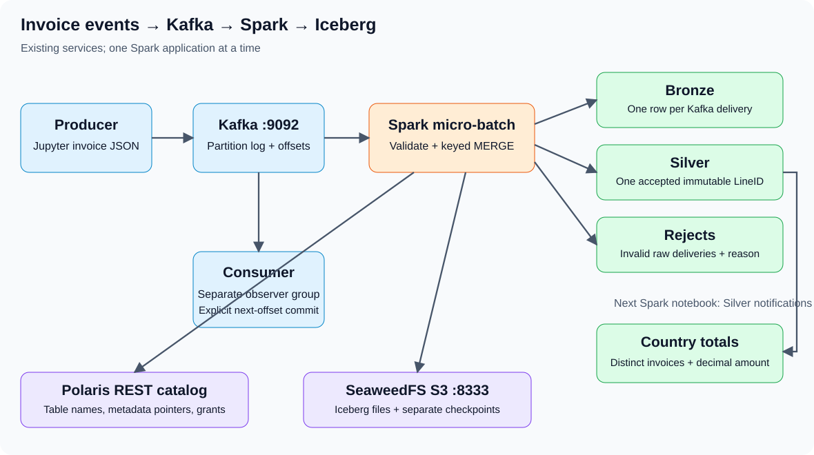

# Kafka invoices, Spark streaming and an Iceberg lake

## Follow one invoice

The producer publishes an invoice line as JSON, keyed by Country. Kafka stores the record in a partition with an offset. The Python consumer can inspect that record independently of Spark. Spark reads records through its JVM Kafka connector, validates them and commits lake tables through Polaris to SeaweedFS.

| Component | Role |
|---|---|
| Python producer | Publish invoice JSON and wait for broker acknowledgements |
| Kafka broker | Store ordered partition logs; records remain until retention removes them |
| Python consumer | Observe records and demonstrate a separate group's manual commits |
| Spark driver in Jupyter | Define the stream and coordinate finite micro-batches |
| Existing Spark worker | Run the executor tasks |
| Polaris | Resolve/authorize Iceberg table names and metadata references |
| Iceberg | Track table schemas, files, snapshots and commits |
| SeaweedFS S3 | Store Parquet/metadata objects and durable checkpoint objects |

## Two different kinds of identity

**Transport identity** is topic + partition + offset. Bronze keeps one row per delivered Kafka record. The same business event published twice has different offsets and therefore two Bronze rows. Invalid JSON is preserved too.

**Business identity** is the producer-supplied LineID. Silver accepts one immutable, valid invoice line per LineID. Exact re-publication does not duplicate the sale. A different valid payload for an existing LineID fails visibly. An invoice can contain several distinct lines, including identical product/price values; explicit IDs avoid collapsing legitimate identical lines as a full-row hash would.

Rejects retains invalid deliveries and a reason. Its identity is transport identity, so re-publishing bad data creates another rejected occurrence. Re-running the same Spark micro-batch does not duplicate that occurrence.

## Offsets are not interchangeable

The observer consumer commits its group's **next** offset after inspecting one record. A commit is not a deletion, nor is printing a record durable business processing. A new group starts at earliest available input only if it has no valid committed offset.

Spark keeps query offsets and completed micro-batches in its checkpoint, not in the observer group's commits. It can still read the original records after the observer has consumed/committed them. `startingOffsets=earliest` only initializes a new streaming query; it does not override an existing checkpoint.

Kafka guarantees ordering within a partition, not across the whole topic. Country keys route matching keys consistently while partitioning remains unchanged. Do not change topic partitioning halfway through this exercise or use offset numbers as global event ordering.

## Micro-batches, commits and replay

The Kafka query uses AvailableNow: capture available input, process it in bounded batches, then finish. A later producer batch is processed by restarting the query with the same checkpoint. `maxOffsetsPerTrigger=20` limits admission into a batch; it is not a total lifetime record limit.

Each callback writes Bronze, rejects and Silver in that order. Each Iceberg table has its own commit. A later failure does not roll back earlier table commits. The checkpoint is not successfully advanced for the failed batch, so retry revisits those records. Stable merge keys make those revisits safe under the one-writer, immutable-line contract. This is not a distributed transaction or an unrestricted exactly-once guarantee.

Use `failOnDataLoss=true`: if Kafka retention removes required offsets, stop on the error. Do not silently reset the query to latest or delete checkpoints to make it proceed.

## Country totals

The second Spark notebook reads Silver's append snapshots as notifications. For each callback, it recomputes all committed Silver rows and assigns absolute country totals. That supports exact distinct invoice counts and safe replay on the small dataset. It deliberately trades a full scan for simple correctness. No 60-second window or watermark is used here.

Keep Silver append-only. Overwrite/delete snapshots are not skipped. Gold can update existing country rows because it is read using batch queries. The merge does not remove countries that disappear from Silver; refunds, corrections, deletions and changing dimensions require a different design.

## Checkpoints and storage

Kafka-to-lake and Silver-to-country use distinct S3A checkpoint paths. Spark's Hadoop S3A client accesses those checkpoints. Iceberg's S3FileIO accesses the table objects. Both use the existing SeaweedFS endpoint and environment-backed credentials; Python kafka-python does neither.

Polaris is not the Parquet store. It returns the current metadata reference. Spark reads/writes the metadata and data objects in SeaweedFS. A successful catalog request does not prove storage access is working.

Keep topic, namespace, table locations and checkpoints together for a run. Changing a constant does not migrate an existing table. Never delete/recreate the topic under a checkpoint or expire required Silver snapshots during the exercise.

## Python pip versus Spark dependencies

`kafka-python` is needed only by the Jupyter producer/consumer. Notebook 01 includes its `%pip` cell, targeting `/workspace/.course-python/kafka-python-2.2.15` on the existing notebook volume; no image rebuild is required. Spark executors use the image's JVM Kafka connector, not that Python package. Each Spark notebook checks the existing connector, token-provider, Kafka-client, Iceberg and S3 JAR names before starting its session, without downloading anything.

## Finite processing before live processing

The producer publishes small batches and closes. The consumer stops after a record/time bound and closes in finally. The Spark queries use finite triggers and a three-minute wait limit. Only one Spark application is needed at a time; stop its session before opening the next Spark notebook.

The optional recurring query checks every thirty seconds. It keeps the executor occupied until stopped. Stop production before `processAllAvailable()`; continuously arriving input can keep that call waiting. Do not leave recurring queries running between exercises.

## References

[kafka-python 2.2.15 producer](https://kafka-python.readthedocs.io/en/2.2.15/apidoc/KafkaProducer.html), [consumer](https://kafka-python.readthedocs.io/en/2.2.15/apidoc/KafkaConsumer.html), [Spark Kafka integration](https://spark.apache.org/docs/3.5.6/structured-streaming-kafka-integration.html), and [Iceberg 1.10 streaming](https://iceberg.apache.org/docs/1.10.0/spark-structured-streaming/). These references explain the APIs; live connector behavior still needs verification on the existing stack.
