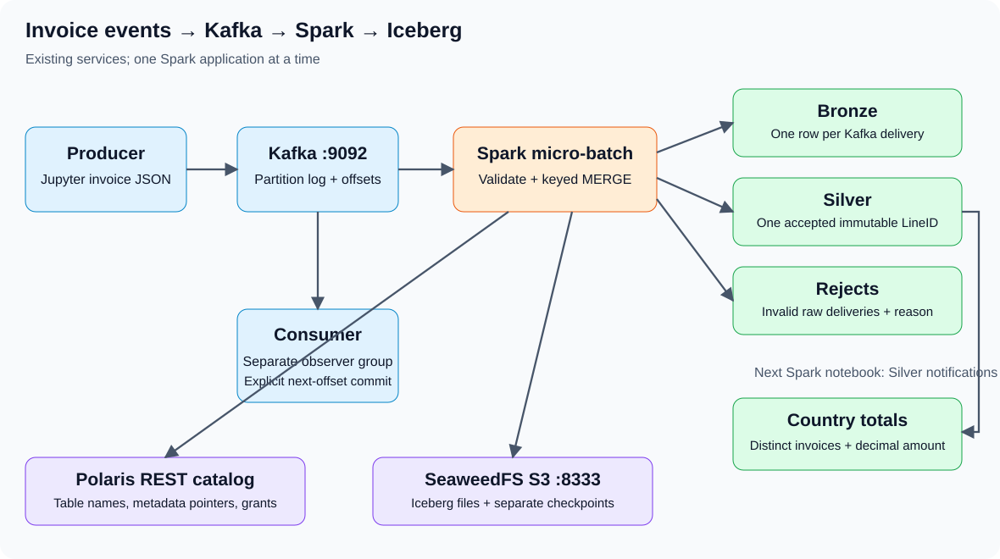

# Spark Structured Streaming: Kafka invoices to an Iceberg data lake

Use the existing JupyterLab and OpenShift services. The invoice producer, consumer, offset example and Spark Kafka example are adapted from the existing `Day46` files into the four notebooks here. Each notebook contains its own setup, functions and processing code. Upload the four notebooks directly into JupyterLab; no companion Python package or standalone runner is required.



## Run order

| File | What to run |
|---|---|
| [00: Kafka basics](00-kafka-basics.md) | Start/stop services, four-partition orders topic, literal JSON, keys, consumer groups, offsets and retention |
| [Introduction](00-kafka-spark-datalake-introduction.md) | Architecture, offsets, checkpoints, deduplication and resource limits |
| [01-invoice-producer.ipynb](01-invoice-producer.ipynb) | Install the Python client here, create the topic explicitly and send invoice batches |
| [02-invoice-consumer.ipynb](02-invoice-consumer.ipynb) | Inspect messages and demonstrate manual commits |
| [03-kafka-to-iceberg.ipynb](03-kafka-to-iceberg.ipynb) | Stream Kafka to Iceberg Bronze, Silver and rejects |
| [04-silver-to-country-totals.ipynb](04-silver-to-country-totals.ipynb) | Read Silver append snapshots and update lifetime country totals |
| Matching `.md` files | The same notebook instructions/code in readable text |
| [groups.md](groups.md) | Inspect topic partitions, observer offsets and lag |

Run selected cells in order; do not use Run All across install, send or alternative trigger cells. No notebooks contain saved outputs or credentials.

## Included adaptations of the original scripts

| Original | Adapted file here |
|---|---|
| Original invoice producer | [01: invoice producer](01-invoice-producer.ipynb) |
| Original invoice consumer | [02: invoice consumer](02-invoice-consumer.ipynb) |
| Original manual offset-commit example | Manual-commit cells in [02: invoice consumer](02-invoice-consumer.ipynb) |
| Original Spark Kafka example | [03: Kafka to Iceberg](03-kafka-to-iceberg.ipynb) and [04: country totals](04-silver-to-country-totals.ipynb) |
| `Day46/groups.md` | [groups.md](groups.md) |

The producer retains invoice JSON, Country keys and a send loop. It now uses the pure-Python `kafka-python` API, finite batches, acknowledged sends and a stable LineID. The fixed fixtures make lakehouse verification reproducible.

Notebooks 03 and 04 use the existing standalone Spark service, Polaris Iceberg and SeaweedFS. They do not start local Spark or use HDFS checkpoints. The original 60-second Kafka-output window is replaced here by the lifetime-country calculation from the [existing data-lake lesson](../07-OpenShift-Spark-Streaming-DataLake/README.md). These are different aggregation contracts. No separate Spark runner is needed.

## Python Kafka client: install inside Jupyter, without rebuilding an image

The Python producer/consumer needs `kafka-python==2.2.15`, imported as `kafka`. The install cell is included directly in **01-invoice-producer.ipynb** and its Markdown version. Run it in the existing Jupyter kernel when needed:

```ipython
%pip install --no-deps --target /workspace/.course-python/kafka-python-2.2.15 "kafka-python==2.2.15"
```

This is a pure-Python package. `%pip` targets the current kernel and the explicit destination is on the existing notebook PVC. It avoids system/site-package writes and an unwritable `/nonexistent` home in container exec sessions. Every notebook adds that directory to its Python import path. Check the imported version. Restart only the notebook kernel if an older imported module is cached; no pod/service restart is needed. Repeating the same pinned install can report that the target files already exist; once the version check passes, skip the install on later runs.

If an offline wheel is already available under `/workspace/wheels`, use this instead:

```ipython
%pip install --no-index --find-links=/workspace/wheels --no-deps --target /workspace/.course-python/kafka-python-2.2.15 "kafka-python==2.2.15"
```

If notebook-volume permissions fail or no package source is available, stop and inspect that environment. Do not use sudo, install the unrelated `kafka` package or rebuild the image. Copying the course does not itself run pip.

**Spark does not use kafka-python.** Its source needs the existing Spark Kafka connector and dependencies in `/opt/spark/jars`. Setup checks their presence. Pip does not supply those JARs. Do not add `--packages` downloads or install PySpark/Iceberg/Hadoop into the notebook environment.

## Existing endpoints and isolated names

| Item | Value |
|---|---|
| Namespace / Jupyter container | `bigdata` / `jupyter` in `spark-master-0` |
| Kafka bootstrap inside the cluster | `kafka:9092` |
| Spark standalone master | `spark://spark-master:7077` |
| Polaris / existing catalog | `http://polaris:8181/api/catalog` / `training` |
| SeaweedFS S3 / bucket | `http://seaweedfs:8333` / `warehouse` |
| Default topic / observer group | `invoices-lake` / `invoice-observer` |
| New Iceberg namespace | `polaris.invoice_lake` |
| Table location root | `s3://warehouse/iceberg/invoice_lake` |
| Checkpoint root | `s3a://warehouse/invoice-lake/checkpoints` |

The **first code cell in every notebook** contains the settings. Use the same values across all four notebooks:

```python
TOPIC = "invoices-lake"
CONSUMER_GROUP = "invoice-observer"
DATALAKE = "polaris.invoice_lake"
LOCATION_ROOT = "s3://warehouse/iceberg/invoice_lake"
INGEST_CHECKPOINT = "s3a://warehouse/invoice-lake/checkpoints/kafka_to_lake"
GOLD_CHECKPOINT = "s3a://warehouse/invoice-lake/checkpoints/silver_to_country"
```

These are fixed, readable names; no random identifiers are generated. Table names are visibly derived from DATALAKE in the same cell. Notebook calls pass the selected names explicitly into the functions defined in each notebook. For an independent dataset, choose another simple topic/lake/location/checkpoint set and update every notebook consistently. Keep the original settings for resume. Changing a location does not relocate an existing table. Do not recreate a topic or remove a checkpoint while resuming.

`DATALAKE` is the Spark catalog/namespace identifier. `LOCATION_ROOT` is its SeaweedFS S3 object prefix; the two settings serve different purposes and should describe the same exercise dataset.

All settings are in the first code cell of each notebook. The functions and callbacks are defined in later cells in the same notebook.

Credentials come from the existing Jupyter environment. They are used by Spark's catalog/S3 clients, never printed or copied into cells. Kafka uses the existing internal listener; a bootstrap connection is insufficient unless advertised broker addresses are also reachable from Jupyter/executors.

## Edit and run directly in JupyterLab

Jupyter already runs in `spark-master-0`. Open `user_notebooks/10-OpenShift-Spark-Streaming-Kafka-DataLake` in its file browser and start with `01-invoice-producer.ipynb`. No publishing script or additional deployment is needed.

Edit code cells directly in JupyterLab and save the notebook. Setup, sample data, validation and processing functions are included in the notebook itself. The files are on the existing `/workspace` notebook volume.

Stop streaming queries before changing their code. Rerun edited function-definition cells before starting another query. If a fresh Spark context is needed, release the session and restart only the affected notebook kernel. Do not restart the pod or Spark services.

The host directory and Jupyter's volume are separate copies. Saving in Jupyter does not update the host source automatically, and editing host files does not update the copied notebook. Avoid copying over active edits.

### One-time copy only if the course folder is missing

From the host terminal, with the destination folder absent:

```bash
cd ~/openshift
export PATH="$HOME/.crc/bin/oc:$PATH"
oc cp ./10-OpenShift-Spark-Streaming-Kafka-DataLake bigdata/spark-master-0:/workspace/user_notebooks/10-OpenShift-Spark-Streaming-Kafka-DataLake -c jupyter
```

Skip this copy if the folder is already visible in JupyterLab. It copies files without executing them. Alternatively, upload just the four `.ipynb` files through JupyterLab. No subdirectory or companion Python files are required.

If needed, open the existing Jupyter service through a loopback forward:

```bash
export PATH="$HOME/.crc/bin/oc:$PATH"
oc port-forward -n bigdata pod/spark-master-0 28888:8888 --address=127.0.0.1
```

Keep that terminal open and use `http://127.0.0.1:28888/lab` in the host browser with the existing Jupyter token. Use an existing forwarder instead if it already serves the UI. Do not display authentication configuration.

## Hands-on sequence and expected results

1. Check the existing services; use the startup commands below if Kafka/ZooKeeper were paused. Start with notebook 01; the Spark notebooks perform their own preflight before creating a session.
2. Open producer 01, run its pip/version cells if needed and create the fresh topic explicitly. Set SEND_A to True and run that send cell once: ten Kafka records.
3. Open consumer 02. Observe ten records. Optionally demonstrate explicit commits. This does not affect Spark's progress.
4. Run 03's finite ingest and inspect the lake: Bronze 10, Silver 7, rejects 2; accepted amount 175.00. Stop its Spark session.
5. Run 04 in a fresh kernel: country totals below. Stop its Spark session.
6. Return to producer 01, set SEND_B to True and send only B: two more Kafka records.
7. Reopen 03 with the unchanged run/checkpoint, process finite input, inspect and stop Spark. Expect Bronze 12, Silver 8, rejects 2; accepted amount 225.00.
8. Reopen 04 with its unchanged checkpoint, update Gold and stop Spark.
9. Re-run finite processing without new messages. Counts/totals must remain unchanged.

| Country | Orders after A | Amount after A | Orders after B | Amount after B |
|---|---:|---:|---:|---:|
| IN | 2 | 110.00 | 2 | 110.00 |
| UK | 1 | 30.00 | 2 | 80.00 |
| US | 1 | 35.00 | 1 | 35.00 |

TotalOrders counts distinct invoices per country; it is not a line count or quantity sum. Money uses one reporting currency and excludes invalid/cancelled sales, tax, shipping and refunds. Re-publishing A after B deliberately adds ten raw deliveries: Bronze becomes 22 and rejects 4, but Silver stays 8 and Gold stays 225.00. Actual offsets/file/snapshot IDs vary.

## Resource and safety boundaries

### Start the existing ZooKeeper and Kafka only when paused

These commands change replica counts on the already installed workloads. Run them deliberately when the services are needed; they do not rebuild images or replace service configuration. Start ZooKeeper first and wait, then start Kafka:

```bash
export PATH="$HOME/.crc/bin/oc:$PATH"
oc scale statefulset/zookeeper -n bigdata --replicas=1
oc rollout status statefulset/zookeeper -n bigdata --timeout=300s
oc scale statefulset/kafka -n bigdata --replicas=1
oc rollout status statefulset/kafka -n bigdata --timeout=300s
oc get pods -n bigdata -l app=zookeeper
oc get pods -n bigdata -l app=kafka
```

If they were already running, do not restart them. When both were originally paused and no other work needs them, stop Kafka first and then ZooKeeper after all producer/consumer/Spark work has finished:

```bash
oc scale statefulset/kafka -n bigdata --replicas=0
oc wait -n bigdata --for=delete pod/kafka-0 --timeout=180s
oc scale statefulset/zookeeper -n bigdata --replicas=0
```

Keep the existing Kafka/ZooKeeper PVCs. Do not stop services that were already in use by other work.

Use only one Spark notebook/application at a time: one worker core, a 512 MiB executor and two shuffle partitions. Default triggers finish; recurring mode is explicit and must be stopped. Release Spark before moving to the next Spark notebook. This avoids the two-simultaneous-driver requirement of the older exercise.

No new Kubernetes manifests, service configuration changes, extra brokers/workers, image builds or restarts are needed. The optional start/stop commands above only resume/pause existing Kafka and ZooKeeper. If required JARs/credentials are missing, stop instead of rebuilding the stack. Normal hands-on actions create only the explicitly named topic, consumer commits, table objects and checkpoints in the existing services. No remote actions are performed by the local validation tests.

Keep checkpoints, topic data and Silver snapshots for resume. Do not run the old streaming runner: it includes service restart checks. No destructive cleanup commands are included here.
