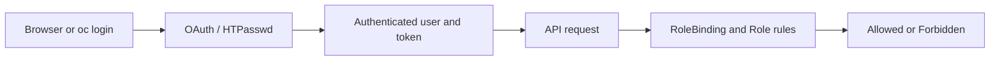
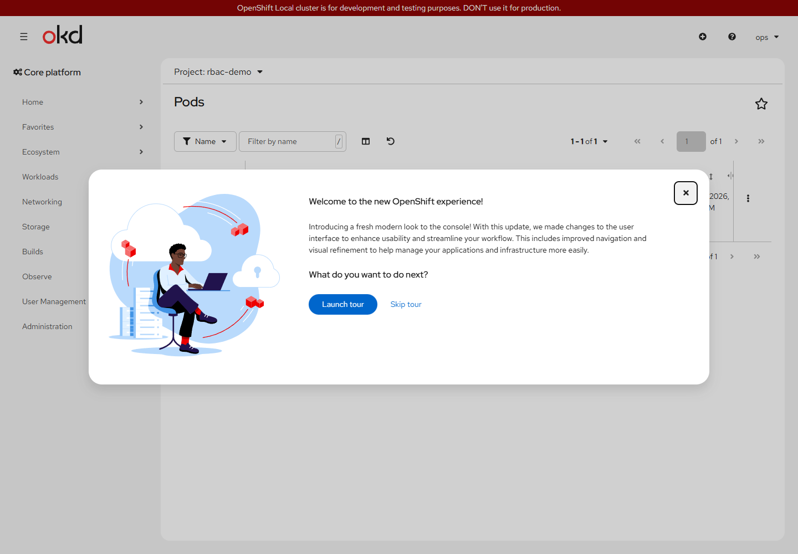

# OKD administration: users, portal access and RBAC

This lesson creates three temporary OKD accounts, gives them different duties in
one project, and proves the differences through both the web console and `oc`.
The exercise uses its own `rbac-demo` project and does not grant access to the
existing `bigdata` applications.

## Authentication and authorization

**Authentication** answers “Who are you?” The OAuth server checks a username and
password against the configured HTPasswd identity provider, then issues a token.
The web console and `oc login` use that same authentication system.

**Authorization** answers “What can that identity do?” The API checks RBAC for
every request. A successful login does not grant permission to administer the
cluster. Hiding or showing a console button is not the security boundary: the
API enforces the permission even when a command is typed manually.



An HTPasswd file stores password hashes, not Kubernetes permissions. A Secret
supplies that file to the identity provider. Creating a Kubernetes `User` object
alone does not create a password. With the `claim` mapping method, the first
successful login creates the OKD User and Identity mapping automatically.

Operating-system accounts and OKD accounts are independent identities.
Their sessions and permissions are separate.

## The RBAC objects

| Object | Purpose in this lesson |
|---|---|
| Role | Rules limited to a namespace: API groups, resources and verbs |
| ClusterRole | Reusable or cluster-scoped rules; OKD supplies an `admin` ClusterRole |
| RoleBinding | Grants a Role, or a ClusterRole's namespaced permissions, in one namespace |
| ClusterRoleBinding | Grants a ClusterRole across the cluster; this exercise creates none |

`get`, `list`, `watch`, `create`, `update`, `patch` and `delete` are different
verbs. Subresources are separate too: `pods/log` controls logs and `pods/exec`
controls opening a process inside a container.

A RoleBinding to the built-in `admin` ClusterRole in `rbac-demo` makes the user
a **project administrator**, not `cluster-admin`. The name of an account does
not itself give permissions: naming a user `admin` is not an authorization rule.

## Accounts and expected permissions

Choose account passwords interactively during setup. No fixed passwords are supplied.

| Username | Binding | Intended duty |
|---|---|---|
| `admin` | `project-admin` → built-in `admin` ClusterRole | Manage this project's applications and access |
| `dev` | `project-developer` → `app-developer` Role | Deploy, update and debug applications |
| `ops` | `project-operator` → `app-operator` Role | Inspect workloads/logs and delete a pod to restart it |

The following table concerns **rbac-demo**, unless another scope is stated.

| Operation | admin | dev | ops |
|---|:---:|:---:|:---:|
| Log in to console and CLI | Yes | Yes | Yes |
| List pods and read logs | Yes | Yes | Yes |
| Create ConfigMaps | Yes | Yes | No |
| Create/update/scale Deployments | Yes | Yes | No |
| Delete a pod (controller replaces it) | Yes | Yes | Yes |
| Execute a command in a pod | Yes | Yes | No |
| Directly read Secrets | Yes | No | No |
| Manage namespace Roles/RoleBindings within granted authority | Yes | No | No |
| Read cluster nodes | No | No | No |
| Read pods in existing bigdata project | No | No | No |

The `dev` role is a trusted application-developer role. Although direct Secret
reads are denied, someone who can create pods can potentially mount Secrets or
use service accounts available in that namespace. Use separate projects for
stronger separation between developers and sensitive workloads.

RBAC permissions are additive: a restrictive Role does not cancel another
RoleBinding or group grant. OKD commonly grants `self-provisioner` to
`system:authenticated:oauth`. When that default grant is present, all three accounts can request
their own new projects and become administrators of those projects. This does
not grant access to `bigdata`, and this lesson leaves that existing cluster
policy unchanged. Use a separate, deliberate cluster-policy exercise if project
self-provisioning must be disabled.

## Portal and CLI access

Get the portal address as the existing cluster administrator:

```bash
oc -n openshift-console get route console -o jsonpath='{.spec.host}{"\n"}'
```

Open the returned HTTPS address in a browser that can resolve the cluster routes.
Use a separate private window or browser profile for each user. Select the
**rbac-training** identity provider, enter that account's credentials, choose
the `rbac-demo` project, and open **Workloads → Pods**.

Available console perspectives and navigation can vary by version. Switching
to an Administrator perspective does not grant cluster-administrator rights.
Expect Forbidden responses for operations outside the user's permissions.

The tested operator session is authenticated as `ops` in `rbac-demo`. The
first-login welcome dialog is visible in this captured session; select
**Skip tour** before exploring the pod table. API checks recorded alongside
the screenshot verify the role's allowed and denied operations:



For the CLI, `oc login` obtains a user token. Use a separate kubeconfig per user
so changing identities does not overwrite the administrator's admin session. The
hands-on lesson shows this explicitly and checks permissions with real logins,
not only administrator impersonation.

Deleting a User alone is insufficient cleanup: the identity provider could let
the same password recreate it, and tokens also require revocation. The cleanup
procedure removes the temporary identity provider, hashes, namespace/RBAC,
users, identities, access/authorization tokens, client authorizations and local
test kubeconfigs. Normal cluster audit history remains intact.

## Official references

- [OKD 4.22: using RBAC](https://docs.okd.io/4.22/authentication/using-rbac.html)
- [HTPasswd identity provider](https://docs.okd.io/4.22/authentication/identity_providers/configuring-htpasswd-identity-provider.html)
- [Configuring project creation and self-provisioning](https://docs.okd.io/4.22/applications/projects/configuring-project-creation.html)
