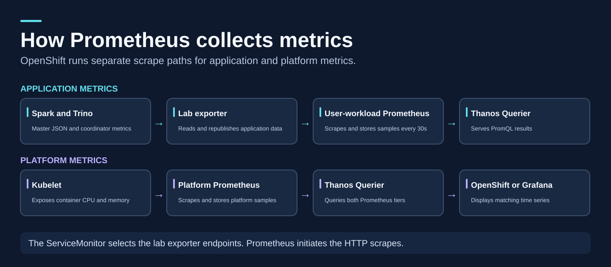

# Prometheus on OpenShift

Prometheus periodically scrapes HTTP endpoints and stores samples as time series. Each series has a metric name and labels. Gauges can rise or fall. Counters increase until they reset, for example after a restart. In PromQL, `rate()` estimates a counter's per-second increase over a specified window.

## What Prometheus does

Prometheus is a monitoring system and a time-series database. It answers questions such as “How many Spark workers were registered over the last 30 minutes?” and “When did CPU usage rise?” For example, every scrape of `bigdata_spark_workers` can add another timestamped value to the same series. A label change creates a different series, which lets you distinguish sources such as two containers exposing the same metric.

| Component | Role |
| --- | --- |
| Target discovery | Finds endpoints to scrape. In OpenShift, the Prometheus Operator turns resources such as ServiceMonitors into scrape configuration. |
| Scrape engine | Pulls metrics over HTTP and records whether each scrape succeeded in the `up` metric. |
| Time-series database (TSDB) | Stores timestamped samples and indexes their names and labels. |
| PromQL engine | Filters, aggregates and calculates values. An instant query evaluates at one timestamp. A range query evaluates repeatedly over an interval. |
| Rule evaluator | Runs configured expressions periodically. Recording rules save computed series. Alerting rules can send firing alerts to Alertmanager, which groups and routes notifications. |
| Thanos Querier | Provides a common OpenShift query endpoint over the platform and user-workload Prometheus tiers. |

### How metrics move through OpenShift



[PNG version](assets/prometheus-metric-flow.png)

In this diagram, solid arrows follow the data. The exporter reads the applications, and Prometheus initiates scrapes of the exporter. When you run a query in OpenShift, Thanos reads the matching series and returns the result to the console. The selected time range controls which stored observations you see.

## Inspect the monitoring setup

The Cluster Monitoring Operator manages platform Prometheus in `openshift-monitoring`. The setting `enableUserWorkload: true` in `00-native-monitoring.yaml` enables application monitoring in `openshift-user-workload-monitoring`. Thanos Querier provides a common query layer.

In `30-servicemonitors.yaml`, the `training-bigdata-metrics` ServiceMonitor selects the Service labeled `app: bigdata-metrics` and scrapes its endpoints on the named `http` port. This is the relevant `spec` excerpt.

```yaml
selector:
  matchLabels:
    app: bigdata-metrics
endpoints:
  - port: http
    path: /metrics
    interval: 30s
```

From an authenticated OpenShift terminal, inspect the active monitor and its endpoint discovery.

```bash
oc -n openshift-user-workload-monitoring get pods
oc -n bigdata get servicemonitor training-bigdata-metrics
oc -n bigdata get svc bigdata-metrics --show-labels
oc -n bigdata get endpointslices -l kubernetes.io/service-name=bigdata-metrics
```

## Follow Spark and Trino metrics

- **Spark.** The exporter in `application-metrics.py` fetches `http://spark-master:8080/json/`. It counts workers marked `ALIVE` and derives gauges for workers, active applications and worker cores.
- **Trino.** The same exporter reads `http://trino:8080/metrics` and republishes selected QueryManager, ClusterMemoryManager and garbage-collection metrics.
- **Scraping.** The exporter refreshes its cache about every 30 seconds. Prometheus scrapes the cache through the ServiceMonitor. The `pod` label on these application series identifies the scrape target, the exporter. On native container CPU and memory metrics, `pod` identifies the workload being measured.

## Run queries in the browser

1. Open the OpenShift web console. In the **Administrator** perspective, go to **Observe → Metrics**.
2. Set **Last 30 minutes**. Paste one expression at a time and select **Run queries**.
3. Inspect the graph and series labels. The `prometheus-api-http` Route exposes the project-scoped query API. Use **Observe → Metrics** or [Grafana Explore](03-grafana.md) for the interactive interface. [OpenShift monitoring guide](https://docs.redhat.com/en/documentation/openshift_container_platform/4.17/pdf/monitoring/OpenShift_Container_Platform-4.17-Monitoring-en-US.pdf)

Check the exporter scrape. A value of `1` means Prometheus scraped it successfully. A value of `0` indicates a scrape failure.

```promql
up{namespace="bigdata",service="bigdata-metrics"}
```

Check which upstream endpoints the exporter reached. Expect separate `spark` and `trino` series when both checks are available.

```promql
bigdata_service_up{component=~"spark|trino"}
```

Run these separately to see Spark worker registration and Trino's cumulative completed-query total.

```promql
bigdata_spark_workers
```

```promql
trino_execution_name_QueryManager_CompletedQueries
```

Compare workload CPU usage. A value of `0.5` means half a CPU core on average over five minutes.

```promql
sum by (pod) (
  rate(container_cpu_usage_seconds_total{namespace="bigdata",container!="",container!="POD",pod=~"spark-.*|trino-.*"}[5m])
)
```

If a series is missing, check the time window, exporter scrape status and upstream endpoint health. A successful exporter scrape can coexist with a failed application endpoint or an unhealthy container.
