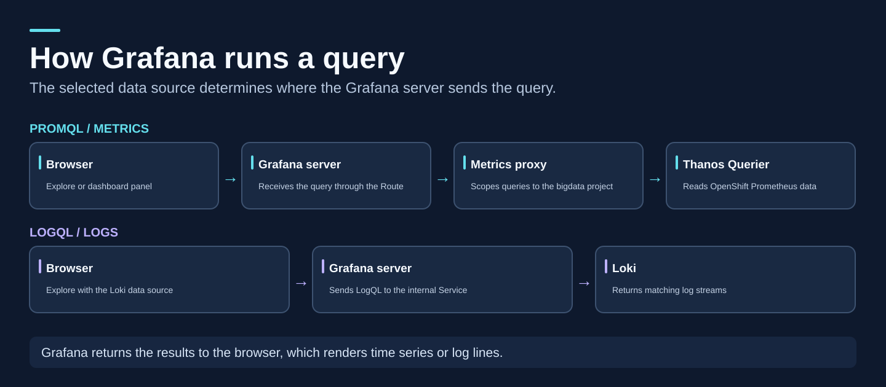

# Grafana

Grafana sends queries to configured data sources and visualizes their results. A dashboard groups panels around a shared time range. Each panel specifies a query, visualization and units. Explore gives you a place to run ad hoc queries without editing a dashboard.

The data sources in `20-dashboards-metrics.yaml` are **OpenShift Prometheus** and **Loki**. Grafana sends PromQL through the metrics proxy in its pod, which queries Thanos with access scoped to `bigdata`. Grafana sends LogQL to the Loki Service.

## What Grafana does

Grafana is a visualization and investigation application. In this lab you can use the same browser interface to plot Spark memory from Prometheus and read Spark container logs from Loki. Set the same time range in both views to compare what changed with what the container reported.

| Component | Role in this lab |
| --- | --- |
| Web UI | Provides dashboards, Explore, the time picker and query editors. |
| Grafana server | Handles sign-in and dashboard access, executes server-side data-source requests and returns results to the browser. |
| Data-source plugins | Translate a Grafana query request into the backend API request. The **OpenShift Prometheus** source uses PromQL and **Loki** uses LogQL. |
| Dashboard and panels | Store query and presentation settings such as legend, unit, visualization and time range. The **Training** folder contains provisioned dashboards. |
| Grafana database | Persists Grafana-managed settings and dashboards. The metrics and log records stay in their respective backends. |
| Metrics proxy | Runs alongside Grafana in the same pod and sends project-scoped queries to Thanos. |

### What happens when you run a query



[PNG version](assets/grafana-query-flow.png)

When you select **Run query** in Explore, the browser sends the expression and time range to Grafana. Grafana uses the selected data source to query the backend. The browser renders the returned samples as a graph or the returned log entries as a list. Dashboard refresh repeats this process with the current time range.

## Open Grafana

In the OpenShift console, select project **bigdata**, go to **Networking → Routes** and open the location for **ops-grafana**. Alternatively, print the route hostname from an authenticated terminal.

```bash
oc -n bigdata get route ops-grafana -o jsonpath='{.spec.host}{"\n"}'
```

Open that hostname over HTTPS and sign in with your assigned Grafana access.

## Explore pod memory and inspect a dashboard

1. Open **Explore**, select **OpenShift Prometheus**, switch to **Code** and set **Last 30 minutes**.
2. Paste the query below and select **Run query**. Use **Range** if the query is in instant mode. Hover over a line to inspect the pod and its memory working set in MiB.
3. Open **Dashboards → Training** and choose **Spark monitoring** or **Trino monitoring**. Set the same time range and compare a panel with the corresponding query from the [Prometheus lesson](00-Promethus.md).
4. Note a pod and timestamp. Use the [Loki lesson](04-grafana-loki.md) to inspect that pod's logs around the same time.

```promql
sum by (pod) (
  container_memory_working_set_bytes{namespace="bigdata",container!="",container!="POD"}
) / 1024 / 1024
```

If the route is missing, see [the route setup guide](routes-grafana-promethus-loki.md).
