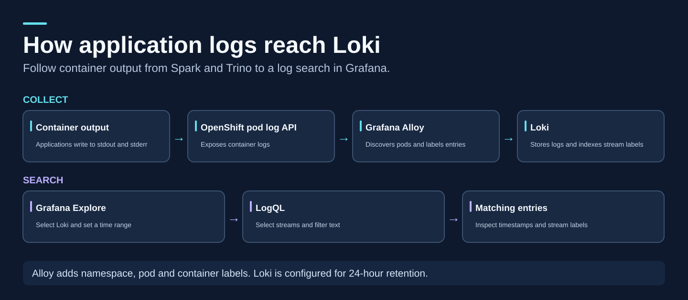

# Grafana Loki and application logs

A log is a timestamped record of an event. For example, a Spark container might record a worker registration or print an exception with a stack trace.

The container runtime captures application stdout and stderr. Alloy discovers pods in `bigdata`, reads their container logs through the Kubernetes API, attaches labels and pushes entries to Loki. Loki indexes the labels and stores the log lines. Grafana searches those streams with LogQL. Spark event history follows its separate storage configuration.



[PNG version](assets/loki-log-flow.png)

## Where collection is configured

In `10-logging.yaml`, the `alloy-config` ConfigMap contains `config.alloy`. These excerpts show the discovery scope, log source and destination.

```alloy
discovery.kubernetes "pods" {
  role = "pod"
  namespaces { names = ["bigdata"] }
}
```

The `discovery.relabel "logs"` block maps Kubernetes metadata to stream labels such as `namespace`, `pod` and `container`.

```alloy
loki.source.kubernetes "pods" {
  targets    = discovery.relabel.logs.output
  forward_to = [loki.write.local.receiver]
}
loki.write "local" {
  endpoint { url = "http://loki:3100/loki/api/v1/push" }
}
```

The same manifest sets Loki's `limits_config.retention_period` to `24h`.

## Search and compare existing logs

1. Open [Grafana](03-grafana.md), go to **Explore**, select **Loki**, switch to **Code** and set **Last 30 minutes**.
2. Run the project query and then narrow it to Spark and Trino. Expand a line to inspect its timestamp and container labels.

```logql
{namespace="bigdata"}
```

```logql
{namespace="bigdata",pod=~"spark-.*|trino-.*"}
```

3. Add a case-insensitive text filter. An empty result can mean the selected streams contain no matching messages. If the unfiltered query is empty, widen the range to **Last 6 hours** and use the label browser to find pods that emitted logs. [LogQL log queries](https://grafana.com/docs/loki/latest/query/log_queries/)

```logql
{namespace="bigdata",pod=~"spark-.*|trino-.*"} |~ "(?i)error|exception|failed"
```

4. Compare a Loki entry with live container logs. Substitute the pod and container names from the expanded log entry and match the duration to the Grafana time range.

```bash
oc -n bigdata logs POD_NAME -c CONTAINER_NAME --since=30m --timestamps
```

For a restarted container, add `--previous` to read the previous terminated instance in the same pod. Loki can retain older entries already collected within its retention window. Compare the log timestamp with the CPU or memory graph for that pod.
