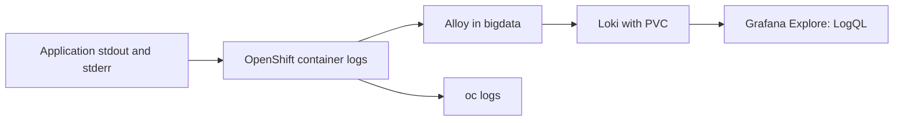
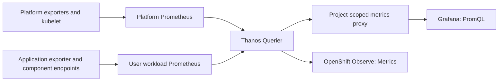

# Architecture and telemetry

Telemetry is data emitted by a running system. Observability uses that data to explain behavior such as a slow Spark job or a failed API call.

| Signal | Meaning | Example | Backend here |
|---|---|---|---|
| Logs | Timestamped event messages | Executor exception | Loki |
| Metrics | Numeric measurements over time | Container memory in bytes | OpenShift Prometheus |
| Traces | Related spans across request operations | API request and database call | Requires instrumentation and a trace backend; not configured by this stack |

OpenTelemetry provides instrumentation and signal collection/export conventions. OpenShift Telemetry is a separate remote health feature.

## Logs architecture

Alloy discovers pods and reads their logs through the Kubernetes API in `bigdata`. Loki stores log streams and indexes their labels. Grafana queries Loki. Files inside containers are collected only when a collection path exists or their contents are written to stdout/stderr. Host journals and audit logs are outside this configured collection scope.

## Metrics architecture

Prometheus periodically pulls metrics from selected endpoints. Thanos provides a combined query layer. Grafana's proxy uses a rotating service-account token, validates the service CA and restricts queries to `bigdata`. Routes and port forwarding provide access; they do not collect signals.

## Investigate a symptom

1. Find a pod's CPU or memory spike in Grafana.
2. Set a time range around that spike.
3. Query that pod's logs in Loki over the same range.
4. Compare with `oc describe pod` for scheduling failures, restarts and probe errors.

Metrics show scale and timing. Logs describe events. Kubernetes events describe control-plane actions and are not automatically collected as application logs.

Background: [Loki concepts](https://grafana.com/docs/loki/latest/get-started/) and [Alloy documentation](https://grafana.com/docs/alloy/latest/).
