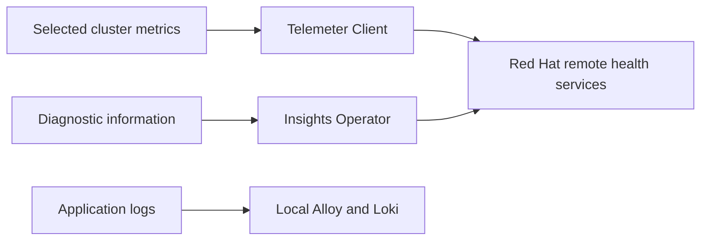

# OpenShift Telemetry

Telemetry in general means emitted operational data. **OpenShift Telemetry** names a specific remote health feature: the Telemeter Client sends selected aggregated cluster health and usage metrics to Red Hat. The Insights Operator provides a separate diagnostic reporting workflow. These features are separate from application log storage and Grafana queries. See [Red Hat's Telemeter description](https://catalog.redhat.com/en/software/containers/openshift4/ose-telemeter/5cdc236dd70cc57c44b24801) and [remote health monitoring](https://docs.redhat.com/en/documentation/openshift_container_platform/4.8/pdf/support/OpenShift_Container_Platform-4.8-Support-en-US.pdf).



## Inspect the installed distribution

This prepared environment uses CRC/OKD. Components and reporting behavior depend on distribution, configuration, credentials and connectivity. Confirm actual resources:

```bash
oc get clusterversion
oc get co monitoring
oc -n openshift-monitoring get deployments
oc -n openshift-monitoring get pods -o name | grep -E 'telemeter|prometheus|thanos'
oc get co insights
oc -n openshift-insights get pods
```

An absent Insights operator or Telemeter pod can reflect the installed distribution. It does not establish that application monitoring is broken. If Telemeter exists:

```bash
oc -n openshift-monitoring describe deployment telemeter-client
oc -n openshift-monitoring logs deployment/telemeter-client --tail=50
```

Inspect local monitoring separately:

```bash
oc -n openshift-monitoring get configmap cluster-monitoring-config -o yaml
oc -n openshift-user-workload-monitoring get configmap user-workload-monitoring-config -o yaml
oc -n bigdata get servicemonitors
```

The supplied configuration enables user-workload monitoring for application metrics. This does not imply that all application logs are sent remotely. Keep these exercises read-only.

| Feature | Purpose | Check |
|---|---|---|
| Platform monitoring | Local OpenShift health metrics and alerts | Monitoring operator and console Observe |
| User-workload monitoring | Local application scraping | ServiceMonitors and PromQL |
| Application logging | Local `bigdata` log storage | Alloy, Loki and LogQL |
| OpenShift Telemetry | Selected remote cluster health metrics | Telemeter, if installed |
| OpenTelemetry | Instrumentation and signal transport framework | Application and collector configuration |

An unavailable remote reporting service does not by itself mean local metrics and logs are unavailable.
