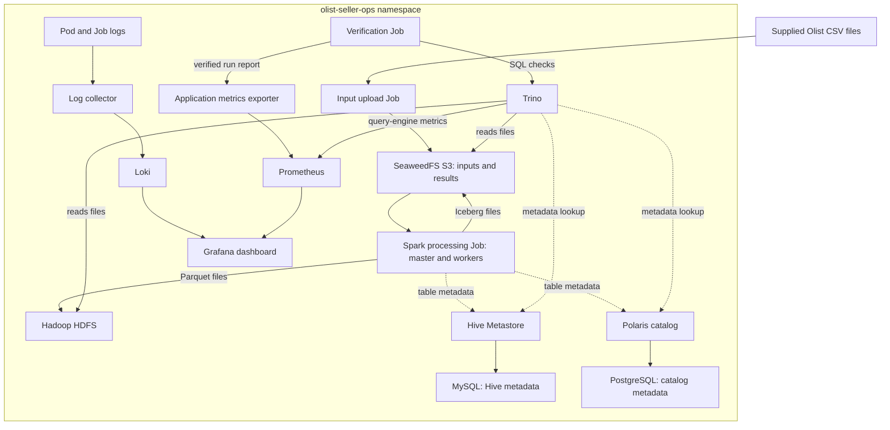

# Olist Seller Operations Platform

> **Guidance note:** The directions and hints are provided for information, to clarify expectations and help save time. They are not intended to prescribe a single approach or influence your solution choices. Use your own judgment and explain your decisions while meeting the required outcomes.

Deploy a platform that helps Olist's seller operations team check seller activity, merchandise value, fulfillment status and shipping deadlines. Use Spark to process the supplied data, Hive/Hadoop and Polaris/S3 to store the results, Trino to check them, and Loki, Prometheus and Grafana to observe the platform.

Plan for approximately **3.5 hours** with the existing cluster and supplied images ready. Data, standalone programs, SQL and manifests are ready. Your work is deployment and administration. Use your existing CRC/OpenShift cluster and its supplied images. Do not build images, write application code, change platform monitoring or alter registry permissions.

[Work steps](#work-to-complete) | [Architecture](#architecture) | [Assessment](#assessment) | [Submission](#submission) | [Cleanup](#cleanup-after-review)

## Architecture



Dashed arrows show table-metadata lookups or registration. Trino reads the physical files from HDFS and S3. ConfigMaps and Secrets provide settings and credentials. Services and Routes expose Spark UI and Grafana; Service forwarding is an alternative.

The diagram shows the logical platform. Follow the work order below: Spark publishing finishes before Trino verification, and completed batch services stop before dashboard observation.

## Before beginning

Use the existing CRC/OpenShift installation on the supplied training VM. The manifests reuse the course images; no image builds or new cluster installation are part of the exercise.

Before beginning, confirm cluster access, a Ready node, a working default StorageClass and availability of the image references listed in `IMAGES.json`. Private image references must already be accessible through the training environment. Do not add registry grants or change security policies to work around a different VM image.

The workflow limits memory use by finishing Spark publishing before starting Trino verification. It then checks scaling and Hive access, saves evidence, and stops completed batch services before bringing up the dashboard. PVCs are retained until cleanup. Follow that order even if the VM has spare capacity.

The reference cluster has an unavailable Kubernetes Metrics API. Application metrics use the supplied exporter and Prometheus, so processing and dashboard checks do not depend on that API. The final task is to inspect and explain its availability, leaving platform configuration unchanged.

CRC may report `OKD: Starting` while the existing API is reachable and its node is Ready because pre-existing operator checks are incomplete. Record the operator conditions; do not change platform services to make the summary label disappear.

Browser access uses the Route hosts created by the cluster. Service forwarding is provided as an alternative. Use the VM's own terminal and browser; `localhost` in the reference commands refers to that VM.

## Supplied files

| Location | Contents |
|---|---|
| `data/` | CSV inputs, checksums, row counts and expected totals |
| `programs/` | Complete standalone processing, verification, upload and telemetry programs |
| `manifests/` | Deployments, Jobs, storage, networking, settings and blank credential templates |
| `queries/` | Ready-to-run Trino validation and Hive metadata queries |
| `IMAGES.json` | Existing image references used by the manifests |

## Data and expected results

The supplied sample contains 3,095 sellers, 3,000 orders and 3,379 order-item rows. Orders are selected by a reproducible hash of `order_id`; all associated items and all sellers are retained. File sizes, hashes and row counts are in `data/manifest.json`.

Use the original relationships:

- `sellers.seller_id = order_items.seller_id`
- `order_items.order_id = orders.order_id`

### Seller activity

`seller_activity` has one row for every seller, including sellers with no sampled orders. It contains seller ID/state, distinct orders handled, item rows, merchandise value excluding freight, delivered/canceled/other distinct order counts, and on-time/late/missing carrier-handoff item counts.

Shipping performance compares item-level `shipping_limit_date` with order-level `order_delivered_carrier_date`. Equality is on time. A missing carrier timestamp is counted separately. The order-level timestamp is an operational proxy; it does not prove an individual seller's exact dispatch time.

Orders involving several sellers count once for each seller. Fulfillment counts are distinct orders per seller; shipping counts are item rows.

### Geography

`seller_geography` contains seller state, seller count and order-item rows. There are 23 state rows in the supplied sample.

### Expected totals

| Measure | Value |
|---|---:|
| Sellers | 3,095 |
| Input orders | 3,000 |
| Item rows | 3,379 |
| Seller-order pairs | 3,007 |
| Merchandise value | 390,764.28 |
| Delivered seller-order pairs | 2,947 |
| Canceled seller-order pairs | 11 |
| Other seller-order pairs | 49 |
| On-time handoff items | 3,022 |
| Late handoff items | 321 |
| Missing handoff items | 36 |

Both business tables are published to Hive/HDFS and Polaris/Iceberg/S3. The verification Job compares every row from both catalogs with independently calculated results from the CSV bytes. A successful run records `SELLER_OPS_PASS`, a report in the exporter and a durable verification table in Polaris/S3.

The processing programs are standalone files. They use the Python and Spark libraries already present in the supplied image; they do not import other project files or require package installation.

Source: [Brazilian E-Commerce Public Dataset by Olist](https://www.kaggle.com/datasets/olistbr/brazilian-ecommerce). Retain its CC BY-NC-SA 4.0 attribution and terms when distributing this subset.

## Assessment

| Area | Marks | Full credit | Partial credit | Evidence |
|---|---:|---|---|---|
| Cluster access and project | 10 | Identity/version, Ready node, storage and correct active project verified | 5-8 for a missing check; 1-4 for access without correct project use | Access and project records |
| Configuration and credentials | 15 | Settings and all Secret references match; input ConfigMaps are correct; evidence contains no credentials | 8-12 for a minor corrected mismatch; 1-7 for incomplete configuration | Sanitized manifests and reference/key checks |
| Deployment and storage | 15 | Required services verified Ready, PVCs Bound, initialization Jobs complete and DataNode registered; controlled shutdown recorded | 8-12 for one incomplete component with a sound diagnosis; 1-7 for a partial platform | Pod/PVC/Job status and dependency checks |
| Networking and access | 10 | Services select the right pods; Spark and authenticated Grafana are accessible; Pod/Service/Route distinction is understood | 5-8 for demonstrated forwarding with a documented Route limit; 1-4 for pod-only access | Services, Routes, endpoints and access results |
| Processing and validation | 15 | Both supplied Jobs succeed; correct business totals, both outputs and zero cross-catalog differences; physical storage checked | 8-12 for successful processing with incomplete result evidence; 1-7 for a diagnosed incomplete run | Run ID, success logs, SQL results and storage checks |
| Scaling | 10 | One-to-two desired/Ready workers and registration verified; capacity effect explained | 6-8 for correct scaling and proven resource limit; 1-5 for replica counts without registration | Before/after counts and Spark registration |
| Logs and metrics | 10 | Relevant logs available directly and in Loki; dashboard values and scrape health interpreted; Metrics API availability checked correctly | 5-8 for one missing observation; 1-4 for pod logs only | Log queries, dashboard readings, targets and API condition |
| Diagnosis and recovery | 10 | Symptom, investigation, root cause, safe correction and verified recovery | 5-8 for correct recovery with weak investigation; 1-4 for symptom only | Five-part fault account |
| Submission and explanation | 5 | Organized evidence, concise explanation and clean credential templates | 2-4 for omissions; 1 for screenshots without supporting text | Archive and report |
| **Total** | **100** | | | |

A documented unavailable Metrics API does not lose marks when the condition is identified correctly and application metrics are verified. A proven scheduling limit can earn scaling credit when the desired configuration and diagnosis are correct. Do not claim successful execution where only manifests or screenshots are available.

Common errors include using the wrong project, inconsistent Secret keys, starting consumers before initialization completes, treating Running as Ready, confusing item rows with distinct orders, checking only output counts, and assuming replica count proves Spark registration. Credential values must be removed from evidence and any exposed value replaced privately.

## Submission

Save text evidence as you work. Submit `ParticipantID_Olist_Seller_Ops.zip` containing:

- Final non-secret manifests and blank credential templates.
- Cluster/project, workload, storage and networking checks.
- Processing and verification logs, run ID and SQL results.
- Worker counts and registration before and after scaling.
- Loki results, dashboard readings and Metrics API availability.
- The fault's symptom, investigation, root cause, correction and recovery.
- A short report explaining the deployment and any unresolved limits.

Screenshots may supplement text evidence. Exclude passwords, tokens, supplied programs and source data from the submission.

### Organize the proof

Create an `evidence/` folder with `step01/` through `step12/` subfolders. In each, save relevant command history as `stepNN_commands.txt`, outputs or logs as `.txt` or `.log`, and supporting screenshots as `.png`. Use descriptive names, such as `step09_workers_before.png` and `step09_workers_after.png`. A single folder with the same step prefixes is also acceptable.

| Step | Proof to retain | Example filename |
|---|---|---|
| 1 | Identity, project, node and storage checks | `step01_cluster_status.txt` |
| 2 | Input hashes and sanitized configuration checks | `step02_input_checks.txt` |
| 3 | Ready storage/database pods and Bound PVCs | `step03_storage_status.txt` |
| 4 | Bootstrap, server readiness and catalog success | `step04_catalog.log` |
| 5 | DataNode registration, paths and Hive initialization | `step05_hive_ready.txt` |
| 6 | Three upload markers and worker registration | `step06_upload.log` |
| 7 | Compute/verification success logs and matching run ID | `step07_verification.log` |
| 8 | SQL results, differences and physical output locations | `step08_sql_results.txt` |
| 9 | Before/after worker counts, registration and saved logs | `step09_workers_after.png` |
| 10 | Hive query output and controlled workload shutdown | `step10_batch_shutdown.txt` |
| 11 | Dashboard, Loki, scrape health and five-part fault account | `step11_fault_report.md` |
| 12 | Metrics API condition and readings or explained limit | `step12_metrics_api_status.txt` |

Keep screenshots readable and show enough context to identify the project, resource or run. Pair them with text output where available. Reference the step number and relative evidence paths in your report; explain failed attempts and their corrections without claiming an unverified outcome. Remove credentials from command history, logs and screenshots, including literal Secret arguments and encoded Secret values. Do not submit a raw terminal-history dump.

## Cleanup after review

Keep the project until the evidence has been checked. After review, delete only `olist-seller-ops` and confirm that its namespace, workloads and PVCs have been removed. Do not delete `bigdata`, existing images or platform resources.

**Hint:** deletion destroys the project's stored data. If the namespace remains Terminating, inspect its conditions and remaining resources before taking further action. Leave platform monitoring and permissions unchanged.

Cleanup follows evidence review; it is not an additional troubleshooting fault. The final operational task in the work list is the Metrics API check.

## If you get stuck

Confirm the project, inspect the resource state and events, then read the relevant logs. Check the dependency named in the work step before changing configuration. Change one thing at a time and verify the result.

| Symptom | Start by inspecting |
|---|---|
| Pod Pending | Scheduling events and PVC binding |
| Configuration error | Referenced ConfigMap/Secret names and keys |
| Image pull error | Exact reference in `IMAGES.json` and existing image availability |
| Repeated container restart | Termination reason, previous container logs and dependency readiness |
| Job does not complete | Job conditions, its pod logs and the last success marker |

Do not rebuild an image, change platform permissions or edit business logic to bypass a deployment problem.

### Useful references

Use these for the relevant operation, not as another deployment sequence. Keep the supplied image versions and manifests.

- Pod state and events: [application troubleshooting](https://kubernetes.io/docs/tasks/debug/debug-application/).
- Configuration references: [ConfigMaps](https://kubernetes.io/docs/concepts/configuration/configmap/) and [Secrets](https://kubernetes.io/docs/concepts/configuration/secret/).
- Completion and retries: [Jobs](https://kubernetes.io/docs/concepts/workloads/controllers/job/).
- Connectivity: [Service troubleshooting](https://kubernetes.io/docs/tasks/debug/debug-application/debug-service/).
- Worker and application status: [Spark monitoring](https://spark.apache.org/docs/3.5.9/monitoring.html).
- Log inspection: [Grafana Explore](https://grafana.com/docs/grafana/latest/visualizations/explore/).

## Work to complete

### Using the command examples

The commands below are **examples and syntax references**, not a complete execution script. Read the purpose, inspect the supplied manifest and adapt each example before use. Replace every `REPLACE_...` token; do not type it literally. Choose the correct resource type and name from the manifest. The examples support your approach rather than prescribe a single solution.

Use a **Bash terminal on the training VM**, starting in the capstone directory where `manifests/`, `data/` and `queries/` are visible. These examples use the active project; check `oc project` when opening another terminal. `-n olist-seller-ops` can make the target explicit. The `--` separator in `oc exec` marks the start of the command inside the container. A terminal running `port-forward` must stay open; run other commands in a second terminal.

Do not apply the entire manifests directory at once. The order below allows initialization to finish and keeps memory available. Complete each **Check** before continuing. Save proof in the matching step folder as described under Submission.

| Operation | Command pattern | How to use it |
|---|---|---|
| Deploy a supplied file | `oc apply -f manifests/REPLACE_FILE.yaml` | Read its resource names and dependencies first |
| Wait for a server | `oc rollout status REPLACE_KIND/REPLACE_NAME --timeout=300s` | Use `deployment` or `statefulset` as defined in the manifest |
| Wait for a batch Job | `oc wait --for=condition=Complete job/REPLACE_NAME --timeout=300s` | Use the Job's metadata name, not the YAML filename |
| Inspect a failure | `oc describe pod REPLACE_POD` | Read Events and container state; find the pod with `oc get pods` |
| Read Job output | `oc logs job/REPLACE_NAME` | Search for the expected marker and the first error |
| Inspect recent events | `oc get events --sort-by=.metadata.creationTimestamp` | Match warnings to the resource being checked |

A timeout means the expected condition was not reached; inspect status and logs before retrying. Reapplying a completed Job does not run it again. Keep its evidence before considering a retry.

### 1. Prepare the project

Confirm the existing cluster is running. If it is stopped, use `crc start` for that instance. Authenticate with the access details supplied for your VM if `oc whoami` fails. Check the node and default storage provisioner before creating workloads.

```bash
crc status
oc whoami
oc version
oc get nodes
oc get co
oc get storageclass
```

Create and select `olist-seller-ops`. Command reference: `oc new-project REPLACE_PROJECT`, followed by `oc project REPLACE_PROJECT`. Apply `manifests/00-project.yaml` to create the supplied workload ServiceAccount; its namespace must match the project.

**Check:** correct identity and active project, node `Ready`, a default StorageClass, and `olist-workloads` listed by `oc get serviceaccount`. Record existing operator warnings; do not repair platform services.

### 2. Prepare configuration and data

Create private working and evidence folders. Check the three CSV hashes against `data/manifest.json`; for example, `sha256sum data/olist_sellers_dataset.csv`. Repeat for the orders and items files.

```bash
mkdir -p working evidence/step02
cp manifests/02-secret-template.yaml working/02-secrets.yaml
```

Edit only the private copy. Replace every placeholder with alphanumeric lab secrets. Preserve these relationships:

| Configuration | Match to preserve |
|---|---|
| Database accounts | Both usernames remain `team`; `lab-credentials/database-password` equals `mysql-credentials/password` |
| MySQL root | A separate private root password |
| S3 | Access and secret keys match in `lab-credentials` and the `s3.json` identity |
| Polaris | Client stays `team`; bootstrap value is `POLARIS,team,` followed by that same client secret |
| Grafana | A separate `grafana-login` Secret with a private `password` key; login user is `admin` |

Apply the edited private file and `03-application.yaml`. That application manifest already contains the programs as ConfigMap data; no code packaging or development is needed. Secret syntax reference: `oc create secret generic REPLACE_NAME --from-literal=password=REPLACE_PRIVATE_VALUE`. Adapt it for Grafana and keep its value out of submitted history.

Create `seller-input-main` from the sellers **and items** CSVs. Create `seller-input-orders` from the orders CSV. Example for the latter:

```bash
oc create configmap seller-input-orders --from-file=data/olist_orders_dataset.csv
```

For the first ConfigMap, use the same command pattern with two `--from-file` arguments. Create these input ConfigMaps directly; do not generate YAML and then use client-side apply, whose saved annotation can exceed the size limit.

**Check:** `oc get configmap,secret` lists the expected names. Filenames remain the ConfigMap keys. Compare Secret key names with the consuming manifest privately; do not export Secret values as proof.

### 3. Deploy storage and databases

Apply `10-seaweedfs.yaml`, `11-postgresql.yaml` and `12-mysql.yaml`. These create S3-compatible storage and the two metadata databases. Example for the first server:

```bash
oc apply -f manifests/10-seaweedfs.yaml
oc rollout status statefulset/seaweedfs --timeout=300s
oc get pods,pvc
```

Use the same apply/wait pattern for StatefulSets `postgres` and `mysql`. Wait for all three before continuing.

**Check:** three server pods are Ready and their PVCs are `Bound`. If a claim is Pending, inspect its events and StorageClass. If a pod restarts, inspect its logs and previous container logs (`oc logs REPLACE_POD --previous`). A Running pod alone is insufficient.

### 4. Prepare Polaris

Work in this order: bootstrap Job, Polaris server, then catalog Job. Start with:

```bash
oc apply -f manifests/20-polaris-bootstrap.yaml
oc wait --for=condition=Complete job/polaris-bootstrap --timeout=300s
oc logs job/polaris-bootstrap
```

Next apply `21-polaris.yaml` and wait for Deployment `polaris`. Then apply `22-polaris-catalog.yaml`, wait for Job `polaris-catalog` and read its logs using the same patterns.

**Check:** both Jobs Complete, server Ready, and catalog log contains `POLARIS_CATALOG_READY training s3://warehouse/iceberg`. If authentication fails, compare the related Secret fields privately. Do not edit the supplied program or repeat initialization without reading the failure.

### 5. Prepare Hadoop and Hive

Apply `30-hdfs.yaml`; wait for StatefulSets `namenode` and `datanode`. Confirm HDFS registration from inside the NameNode:

```bash
oc exec namenode-0 -- hdfs dfsadmin -report
```

Prepare `/user/hive/warehouse`, `/olist` and `/tmp/hive`. HDFS command reference: `hdfs dfs -mkdir -p REPLACE_PATH`; run it through `oc exec namenode-0 --`. Use HDFS `-chmod 1777 /tmp/hive` for the shared scratch directory, and `-ls -d` to inspect the three paths. These commands act on HDFS, not the VM filesystem.

Apply `31-hive-schema.yaml`, wait for Job `hive-schema` and read its logs. Only after it succeeds, apply `32-hive.yaml` and wait for Deployment `hive-metastore`. Leave `hiveserver2` at zero replicas until step 10.

**Check:** one live DataNode, all required paths, `/tmp/hive` mode `drwxrwxrwt`, successful Hive schema initialization and Ready Metastore. MySQL must remain Ready.

### 6. Upload the inputs and start Spark

Apply `69-input-job.yaml`; wait for Job `seller-input-upload` and read its logs. Continue only after finding three `INPUT_UPLOADED` messages, one per source file. Then apply `40-spark.yaml` and wait for StatefulSet `spark-master` and Deployment `spark-worker`.

To inspect registration, open a separate VM terminal and keep this example running:

```bash
oc -n olist-seller-ops port-forward service/spark-master 18080:8080
```

Open `http://localhost:18080` in the VM browser, or inspect `curl -fsS http://localhost:18080/json/` from another terminal. Keep this forwarding session for the scaling check; restart it if it exits.

**Check:** upload Job Complete, correct filenames, and one alive worker registered with the Spark master. Pod readiness and registered workers are different checks. Keep Trino stopped until publishing finishes.

### 7. Run and verify the supplied workload

Apply `60-metrics.yaml` and `61-logging.yaml`. Wait for Deployments `ops-metrics`, `loki` and `log-collector`. Apply `70-seller-job.yaml` to run the supplied processing program; no Python command needs to be assembled manually.

```bash
oc wait --for=condition=Complete job/seller-process --timeout=900s
oc logs job/seller-process
```

Find `INPUT_COUNT`, `OUTPUT_VERIFIED` for both tables and `SELLER_COMPUTE_PASS`. Save the log and copy the run ID exactly. For example, after creating its folder, `oc logs job/seller-process > evidence/step07/step07_compute.log` saves the output.

Only now apply `50-trino.yaml` and wait for StatefulSet `trino`. A useful connection check is:

```bash
oc exec trino-0 -- trino --server http://localhost:8080 --user team --execute 'SHOW CATALOGS'
cp manifests/71-verify-job.yaml working/71-verify-job.yaml
```

Replace `REPLACE_RUN_ID` in the working copy with the actual compute run ID. Apply that copy, wait for Job `seller-verify` with a `600s` timeout, and save its logs.

**Check:** both Jobs Complete; verification logs contain `TRINO_VERIFIED` for both tables and `SELLER_OPS_PASS` for the same run. If compute fails, read its first error and dependency state. Keep Trino stopped during a compute retry; do not rerun successful Jobs without a reason.

### 8. Check the business results

Copy `queries/validation.sql` to `working/validation.sql`. Replace **all** `RUN_SCHEMA` occurrences with the successful compute run ID. Run the working SQL file through the client inside the Trino pod:

```bash
oc exec -i trino-0 -- trino --server http://localhost:8080 --user team --file /dev/stdin < working/validation.sql
```

Here `-i` carries input into the container; `<` reads the file from the VM. Save the output, compare it with `data/expected-summary.json`, and explain the checks rather than merely recording that the command ran.

**Check:** 3,095 sellers, 3,379 items, merchandise value `390764.28`, 23 geography rows, and zero differing rows for both business tables. The supplied SQL also shows HDFS and S3 file locations and the durable verification record. Inspect HDFS while it is still running; reference: `oc exec namenode-0 -- hdfs dfs -ls -R /olist`. Distinct orders and item rows measure different things.

### 9. Scale and collect logs

Stop the completed Trino coordinator to release memory: use `oc scale statefulset/trino --replicas=0`. Retain its PVC. Record the original worker count and registered workers before making the change.

```bash
oc get deployment spark-worker
oc scale deployment/spark-worker --replicas=2
oc rollout status deployment/spark-worker --timeout=300s
```

Record the after-state and refresh Spark UI or its JSON endpoint from step 6. Save master, worker and Job logs before any shutdown. Multi-worker log example:

```bash
oc logs deployment/spark-worker --all-pods=true
```

**Check:** two desired and Ready replicas **and** two alive registered workers. If a worker is Pending, capture scheduling events and resource requests. Explain available capacity; this workload uses one execution core, so adding a registered worker does not guarantee faster execution.

### 10. Check Hive access and release batch resources

Start Deployment `hiveserver2` with one replica and wait for readiness. Use its supplied client to run the statement in `queries/hive_metadata.sql`:

```bash
oc exec deployment/hiveserver2 -- /opt/hive/bin/beeline -u jdbc:hive2://localhost:10000/default -n team -e 'SHOW DATABASES;'
```

Save the output and logs, then stop the completed batch servers with the scale pattern used in step 9:

| Resource type | Names | Required replicas |
|---|---|---:|
| Deployment | `hiveserver2`, `spark-worker`, `hive-metastore` | 0 |
| StatefulSet | `namenode`, `datanode` | 0 |
| StatefulSet | `spark-master` | Keep running |
| StatefulSet | `trino` | Restore to 1 by reapplying `50-trino.yaml` |

**Check:** Hive metadata query succeeded, selected batch pods stop, Trino is Ready again, and PVCs remain Bound. Use `oc get pods,pvc` to distinguish stopped workloads from deleted storage. Hive/HDFS business queries are unavailable while their servers are stopped; that is why step 8 comes first.

### 11. Observe the platform and resolve the assigned fault

Apply `62-prometheus.yaml`, `63-grafana.yaml` and `64-routes.yaml`. Wait for Deployments `prometheus` and `grafana`. List access points and backends:

```bash
oc get services,routes,endpointslices
```

Open the Spark and Grafana Route hosts. Grafana uses `admin` and the private password prepared in step 2. If browser Route access is unavailable, adapt the step 6 forwarding pattern for Service `grafana` with local port `13000` and Service port `3000`.

In the supplied Grafana dashboard, record job success, processing seconds, input items and output rows. In Explore, select the Loki datasource and search for the same successful run. Query example:

```logql
{namespace="olist-seller-ops"} |= "SELLER_OPS_PASS"
```

Check Prometheus target health through its UI; forwarding example: `oc port-forward service/prometheus 19090:9090`, then open `http://localhost:19090/targets` in the VM browser. PromQL references include `olist_job_success`, `olist_job_duration_seconds`, `olist_input_items` and `olist_output_rows`.

After recording a healthy baseline, investigate the single assigned connectivity fault. Save the symptom, investigation, root cause, correction and verified recovery. Useful investigation references are `oc describe service REPLACE_NAME`, `oc get pods --show-labels` and `oc get endpointslices`. Compare findings and choose a correction; no fault patch is supplied here.

**Check:** exporter target up, job success `1`, nonzero processing duration, matching run in Loki, authenticated dashboard access, and demonstrated fault recovery. For empty panels, inspect datasource health, scrape status and time range first. Do not introduce extra faults or change platform services.

### 12. Check the Metrics API

Inspect the Kubernetes Metrics API last. Registration alone does not prove it can serve readings.

```bash
oc get apiservice v1beta1.metrics.k8s.io
oc describe apiservice v1beta1.metrics.k8s.io
oc top nodes
oc top pods
```

**Check:** when available, save node and project pod CPU/memory readings. Otherwise, save the API condition or absence and explain the limitation. Use the backing Service named in the APIService to investigate endpoints if needed; do not start or reconfigure platform monitoring. Explain why the separate exporter/Prometheus path still provides application metrics. Save this as step 12 proof and leave permissions unchanged.
