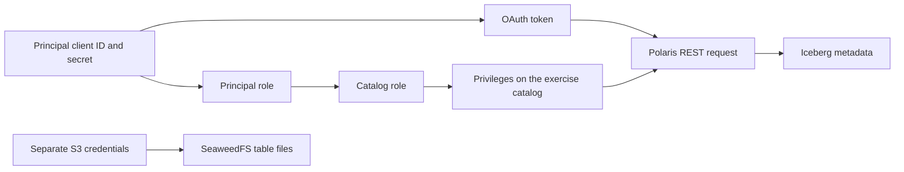

# Polaris authentication and authorization on OpenShift

**Start with [Fundamentals](FUNDAMENTALS.md) before running commands.** It explains principals, users, groups, authentication, authorization, roles and grants.

Use Bash in the Linux VM. This exercise builds four named application principals: admin, developer, ops and viewer. Polaris returns an OAuth client ID and secret for each principal; these are not browser usernames/passwords or OpenShift users.

| Identity | Intended work |
|---|---|
| Existing bootstrap administrator | Create isolated principals/roles and the exercise catalog |
| Exercise admin | Manage the exercise catalog's properties, access grants and content |
| Developer | Create namespaces/tables and write data in the exercise catalog |
| Ops | Inspect catalog/namespace/table metadata; no data privilege or S3 credentials supplied to this role |
| Viewer | Read existing tables; no content changes |

A namespace is the Iceberg REST equivalent of a database. Curl creates and changes catalog/namespace/table metadata. PySpark writes and reads the actual table records through the same identities and SeaweedFS storage.

## Run order

1. [Fundamentals](FUNDAMENTALS.md): identity, tokens, role assignments, privileges and the four access patterns.
2. [00: Access and authentication](00-access-and-authentication.md): preflight, port forwarding, bootstrap token and run state.
3. [01: Principals, roles and catalog](01-principals-roles-catalog.md): create all four principals, scoped grants, edit/view catalog.
4. [02: Namespaces, tables and denied requests](02-namespaces-tables-permissions.md): metadata operations and explicit permission checks; revoke/regrant.
5. [03: PySpark and SeaweedFS](03-notebooks-and-storage.md): create private notebook configuration and execute the developer/viewer notebooks.
6. [04: Cleanup](04-cleanup.md): remove only this run's objects after reviewing evidence.

Keep one working Bash terminal for sections 00 to 03; its variables carry across steps. Use a second terminal for port forwarding. No separate helper script is needed. Each fresh run gets a unique catalog, principal and role prefix. Do not rerun the creation blocks against the same prefix: generated credentials are returned only at creation/rotation. To repeat, start section 00 again with a new run ID.

The existing `training` catalog, bootstrap account, OpenShift Secrets/manifests, images and replica counts must remain unchanged. Only the existing CRC instance is started if needed. If an essential workload was scaled to zero, report that preflight failure rather than applying manifests or silently starting extra services.

## Storage authorization boundary

Polaris controls catalog access. SeaweedFS uses separate, shared S3 credentials. Anyone with those S3 credentials can access files directly, so do not give them to ops. This setup does not provide separate storage credentials for each principal.

See [test results](VALIDATION.md) for the expected successes and denials. API references: [Polaris management API](https://github.com/apache/polaris/blob/main/spec/polaris-management-service.yml), [Polaris access control](https://polaris.apache.org/releases/1.8.0/managing-security/access-control/), [Iceberg REST specification](https://github.com/apache/iceberg/blob/main/open-api/rest-catalog-open-api.yaml).
