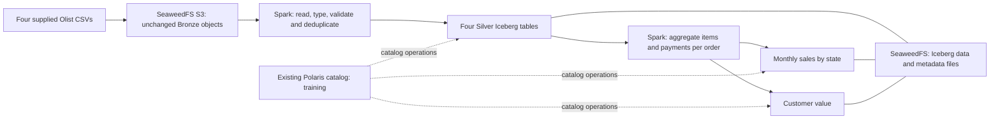

# Olist lakehouse assignment: regional sales and customer value

**Duration:** 6–8 hours. **Stack:** existing OpenShift JupyterLab, Spark standalone, Polaris, Iceberg and SeaweedFS S3. **Source datasets:** four. **Final analytical tables:** two.

Build one complete batch assignment: preserve source CSVs in Bronze, create four typed Silver Iceberg tables, and publish two Gold analytics tables. Explain and validate the results rather than only showing successful writes.

## 1. Business problem and final outcomes

The ecommerce reporting team needs answers to two questions:

1. How do delivered-order sales, freight charges and recorded payments vary by purchase month and customer state?
2. Which repeat customers contribute the most delivered-order value, and how does their recorded payment amount compare?

Build these two reusable Gold tables:

- `polaris.olist_assignment_gold.monthly_state_sales`
- `polaris.olist_assignment_gold.customer_value`

The assignment combines ingestion and analytics. Create two self-contained notebooks with the filenames specified below; completed solution notebooks are not supplied. Use clearly named functions and sections for each dataset. Analytics must read the committed Silver tables, rather than re-reading CSVs or relying on DataFrames left in another kernel.

## 2. Architecture and adaptation



| Earlier assignment component | Component used here |
|---|---|
| HDFS Bronze directories | CSV objects under the existing SeaweedFS `warehouse` bucket |
| Hive external Bronze tables | Spark CSV reads with explicit schemas and dataset-specific temporary views if useful |
| New Polaris catalog `olist` | Existing Polaris catalog `training`, exposed through the Spark alias `polaris` |
| Seven source pipelines | Four dataset-specific transformations in the ingestion notebook |
| Many Gold tables and MySQL publishing | Two Gold Iceberg tables with reconciliation and a short findings report |

Polaris registers tables and resolves metadata references. Spark performs the computation and reads/writes table files directly through SeaweedFS. Use the existing services and credentials. This assignment requires no new catalog, bucket, image, package, service, restart or scaling operation. HDFS, Hive, MySQL, Kafka and Airflow are outside its execution scope.

## 3. Supplied data

Extract [data/olist-four-datasets.zip](data/olist-four-datasets.zip). It contains exactly four original CSV files, unchanged from the supplied Olist archive. No generated data or sampling is used. The ZIP is **21,061,474 bytes (20.09 MiB)**; the uncompressed CSVs total **47,904,680 bytes (45.69 MiB)**.

| Dataset | File | Data rows, excluding header | Business key |
|---|---|---:|---|
| Customers | `olist_customers_dataset.csv` | 99,441 | `customer_id` |
| Orders | `olist_orders_dataset.csv` | 99,441 | `order_id` |
| Order items | `olist_order_items_dataset.csv` | 112,650 | `order_id`, `order_item_id` |
| Order payments | `olist_order_payments_dataset.csv` | 103,886 | `order_id`, `payment_sequential` |

See [data/manifest.csv](data/manifest.csv) for the byte count and SHA-256 of each CSV, and [data/README.md](data/README.md) for attribution. Baseline counts in this assignment apply to these bundled bytes, not another download or modified subset.

Key relationships:

```text
orders.customer_id -> customers.customer_id
order_items.order_id -> orders.order_id
order_payments.order_id -> orders.order_id
```

`customer_id` identifies a customer record associated with an order. `customer_unique_id` identifies the customer across purchases. Use the latter for customer-value grouping. Each order-item row represents one sold item; `order_item_id` is an item sequence, not a quantity to sum. Payments can have several rows per order; `payment_installments` is descriptive and must not multiply `payment_value`.

## 4. Plan the work

| Phase | Time | Required outcome |
|---|---:|---|
| Inspect source files, keys and relationships | 45 minutes | Source inventory, schemas, profiling notes |
| Configure Spark and upload unchanged Bronze | 45 minutes | Four verified Bronze objects |
| Transform, validate and write Silver | 90–120 minutes | Four typed, unique-key Iceberg tables |
| Design order-level aggregation and both analytics | 90–120 minutes | Two Gold tables at the specified grains |
| Reconciliation, rerun and storage evidence | 60–90 minutes | Assertions, stable rerun, Iceberg metadata evidence |
| Findings and submission | 30–60 minutes | Two notebooks and a concise report |

The phases total 6–8 hours, including debugging and explanation. Infrastructure installation and continuous streaming are not part of the work.

## 5. Fixed settings and existing services

Place these settings at the top of both notebooks. Use the same values throughout. For a separately approved independent run, change the assignment root and namespace names together before creating tables; do not use random IDs.

```python
BRONZE_ROOT = "s3a://warehouse/olist-assignment/bronze"
SILVER_NS = "polaris.olist_assignment_silver"
GOLD_NS = "polaris.olist_assignment_gold"
SILVER_ROOT = "s3://warehouse/iceberg/olist_assignment/silver"
GOLD_ROOT = "s3://warehouse/iceberg/olist_assignment/gold"
```

Use the host terminal only for read-only service checks:

```bash
export PATH="$HOME/.crc/bin/oc:$PATH"
oc get pods -n bigdata
oc get statefulset spark-master spark-worker seaweedfs -n bigdata
oc get deployment polaris -n bigdata
oc get svc spark-master polaris seaweedfs -n bigdata
```

Use the existing JupyterLab Python kernel. The internal endpoints are `spark://spark-master:7077`, `http://polaris:8181/api/catalog` and `http://seaweedfs:8333`. Those names resolve inside OpenShift. Stop and report unavailable prerequisites; do not start or reconfigure services as part of this assignment.

Run only one Spark notebook/application at a time. Finish with `spark.stop()` before opening the next notebook in a fresh kernel. Use one executor core, 512 MiB executor memory and two shuffle partitions. Avoid repeatedly caching source tables or collecting whole datasets to Python.

### Spark connection starter

Copy this connection cell into each notebook after its settings. It uses the existing credential environment variables without printing their values. It is setup code; implement the ingestion and analytics yourself.

```python
import os

import socket

REQUIRED_ENV = ["AWS_ACCESS_KEY_ID", "AWS_SECRET_ACCESS_KEY", "POLARIS_CLIENT_ID", "POLARIS_CLIENT_SECRET"]

def preflight():
    missing = [name for name in REQUIRED_ENV if not os.environ.get(name)]
    if missing:
        raise RuntimeError("Missing existing credential environment names: " + ", ".join(missing))
    import importlib.util
    from pathlib import Path
    if importlib.util.find_spec("pyspark") is None:
        raise RuntimeError("Choose the existing Spark-enabled Python kernel; do not pip install PySpark")
    jars = Path(os.environ.get("SPARK_HOME", "/opt/spark")) / "jars"
    patterns = ["iceberg-spark-runtime-*.jar", "iceberg-aws-bundle-*.jar",
                "hadoop-aws-*.jar", "aws-java-sdk-bundle-*.jar"]
    absent = [pattern for pattern in patterns if not list(jars.glob(pattern))]
    if absent:
        raise RuntimeError("Missing image JARs; stop without rebuilding/installing: " + ", ".join(absent))
    print("PREFLIGHT_PASS: required environment names, PySpark and image JARs present")

def start_spark(app_name):
    preflight()
    from pyspark.sql import SparkSession
    if SparkSession.getActiveSession() is not None:
        raise RuntimeError("Stop the existing Spark session and restart this kernel before setup")
    builder = (SparkSession.builder.appName(app_name).master("spark://spark-master:7077")
        .config("spark.driver.host", os.environ.get("POD_IP") or socket.gethostbyname(socket.gethostname()))
        .config("spark.driver.bindAddress", "0.0.0.0")
        .config("spark.cores.max", "1").config("spark.executor.cores", "1")
        .config("spark.executor.memory", "512m").config("spark.sql.shuffle.partitions", "2")
        .config("spark.sql.session.timeZone", "UTC")
        .config("spark.sql.extensions", "org.apache.iceberg.spark.extensions.IcebergSparkSessionExtensions")
        .config("spark.sql.catalog.polaris", "org.apache.iceberg.spark.SparkCatalog")
        .config("spark.sql.catalog.polaris.type", "rest")
        .config("spark.sql.catalog.polaris.uri", os.environ.get("POLARIS_URI", "http://polaris:8181/api/catalog"))
        .config("spark.sql.catalog.polaris.warehouse", "training")
        .config("spark.sql.catalog.polaris.rest.auth.type", "oauth2")
        .config("spark.sql.catalog.polaris.scope", "PRINCIPAL_ROLE:ALL")
        .config("spark.sql.catalog.polaris.oauth2-server-uri", os.environ.get("POLARIS_URI", "http://polaris:8181/api/catalog").rstrip("/") + "/v1/oauth/tokens")
        .config("spark.sql.catalog.polaris.header.Polaris-Realm", "POLARIS")
        .config("spark.sql.catalog.polaris.rest-metrics-reporting-enabled", "false")
        .config("spark.sql.catalog.polaris.credential", os.environ["POLARIS_CLIENT_ID"] + ":" + os.environ["POLARIS_CLIENT_SECRET"])
        .config("spark.sql.catalog.polaris.io-impl", "org.apache.iceberg.aws.s3.S3FileIO")
        .config("spark.sql.catalog.polaris.s3.endpoint", os.environ.get("S3_ENDPOINT", "http://seaweedfs:8333"))
        .config("spark.sql.catalog.polaris.s3.path-style-access", "true")
        .config("spark.sql.catalog.polaris.s3.access-key-id", os.environ["AWS_ACCESS_KEY_ID"])
        .config("spark.sql.catalog.polaris.s3.secret-access-key", os.environ["AWS_SECRET_ACCESS_KEY"])
        .config("spark.sql.catalog.polaris.client.region", "us-east-1")
        .config("spark.hadoop.fs.s3a.endpoint", os.environ.get("S3_ENDPOINT", "http://seaweedfs:8333"))
        .config("spark.hadoop.fs.s3a.path.style.access", "true")
        .config("spark.hadoop.fs.s3a.connection.ssl.enabled", "false")
        .config("spark.hadoop.fs.s3a.aws.credentials.provider", "org.apache.hadoop.fs.s3a.SimpleAWSCredentialsProvider")
        .config("spark.hadoop.fs.s3a.access.key", os.environ["AWS_ACCESS_KEY_ID"])
        .config("spark.hadoop.fs.s3a.secret.key", os.environ["AWS_SECRET_ACCESS_KEY"])
        .config("spark.redaction.regex", "(?i)secret|password|token|access.?key|credential"))
    spark = builder.getOrCreate()
    spark.sparkContext.setLogLevel("WARN")
    print("SPARK_STARTED", spark.version, spark.sparkContext.applicationId)
    return spark

spark = start_spark("olist-lakehouse-assignment")
from pyspark.sql import functions as F
```

## 6. Notebook 01: `01_olist_bronze_to_silver.ipynb`

### A. Extract and verify the supplied files

Upload the ZIP and `manifest.csv` into a `data` folder next to the notebook using JupyterLab. Run this code in the notebook to verify and extract only the expected entries:

```python
from pathlib import Path
import csv, hashlib, zipfile

DATA_DIR = Path("data")
with (DATA_DIR / "manifest.csv").open(newline="", encoding="utf-8") as handle:
    manifest = list(csv.DictReader(handle))
with zipfile.ZipFile(DATA_DIR / "olist-four-datasets.zip") as archive:
    assert set(archive.namelist()) == {row["filename"] for row in manifest}
    for row in manifest:
        filename = row["filename"]
        assert Path(filename).name == filename
        content = archive.read(filename)
        assert len(content) == int(row["bytes"])
        assert hashlib.sha256(content).hexdigest() == row["sha256"]
        (DATA_DIR / filename).write_bytes(content)
print("Four source files verified")
```

### B. Copy the unchanged CSVs to Bronze

Use dataset prefixes `customers`, `orders`, `order_items` and `order_payments`. The resulting structure must be:

```text
s3://warehouse/olist-assignment/bronze/
  customers/olist_customers_dataset.csv
  orders/olist_orders_dataset.csv
  order_items/olist_order_items_dataset.csv
  order_payments/olist_order_payments_dataset.csv
```

The configured Spark Hadoop client can copy notebook-local files to SeaweedFS without an additional Python package. Run this once after the source verification and Spark setup:

```python
datasets = ["customers", "orders", "order_items", "order_payments"]
PathJ = spark._jvm.org.apache.hadoop.fs.Path
conf = spark.sparkContext._jsc.hadoopConfiguration()
copies = []
for dataset in datasets:
    filename = f"olist_{dataset}_dataset.csv"
    source = PathJ((DATA_DIR / filename).resolve().as_uri())
    target = PathJ(f"{BRONZE_ROOT}/{dataset}/{filename}")
    fs = target.getFileSystem(conf)
    if fs.exists(target):
        raise RuntimeError("Bronze already exists: verify it and skip upload on resume")
    copies.append((source, target, fs))
for source, target, fs in copies:
    fs.copyFromLocalFile(False, False, source, target)
print("Four unchanged Bronze CSVs uploaded")
```

Verify the Bronze object hashes against the manifest, not just the object names. One available Spark pattern is `spark.read.format("binaryFile").load(object_path).selectExpr("sha2(content, 256) AS sha256")`; inspect one object at a time. On resume, verify all four existing objects and skip the upload cell. If a partial upload failed, inspect it before making changes.

Read each **dataset prefix**, not a hard-coded single filename, so another identically structured batch could later be added. This assignment uses the supplied static snapshot only; do not add extra batch files during the baseline run. Keep ZIPs, reports and manifests outside the watched CSV prefixes.

### C. Profile and transform four datasets

Read CSV with headers, explicit source column order and string types initially. Do not infer identifiers or ZIP-code prefixes as numbers. Parse quoted CSV using Spark's CSV reader. Use `header=true`, `enforceSchema=false`, `mode=FAILFAST` and `pathGlobFilter=*.csv` with your explicit string schema. The header must match the schema by position; do not silently assign a different column order. These options follow [Spark CSV reader behavior](https://spark.apache.org/docs/3.5.6/sql-data-sources-csv.html).

Implement a separate transformation function for each dataset. Required selected columns and Silver types:

| Table | Columns and types |
|---|---|
| `customers` | `customer_id STRING`, `customer_unique_id STRING`, `customer_zip_code_prefix STRING`, `customer_city STRING`, `customer_state STRING` |
| `orders` | `order_id STRING`, `customer_id STRING`, `order_status STRING`; all five source date/time columns as `TIMESTAMP`: `order_purchase_timestamp`, `order_approved_at`, `order_delivered_carrier_date`, `order_delivered_customer_date`, `order_estimated_delivery_date` |
| `order_items` | `order_id STRING`, `order_item_id INT`, `product_id STRING`, `seller_id STRING`, `shipping_limit_date TIMESTAMP`, `price DECIMAL(18,2)`, `freight_value DECIMAL(18,2)` |
| `order_payments` | `order_id STRING`, `payment_sequential INT`, `payment_type STRING`, `payment_installments INT`, `payment_value DECIMAL(18,2)` |

Required rules:

- Trim strings; normalize blank strings to null. Uppercase state codes and lowercase order statuses/payment types. Preserve city text without attempting accent removal.
- Keep ZIP-code prefixes as strings to preserve leading zeros. Do not invent missing leading digits in a value already shortened in the source.
- Parse timestamps with `yyyy-MM-dd HH:mm:ss`. Treat them as source-local wall-clock values: the source provides no timezone. The session uses UTC consistently for parsing/grouping; do not describe this as a verified timezone conversion.
- Fail on null/blank business keys, invalid required casts, null/negative prices/freight/payments, nonpositive item/payment sequence values, negative/null installment counts, malformed two-letter state codes or blank `customer_unique_id`. Require nonblank order status and payment type; validate a state against the two-uppercase-letter pattern.
- Require valid purchase timestamps. Other lifecycle dates can legitimately be absent for undelivered orders; retain those nulls. A nonblank source date that fails parsing is an error.
- Keep zero monetary amounts, zero installments and the source's `not_defined` payment type. They are not grounds for dropping otherwise valid rows from payment reconciliation.
- Remove exact duplicate rows, then fail if different rows share a business key. Do not choose arbitrary survivors with `dropDuplicates(key)`.
- Check order-to-customer and item/payment-to-order relationships with left anti joins. Report counts; fail on unexpected orphans.
- Preserve all order statuses in Silver. Apply delivered-only eligibility in the analytics stage.

Record raw count, exact duplicates removed, invalid-row count and Silver count for each dataset. For this bundle, expect the four source counts to remain unchanged and zero duplicate business keys. If a rule fails, show the issue and stop publication; do not silently relax the rule or fill invalid monetary values with zero.

### D. Publish four Silver Iceberg tables

Create only the assignment namespaces in the existing catalog:

```python
spark.sql(f"CREATE NAMESPACE IF NOT EXISTS {SILVER_NS}")
spark.sql(f"CREATE NAMESPACE IF NOT EXISTS {GOLD_NS}")
```

Write four tables named `customers`, `orders`, `order_items` and `order_payments` under `SILVER_NS`, with locations under `SILVER_ROOT/<dataset>`. Use Iceberg format version 2. Leave these small tables unpartitioned; explain that choice briefly.

Use a **full-refresh** contract for the static source snapshot. After validation, replace the contents of each existing assignment table, or create it on first use. Use DataFrameWriterV2 `.using("iceberg").tableProperty("format-version", "2").tableProperty("location", expected_path).create()` on first use, and `.overwrite(F.lit(True))` for a full-table refresh after checking the existing location and schema. See [Iceberg Spark writes](https://iceberg.apache.org/docs/1.10.0/spark-writes/). Restrict replacement to these assignment tables; do not append this full snapshot. Fail if an existing table points outside the expected assignment location. Normalize a trailing slash when comparing locations; do not assume a changed constant relocates an existing table.

Validate committed counts and schemas by reading tables back through `spark.table(...)`. A successful write call alone is insufficient. Each table has an independent commit: there is no transaction spanning the four Silver tables or the two Gold tables. If a stage fails, fix and rerun it before starting analytics. Confirm all four Silver tables pass validation together, then stop Spark.

## 7. Notebook 02: `02_olist_gold_analytics.ipynb`

Start in a fresh kernel with the same settings and connection cell. Read all four inputs from `SILVER_NS`. State the grain above every intermediate and final query.

### A. Build the order-level analytical base

1. Aggregate item rows by `order_id`: `item_count = COUNT(*)`, `item_value = SUM(price)` and `freight_value = SUM(freight_value)`.
2. Separately aggregate payment rows by `order_id`: payment-row count and `paid_amount = SUM(payment_value)`.
3. Select delivered orders and join their customer record.
4. Join the item totals at one row per order. Assert every delivered order has items before using an inner join.
5. **Left join** payment totals, retaining a delivered order even when its payment is missing.
6. Derive `order_value = item_value + freight_value`, purchase month and `missing_payment`.

Keep missing `paid_amount` as null at order level, with an explicit missing-payment flag. Define `reconciliation_gap = order_value - paid_amount` **only for orders with a payment row**; leave it null otherwise. In aggregations, sums skip those nulls. Do not treat absent payments as evidence that zero was paid.

Do not join raw items directly to raw payments. For example, two item rows and three payment rows would produce six joined rows, multiplying both amounts. Demonstrate this with a small inline explanatory example, then show the uniqueness checks on your actual order-level base.

`order_value` is merchandise plus charged freight, not profit or a verified accounting-revenue measure. `paid_amount` is the recorded payment value, not a separately verified settlement. Values are in Brazilian reais (BRL). Keep money as decimals; do not multiply payments by installments or add payment amounts to merchandise value as another sales component.

### B. Gold output 1: monthly sales by customer state

**Table:** `polaris.olist_assignment_gold.monthly_state_sales`

**Grain:** one row per purchase month and customer state, for delivered orders. Represent `purchase_month` as the first day of that month with type `DATE`.

| Column | Definition |
|---|---|
| `purchase_month` | Purchase timestamp truncated to month, cast to DATE |
| `customer_state` | State attached to the order's customer record |
| `order_count` | Number of delivered orders in the group |
| `unique_customers` | Distinct `customer_unique_id` within this month/state |
| `item_count` | Sum of order-level item counts |
| `item_value` | Sum of merchandise amounts |
| `freight_value` | Sum of charged freight |
| `order_value` | Sum of merchandise plus freight |
| `paid_order_count` | Number of orders with at least one payment row |
| `missing_payment_order_count` | Number of orders without a payment row |
| `paid_amount` | Sum of recorded payments; retain null if the entire group has no payment rows |
| `reconciliation_gap` | Sum of gaps for matched-payment orders only |
| `avg_order_value` | `order_value / order_count` |

Store monetary totals as `DECIMAL(38,2)` and monetary averages as `DECIMAL(38,2)` after computing the ratio from unrounded totals. Counts must be `BIGINT`; `customer_state` must be `STRING`. Do not sum monthly `unique_customers` to claim a global distinct customer count.

### C. Gold output 2: customer value

**Table:** `polaris.olist_assignment_gold.customer_value`

**Grain:** one row per `customer_unique_id`, across all delivered orders.

Include `customer_unique_id`, `order_count`, `item_count`, `item_value`, `freight_value`, `order_value`, `paid_order_count`, `missing_payment_order_count`, `paid_amount`, `reconciliation_gap`, `avg_order_value`, `avg_payment_per_paid_order`, `first_purchase_timestamp` and `latest_purchase_timestamp`.

`avg_payment_per_paid_order = paid_amount / paid_order_count`, and must be null when that denominator is zero. Customer grouping must not include state/city, which could split the same customer across locations. Keep the full customer summary in Gold; apply a top-20 limit only when displaying results, ordered by `order_value DESC, customer_unique_id ASC` for deterministic ties.

Use `STRING` for the customer identifier, `BIGINT` for counts, `TIMESTAMP` for first/latest purchase values, and `DECIMAL(38,2)` for monetary totals and averages. `avg_order_value` uses all delivered orders as its denominator; the payment average uses only orders with payment rows. Keep all-null payment/gap totals null rather than converting them into observed zero amounts.

Publish both outputs as Iceberg format-version-2 tables at `GOLD_ROOT/<table_name>`, using the same full-refresh and location checks as Silver. Gold must be reproducible from committed Silver alone.

## 8. Acceptance checks and expected values

The following values were calculated independently from the bundled CSVs. They are data-level acceptance targets, not a claim that this assignment has been executed on the cluster.

| Check | Expected value |
|---|---:|
| Silver customers | 99,441 |
| Silver orders | 99,441 |
| Silver order items | 112,650 |
| Silver order payments | 103,886 |
| Delivered orders in the analytical base | 96,478 |
| Delivered-order item rows | 110,197 |
| Delivered orders without item rows | 0 |
| Delivered orders without customer records | 0 |
| Delivered orders without payment rows | 1 |
| Delivered orders with payment rows | 96,477 |
| Gold monthly/state rows | 556 |
| Gold customer-value rows | 93,358 |
| Total delivered merchandise value | 13,221,498.11 |
| Total delivered freight value | 2,198,275.64 |
| Total delivered order value | 15,419,773.75 |
| Recorded payments for delivered orders | 15,422,461.77 |
| Order value of the missing-payment order | 143.46 |
| Matched-payment reconciliation gap | -2,831.48 |

Required assertions:

- No null or duplicate Gold grain keys; order-level base has exactly one row per eligible order.
- Summed `order_count`, `item_count` and monetary totals reconcile between both Gold tables and independently aggregated Silver inputs under the same delivered filter.
- `paid_order_count + missing_payment_order_count = order_count` in every Gold group.
- Both Gold outputs retain the missing-payment order in their order counts and report it through the missing flag.
- `item_value + freight_value = order_value` at order level and at Gold grain.
- The matched gap equals the order-value total **excluding the missing-payment order** minus recorded payments. Do not use the grand order-value total as the matched-only amount.
- Sum and count comparisons must use unformatted numeric values. Compare money in exact decimal cents, not binary floating point.
- Display the ten largest nonzero absolute order-level reconciliation gaps for investigation. Do not manufacture equality by adjusting the payments or dropping mismatches.
- Rerun both stages over unchanged Bronze. Table rows, keys and business aggregates must remain unchanged; Iceberg snapshot IDs may change after refresh writes.

## 9. Prove Iceberg registration and storage

Show all four Silver tables and both Gold tables through the `polaris` catalog. For at least one Silver and one Gold table, display schema, table properties, current data-file paths and snapshot history.

```python
spark.sql(f"SHOW TABLES IN {SILVER_NS}").show(truncate=False)
spark.sql(f"SHOW TABLES IN {GOLD_NS}").show(truncate=False)
spark.sql(f"DESCRIBE TABLE {GOLD_NS}.monthly_state_sales").show(truncate=False)
spark.sql(f"SHOW TBLPROPERTIES {GOLD_NS}.monthly_state_sales").show(truncate=False)
spark.sql(f"SELECT file_path FROM {GOLD_NS}.monthly_state_sales.files LIMIT 5").show(truncate=False)
spark.sql(f"SELECT committed_at, snapshot_id, operation FROM {GOLD_NS}.monthly_state_sales.snapshots").show(truncate=False)
```

Check that file paths lie under the assignment's SeaweedFS warehouse locations. Explain the difference between an S3 Bronze object, an Iceberg data file, an Iceberg snapshot and a Polaris table registration. Do not manually edit or delete Iceberg files. Keep tables and raw files available after completion; release the Spark executor with `spark.stop()`.

## 10. Findings report

Write `findings.md`, approximately 500–800 words, covering:

1. The three largest states by delivered order value and their contribution to the total.
2. The strongest and weakest purchase months by delivered order value. Note incomplete boundary periods before drawing a growth conclusion.
3. The top 20 customers by order value, and the fraction of global delivered-order value represented by them.
4. The number of repeat customers, defined as customers with at least two delivered orders, and their share of delivered-order value.
5. The missing-payment case and the largest reconciliation gaps. Separate observations from hypotheses; these four files cannot prove the cause of a payment difference.
6. How your grain design prevents fan-out and why full refresh is safe for this fixed snapshot but is not a complete incremental/CDC design.

Include a compact validation table with actual versus expected values, and evidence of the unchanged-input rerun. Avoid full customer-level exports or long notebook output dumps; include only what supports the findings.

## 11. Deliverables and assessment

Submit one folder containing:

```text
olist-lakehouse-submission/
  01_olist_bronze_to_silver.ipynb
  02_olist_gold_analytics.ipynb
  findings.md
```

Both notebooks must contain their own required code, with settings at the top and no custom helper-module imports. Include selected schemas, counts and assertions as readable evidence. Do not include credentials, tokens, environment dumps, downloaded libraries or another copy of the source ZIP in the submission. Preserve the source files in Bronze.

| Area | Marks |
|---|---:|
| Bronze integrity, profiling and explicit schemas | 15 |
| Silver typing, validation, keys and relationships | 25 |
| Correct order-level joins and business definitions | 20 |
| Two Gold tables, grain checks and financial reconciliation | 20 |
| Repeatable refresh and Iceberg/storage evidence | 10 |
| Clear notebooks and supported business findings | 10 |
| **Total** | **100** |

Completion requires four valid Silver tables, two valid Gold tables, the specified reconciliations, a successful unchanged-input rerun and released Spark resources. Merely copying Silver into Gold or displaying temporary analytics without persisting them does not complete the exercise.

## References

- [Existing OpenShift Spark streaming/data-lake course](../07-OpenShift-Spark-Streaming-DataLake/README.md)
- [Existing Spark, Polaris and SeaweedFS connection example](../10-OpenShift-Spark-Streaming-Kafka-DataLake/03-kafka-to-iceberg.md)
- [Olist dataset source and data dictionary](https://www.kaggle.com/datasets/olistbr/brazilian-ecommerce)

## GitHub upload

Upload the entire `11-OpenShift-Olist-Lakehouse-Assignment` folder, including its hidden `.gitignore` and `.gitattributes` files, `README.md` and the three supplied files in `data/`. Keep the ZIP compressed in Git; extract it only in JupyterLab while doing the assignment.

The 20.09 MiB ZIP is below GitHub's [25 MiB browser-upload limit](https://docs.github.com/en/repositories/working-with-files/managing-files/adding-a-file-to-a-repository) and its [50 MiB Git warning / 100 MiB Git file limit](https://docs.github.com/en/repositories/working-with-files/managing-large-files/about-large-files-on-github). Git LFS and archive splitting are not needed for this bundle. Repository-specific upload rules can still apply.

The local `.gitignore` explicitly includes the ZIP and manifest, even if a parent rule ignores `*.zip` or `*.csv`. It ignores notebook-local CSV extraction and working notebook/report files. Submit completed notebooks in the separate submission folder specified above. The `.gitattributes` file treats the ZIP as binary to preserve its bytes.
